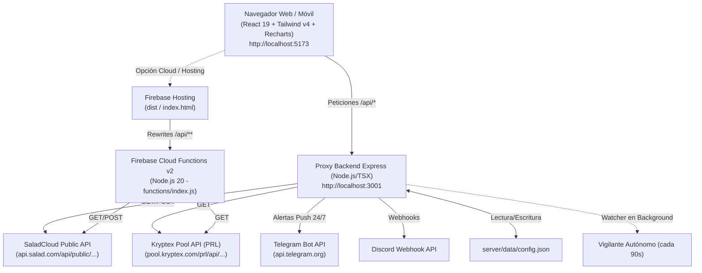

# CONTEXT.md — Documento de Contexto Integral de MinerX ⚡

> **Versión del Proyecto:** 1.2.0  
> **Ruta Local:** `C:\Users\Roman\Documents\MinerX`  
> **Última actualización:** Octubre 2026  
> **Estado de Compilación:** Exitoso (`npm run build` sin errores, TypeScript strict pass)

---

## 1. Visión General y Propósito del Proyecto

**MinerX** es una plataforma centralizada de telemetría, gestión financiera y orquestación de hardware en la nube diseñada específicamente para operadores de minería de **Pearl (PRL - PearlHash PoUW)** en el pool de **Kryptex**, ejecutando cargas de cómputo en contenedores Docker sobre GPUs alquiladas en **SaladCloud**.

### Problemática que Resuelve
1. **Lotería de Silicio ("Silicon Lottery"):** En plataformas descentralizadas de GPUs como SaladCloud, alquilar una misma clase de GPU (ej. RTX 4090) puede asignar una máquina óptima que entrega 300 TH/s o un nodo con throttling térmico/driver deficiente que entrega menos de 200 TH/s, quemando capital cada hora. MinerX detecta anomalías y permite reasignar el nodo en 1 clic.
2. **Dispersión Multicuenta:** Los mineros a escala gestionan múltiples organizaciones o cuentas de SaladCloud con múltiples proyectos. MinerX unifica todas las cuentas en una sola pantalla.
3. **Pérdida por Inactividad Silenciosa:** Si un contenedor se apaga o pierde conexión con el pool de Kryptex, el costo por hora de alquiler sigue corriendo. MinerX vigila los *shares* de Kryptex y envía alertas críticas inmediatas vía Telegram y Discord.
4. **Cálculo Financiero en Tiempo Real:** Fusión directa de los costos reales de alquiler (en USD/hora según la prioridad de SaladCloud) con los ingresos brutos estimados según la recompensa PPS de Kryptex Pearl.

---

## 2. Arquitectura del Sistema

MinerX sigue un patrón desacoplado **Cliente-Servidor (SPA + Proxy Backend)** complementado con soporte de **Firebase Cloud Functions** para despliegue sin servidor.



### Componentes de la Arquitectura

1. **Frontend (SPA):**
   - Construido con **React 19**, **TypeScript** y **Vite 8**.
   - Motor de estilos con **Tailwind CSS v4** (`@tailwindcss/vite`).
   - Componentes tácticos, interfaz en modo oscuro industrial (*Cyber-Industrial Telemetry*), responsive con barra de navegación inferior (`MobileNav`) optimizada para smartphones.
   - Biblioteca de gráficos interactivos: **Recharts** (gráficos de área con gradientes para hashrate y flujo de caja).
   - Iconografía: **Lucide React**.

2. **Backend Proxy Local (`server/server.ts`):**
   - Desarrollado con **Express 5** y ejecutado mediante **tsx**.
   - Resuelve problemas de CORS con las APIs externas (SaladCloud y Kryptex Pool).
   - Servicio en segundo plano (`runAutonomousBackgroundWatcher`): Loop periódico que consulta el estado de workers en Kryptex y despacha notificaciones automáticas a Telegram.
   - Almacenamiento de configuración en `server/data/config.json`.

3. **Backend Cloud Serverless (`functions/index.js` + `firebase.json`):**
   - Adaptación para **Firebase Cloud Functions v2 (Node.js 20)**.
   - Permite desplegar el proxy en Firebase Hosting con rewrite automático de rutas `/api/**` hacia la Cloud Function, facilitando el acceso remoto sin mantener una máquina local encendida.

---

## 3. Estructura de Directorios y Archivos

```
C:\Users\Roman\Documents\MinerX/
├── android/                            # Proyecto nativo Android generado con Capacitor (para APK)
├── dist/                               # Build de producción compilado (Vite)
├── electron/                           # Runtime de escritorio para Windows
│   └── main.cjs                        # Proceso principal de Electron para MinerX.exe
├── functions/                          # Configuración y código de Firebase Cloud Functions
│   ├── index.js                        # Función serverless Express para Firebase v2
│   └── package.json                    # Dependencias de backend para Google Cloud / Firebase
├── public/                             # Recursos estáticos servidos sin procesar
├── release/                            # Salida de binarios ejecutables de escritorio
│   └── win-unpacked/                   # Paquete de distribución de Windows con MinerX.exe
├── server/                             # Servidor Proxy local para desarrollo y VPS
│   ├── data/
│   │   └── config.json                 # Almacenamiento persistente de cuentas y tokens
│   └── server.ts                       # Servidor Express, proxies de API y vigilante Telegram
├── src/                                # Código fuente de la aplicación React
│   ├── assets/                         # Imágenes e iconos SVG
│   ├── components/                     # Componentes modulares de interfaz
│   │   ├── AlertsTab.tsx               # Historial de alertas con filtros por severidad
│   │   ├── ApiManagerTab.tsx           # Configuración multicuenta Salad, Kryptex y Telegram
│   │   ├── EconomicsTab.tsx            # Simulador de flota y base de datos de rentabilidad
│   │   ├── FleetTab.tsx                # Tarjetas y tabla de GPUs activas con filtros
│   │   ├── Header.tsx                  # Barra superior de estado, KPIs y botón de sync
│   │   ├── MobileNav.tsx               # Barra de navegación inferior móvil
│   │   ├── OverviewTab.tsx             # Panel Bento Grid (KPIs, Recharts dinámico, Silicon Lottery)
│   │   └── ReallocateModal.tsx         # Modal de confirmación para reasignación 1-click
│   ├── data/                           # Bases de datos y modelos precalculados
│   │   ├── gpuBenchmarks.ts            # Matriz de 50+ configuraciones GPU, TH/s y prioridades
│   │   └── mockFleetData.ts            # Datos iniciales vacíos y cálculo de fleetSummary
│   ├── types/                          # Definición exhaustiva de interfaces TypeScript
│   │   └── minerx.ts                   # Tipos de Salad, Kryptex, Workers y resumen de flota
│   ├── App.css                         # Reglas de presentación globales
│   ├── App.tsx                         # Orquestador del estado, sync de APIs y polling
│   ├── index.css                       # Directivas Tailwind v4, font-jetbrains y font-rajdhani
│   └── main.tsx                        # Punto de entrada ReactDOM
├── .gitignore                          # Ignorados por Git (node_modules, dist, config.json, release)
├── .oxlintrc.json                      # Configuración de linter Oxlint
├── capacitor.config.ts                 # Configuración de Capacitor para Android APK
├── electron-builder.json               # Configuración de empaquetado para Windows (.exe)
├── firebase.json                       # Configuración de Firebase Hosting y Functions
├── index.html                          # Plantilla HTML5 con fuentes (JetBrains Mono, Rajdhani)
├── package.json                        # Dependencias, scripts de dev, EXE y APK
├── README.md                           # Documentación de usuario y guía de inicio rápido
├── tsconfig.app.json                   # Configuración TypeScript para el cliente React
├── tsconfig.json                       # Referencia raíz de TypeScript
├── tsconfig.node.json                  # Configuración TypeScript para Vite y Server
└── vite.config.ts                      # Configuración de Vite con plugins y proxy inverso
```

---

## 4. Modelos de Datos Clave (`src/types/minerx.ts`)

### `SaladAccountConfig`
Representa una credencial de cuenta/organización en SaladCloud:
* `id`: Identificador único local.
* `accountName`: Nombre descriptivo (ej. "Flota Principal").
* `organizationName`: Slug de la organización en SaladCloud.
* `projectName`: Nombre del proyecto (por defecto: `default`).
* `apiKey`: Clave secreta `Salad-Api-Key`.
* `enabled`: Booleano para activar/desactivar la inclusión de la cuenta en el monitoreo.
* `status`: `'connected' | 'error' | 'untested'`.

### `MergedGPUWorker`
Entidad unificada que fusiona la telemetría del contenedor físico en SaladCloud con las estadísticas del worker en Kryptex:
* `id` / `workerName`: Nombre del worker (debe coincidir con el asignado al minero en Salad).
* `machineId`: Identificador del host físico asignado por SaladCloud.
* `gpuModel` / `vramGB`: Modelo detectado (ej. RTX 4090, 24 GB).
* `saladPriority`: `'Lowest Priority' | 'Low Priority' | 'Medium Priority' | 'High Priority'`.
* `saladStatus`: `'allocating' | 'running' | 'stopping' | 'stopped'`.
* `isMining`: Indica si Kryptex ha recibido shares recientes.
* `minutesSinceLastShare`: Tiempo transcurrido desde el último share válido.
* `currentHashrateTHs`: Hashrate actual reportado en TH/s.
* `expectedBenchmarkTHs`: Hashrate esperado según benchmark de silicio.
* `performanceRatioPct`: `(currentHashrateTHs / expectedBenchmarkTHs) * 100`.
* `hourlySaladCost` / `dailySaladCost`: Costo de alquiler en USD.
* `hourlyGrossRevenue` / `dailyGrossRevenue`: Ingreso estimado por recompensas PPS.
* `hourlyNetProfit` / `dailyNetProfit`: Beneficio neto (`Gross - Cost`).
* `recommendation`: `'OPTIMAL' | 'REALLOCATE_RECOMMENDED' | 'RESTART_CONTAINER' | 'TERMINATE_LOSS'`.

### `FleetSummary`
Resumen consolidado de la flotilla completa:
* `totalAllocatedGPUs`: Total de nodos en SaladCloud.
* `activeMiningGPUs`: Nodos reportando shares en Kryptex.
* `underperformingGPUs`: Nodos rindiendo por debajo del umbral (por defecto < 80%).
* `totalHashrateTHs` / `benchmarkHashrateTHs`: Hashrate global vs teórico.
* `fleetEfficiencyPct`: Porcentaje de rendimiento global de la flotilla.
* `hourlyNetProfitUSD` / `dailyNetProfitUSD` / `monthlyNetProfitUSD`: Finanzas consolidadas.

---

## 5. Endpoints de la API Backend (`server/server.ts`)

| Método | Endpoint | Descripción |
|---|---|---|
| `GET` | `/api/health` | Estado del motor proxy, versión y hora del servidor. |
| `GET` | `/api/config` | Obtiene la configuración almacenada de cuentas, wallet y alertas. |
| `POST` | `/api/config` | Guarda la configuración de forma persistente en `server/data/config.json`. |
| `POST` | `/api/salad/test-account` | Prueba de autenticación con la API de SaladCloud (valida API Key y Organización). |
| `POST` | `/api/salad/all-active` | Consulta y consolida todas las instancias y grupos activos de todas las cuentas habilitadas. |
| `POST` | `/api/salad/reallocate` | **Disparador 1-Click**: Ordena a SaladCloud descartar el nodo actual y provisionar una nueva GPU física. |
| `GET` | `/api/kryptex/pool` | Estadísticas globales del pool Pearl (`/prl/api/v1/pool/info`): hashrate de red, recompensa por bloque, dificultad. |
| `GET` | `/api/kryptex/workers/:address` | Lista de workers y shares en vivo asociados a la dirección de billetera de Kryptex. |
| `GET` | `/api/kryptex/balance/:address` | Balance confirmado, no confirmado y progreso hacia el umbral de pago. |
| `GET` | `/api/kryptex/payouts/:address` | Historial de pagos y estadísticas de recompensas acumuladas. |
| `GET` | `/api/kryptex/chart/:address` | Serie temporal de hashrate histórico reportado por el pool. |
| `POST` | `/api/telegram/test` | Envía un mensaje ping de verificación inmediata al chat y bot de Telegram configurados. |
| `POST` | `/api/alerts/webhook` | Despachador de alertas para Webhooks de Discord (con formato Rich Embed) y Telegram. |

---

## 6. Funcionalidades Principales

### 1. Detección de la "Lotería de Silicio" & Reasignación Inmediata
- El sistema compara continuamente el hashrate en tiempo real de cada worker contra su valor en `GPU_BENCHMARKS`.
- Si el rendimiento cae por debajo de `underperformingThresholdPct` (configurable entre 70% y 95%, típicamente 80%), el worker se marca como `UNDERPERFORMING`.
- Al hacer clic en **"Reasignar GPU"**, se dispara una petición `POST` al endpoint oficial de SaladCloud:
  `https://api.salad.com/api/public/organizations/{org}/projects/{proj}/containers/{containerGroup}/instances/{instanceId}/reallocate`
  SaladCloud termina el nodo físico deficiente de inmediato y transfiere el contenedor a una nueva máquina sin necesidad de recrear el grupo.

### 2. Vigilante Autónomo en Segundo Plano (Telegram Bot 24/7)
- En `server/server.ts`, un temporizador en segundo plano se ejecuta cada **90 segundos**:
  - Consulta `https://pool.kryptex.com/{coin}/api/v3/miner/workers/{walletAddress}`.
  - Compara `minutesSinceShare` contra `maxShareInactivityMinutes` (por defecto 8 min).
  - Si un worker pasa a offline o se detiene, envía un mensaje de alerta a Telegram con botón de acción.
  - Cuando el worker vuelve a reportar hashrate, envía una notificación de recuperación confirmando los TH/s alcanzados.

### 3. Matriz Económica y Simulador de Retorno
- Implementado en `src/components/EconomicsTab.tsx` basándose en las matrices de cálculo de rentabilidad.
- Incorpora benchmarks de más de 50 modelos: RTX 5090, 5080, 5070 Ti, RTX 4090, 4080, 4070, RTX serie 30, laptops y workstation.
- Permite proyectar flotas de 1 a 50 GPUs.
- Calcula el punto de equilibrio exacto (**Break-Even TH/s**) mediante la función:
  $$\text{BreakEven TH/s} = \frac{\text{Costo Alquiler Hora (USD)}}{\text{Recompensa PPS (USD / TH/s / h)}}$$

### 4. Modo 100% Datos en Vivo
- El frontend no recurre a datos ficticios si el usuario ya configuró credenciales.
- Cuando no hay cuentas ni wallet configuradas, el panel se mantiene limpio en ceros invitando a la configuración en la pestaña **"Conexión APIs & Bot"**.

---

## 7. Instrucciones de Ejecución y Flujo de Trabajo

### Requisitos Previos
* Node.js v20 o superior instalado.
* Conexión a Internet para consultar las APIs públicas de Kryptex y SaladCloud.

### Comandos de Desarrollo
```bash
# Navegar a la carpeta del proyecto
cd C:\Users\Roman\Documents\MinerX

# Iniciar Frontend (Vite) y Backend Proxy (Express) en paralelo:
npm run dev

# Iniciar únicamente el cliente frontend:
npm run dev:client

# Iniciar únicamente el servidor proxy local:
npm run dev:server
```

### URLs de Acceso Local
* **Aplicación Web (Desktop):** `http://localhost:5173`
* **Acceso desde el Móvil (LAN):** `http://<IP-LOCAL>:5173` (e.g. `http://192.168.11.4:5173`)
* **API Proxy Backend:** `http://localhost:3001`

### Compilación y Producción
```bash
# Compilar TypeScript y empaquetar con Vite
npm run build

# Ejecutar el servidor en modo producción
npm run start
```

---

## 8. Despliegue en la Nube (Monitoreo Continuo 24/7)

Para que el vigilante de Telegram opere las 24 horas del día sin necesidad de mantener encendida la computadora personal:

### Opción A: Firebase Hosting + Cloud Functions
1. El proyecto ya cuenta con `firebase.json` y el directorio `functions/`.
2. Para desplegar:
   ```bash
   firebase login
   firebase deploy
   ```

### Opción B: Despliegue en Render / Railway / Pequeño VPS
1. Conectar el repositorio de GitHub a **Render.com** o **Railway.app**.
2. Configurar el comando de construcción: `npm install && npm run build`.
3. Configurar el comando de inicio: `npm start` (o `node server/server.ts`).
4. La aplicación quedará disponible en una URL HTTPS pública y el proceso de Node.js ejecutará el vigilante cada 90 segundos ininterrumpidamente.

---

## 9. Convenciones de Código y Estado Técnico

1. **Gestión de Configuración:**  
   Para evitar que cambios de configuración disparen recargas inesperadas de Vite por modificación de ficheros en disco, el frontend utiliza `localStorage` como capa de persistencia primaria y realiza sincronizaciones con el backend mediante `POST /api/config` sólo tras acciones explícitas del usuario.
2. **TypeScript:**  
   El proyecto compila bajo modo estricto sin errores (`tsc -b`). Cualquier modificación en interfaces debe actualizarse de forma simétrica en `src/types/minerx.ts` y en `server/server.ts`.
3. **Control de Estilos:**  
   Se utiliza Tailwind CSS v4 con la nueva arquitectura CSS-first (`@import "tailwindcss";` en `src/index.css`) y el plugin oficial `@tailwindcss/vite`.

---

## 10. Arquitectura de Integración Vast.ai y Motor de Rentabilidad Realista

En cumplimiento con la especificación técnica `MinerX_CALCULADORA_RENTABILIDAD_Y_AUTOMATIZACION_VASTAI.md`, MinerX incorpora un subsistema integral desacoplado para análisis económico, marketplace GPU y automatización supervisada con Vast.ai.

### 10.1 Modelo de Confianza y Procedencia de Datos (Data Provenance)
Para evitar proyecciones irreales y proteger el capital de minería, cada dato y métrica se clasifica explícitamente según su origen (`DataTrustSource`):
* `EXTERNAL_BENCHMARK`: Registros públicos certificados (Kryptex, Hashrate.no).
* `OFFER_ESTIMATE`: Especificaciones y tarifas anunciadas por hosts en Vast.ai.
* `INSTANCE_MEASURED`: Hashrate reportado localmente por el minero (`miner-log`).
* `POOL_OBSERVED`: Hashrate y shares confirmados por el pool Stratum de Kryptex.
* `FINANCIAL_REALIZED`: Liquidaciones bancarias y cobros reales en exchange.
* `USER_ASSUMPTION`: Supuestos parametrizados por el operador.
* `SIMULATED`: Proyecciones probabilísticas y análisis de sensibilidad.

### 10.2 Componentes y Servicios Nuevos
1. **Motor de Dominio Financiero (`src/services/profitabilityService.ts`):**
   - Normalización de unidades (`TH/s`, `GH/s`, `MH/s`, `H/s`).
   - Conversión de costos de almacenamiento mensual (`$/GB/mes`) a costo horario (`$/h`).
   - Cálculo de margen neto, punto de equilibrio (*Break-Even*), impacto de warmup (calentamiento) y escenarios de estrés (*Conservative*, *Base*, *Optimistic*).
2. **Calculadora Interactiva (`src/components/ProfitabilityCalculator.tsx`):**
   - Gráficos interactivos de sensibilidad ($/h vs TH/s) con curvas de ganancia neta.
   - Integrada en `EconomicsTab` con selector de sub-vistas sin alterar ciclos históricos.
3. **Cliente Oficial Vast.ai y Marketplace (`server/services/vastClient.ts`, `vastOffersService.ts`):**
   - Cliente seguro que se conecta a `https://console.vast.ai/api/v0`.
   - Búsqueda autenticada, filtrado por modelo de GPU, precio máximo y tipo de datacenter.
   - Algoritmo de scoring e idoneidad (0-100) para PearlHash.
   - Enmascaramiento estricto de secretos (`vast_...xxxx`) en backend sin exponer credenciales al cliente.
4. **Gestor de Instancias y Telemetría (`server/services/vastInstanceService.ts`):**
   - Asignación de nombres de worker únicos e idempotentes (`vast-${gpu}-${seed}`).
   - Verificación de estado post-acción (Stop Miner, Stop Instance, Destroy Instance).
5. **Motor de Estrategias y Políticas de Fallo (`server/services/strategyEngine.ts`):**
   - Modo predeterminado inquebrantable: `SIMULATION` (sin consumo de saldo sin autorización explícita).
   - Periodo de gracia para calentamiento (*Warmup Period*).
   - Detección de bajo rendimiento con ventanas de medición consecutivas.
   - Políticas de acción configurables: `ALERT_ONLY`, `STOP_MINER`, `STOP_INSTANCE`, `DESTROY_INSTANCE`, `DISABLE_STRATEGY`, `STOP_AND_DISABLE`.
   - Registro persistente de auditoría de decisiones en `server/data/vast_audit_runs.json`.
6. **Panel de Flota Vast.ai (`src/components/VastFleetSection.tsx`):**
   - Visualización en vivo dentro de `FleetTab` con selector por proveedor (`SaladCloud` | `Vast.ai`).
   - Detención de minero, pausa de hardware y destrucción con confirmación de seguridad.
