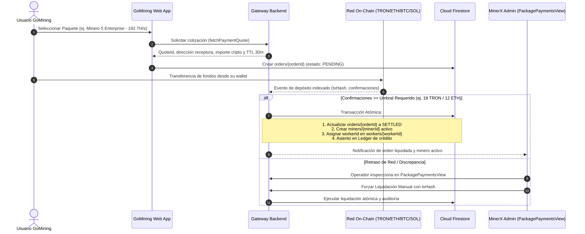
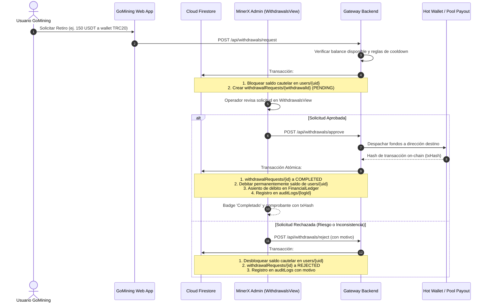

# Arquitectura del Sistema: MinerX Dashboard vs. GoMining Replicate
## Documentación Técnica de Conexiones, Backend y Base de Datos (Módulo Maestro)

**Versión:** 2.5.0  
**Fecha:** Noviembre 2026  
**Ámbito:** `MinerX` (`C:\Users\Roman\OneDrive\Documentos\Gomining-x\MinerX`) y `GoMining Replicate` (`C:\Users\Roman\OneDrive\Documentos\Gomining-x\gomining-x`)  
**Estado:** Producción / Híbrido Auditado con Gestión de Retiros y Pagos de Paquetes  

---

## 1. Resumen Ejecutivo y Arquitectura Global

El ecosistema digital integra dos plataformas interoperables:

1. **MinerX (`MinerX`)**: Plataforma de monitoreo de telemetría de hardware distribuido en tiempo real (SaladCloud GPUs + Kryptex PearlHash Mining Pool), centro de cálculo financiero (**MinerX Profit Engine**) y suite de administración de infraestructura física, contratos, pagos de clientes y solicitudes de retiro.
2. **GoMining Replicate (`gomining-x`)**: Réplica y motor comercial de minería digital tokenizada, catálogo de mineros virtuales (`catalog.ts`, `purchase.ts`), cotizaciones multired (`paymentQuote.ts`, `paymentDestinations.ts`), liquidaciones periódicas de recompensas, motor de comisiones de afiliados Unilevel (4 niveles activos de hasta 10 niveles) y sincronización de estado persistente mediante **Google Cloud Firestore**.

Ambos proyectos comparten la **fuente única de verdad matemática** implementada en `MinerxProfitEngine.ts` y las estructuras de datos de `firestore-schema.md`.

```mermaid
graph TD
    subgraph ClientLayer ["Capa de Cliente (Navegador Web)"]
        UI_Dash["MinerX Dashboard & Admin Center<br/>(React 19 + Tailwind v4 + Recharts)"]
        UI_Gomining["GoMining Client App<br/>(Cart, Checkout, Miners, Wallets)"]
        Store_Local["LocalStorage Cache & Session Store<br/>(minerx_profit_engine_config_v2)"]
        SDK_Firebase["Firebase Client SDK<br/>(Auth Anónimo + demoState)"]
    end

    subgraph ServiceLayer ["Capa de Servicios de Negocio (TypeScript)"]
        PE["MinerX Profit Engine<br/>(Rbase, Var%, Com%, PRL Spot)"]
        MES["MiningEngineService<br/>(Cálculo y Proyección 5 Etapas)"]
        CPS["CommercialPackageService<br/>(Catálogo de Paquetes)"]
        HAS["HashrateAllocationService<br/>(Respaldo Físico vs Virtual)"]
        VWS["VirtualWorkerService & Ranking<br/>(Workers Sintéticos & Pool Leaderboard)"]
        FLS["FinancialLedgerService<br/>(Libro Contable Auditado)"]
        REF["Unilevel Economics Engine<br/>(4-Tier Commissions & Upline Reserves)"]
        PPS["PackagePaymentsService<br/>(Conciliación de Pagos de Paquetes)"]
        CWS["ClientWithdrawalsService<br/>(Gestión de Retiros de Clientes)"]
    end

    subgraph BackendProxy ["Capa de Backend / Proxies Autorizados"]
        SaladProxy["/api/salad/*<br/>(Workloads, Balance, Reallocate)"]
        KryptexProxy["/api/kryptex/*<br/>(Stats, Workers, Balance, Payouts)"]
        PaymentsProxy["/api/orders/* & /api/withdrawals/*<br/>(Conciliación On-chain e Idempotencia)"]
        NodeServer["Node/Express Backend Gateway<br/>(Idempotencia, Auth, CORS)"]
        FirebaseAdmin["Firebase Admin SDK<br/>(Privilegios de Servidor)"]
    end

    subgraph ExternalTelemetry ["Infraestructura y Redes Externas"]
        SaladAPI["SaladCloud API<br/>(Instancias GPU Descentralizadas)"]
        KryptexPool["Kryptex PearlHash Pool<br/>(Stratum Telemetry, Shares, Hashrate)"]
        Blockchains["Nodos Blockchain & Exploradores<br/>(TRON TRC20, Ethereum, Solana, Bitcoin, STP Bridge)"]
    end

    subgraph DatabaseLayer ["Cloud Firestore (Persistencia y Ledger)"]
        DB_Users["users/{uid}<br/>users/{uid}/wallets"]
        DB_Orders["orders/{orderId}<br/>paymentAttempts/{attemptId}"]
        DB_Withdrawals["withdrawalRequests/{withdrawalId}"]
        DB_Miners["miners/{minerId}<br/>(Contratos Activos)"]
        DB_Workers["workers/{workerId}<br/>workerShareWindows/{windowId}"]
        DB_Rewards["miningRewardEvents/{eventId}<br/>poolPayoutAllocations"]
        DB_Referrals["referralEdges/{uid}<br/>referralCommissionLedger/{id}"]
        DB_Pool["poolSnapshots/{snapshotId}<br/>poolPayouts/{payoutId}"]
        DB_Config["operatorConfig/{version}<br/>auditLogs/{logId}"]
    end

    UI_Dash --> Store_Local
    UI_Dash --> SDK_Firebase
    UI_Dash --> ServiceLayer
    UI_Gomining --> ServiceLayer

    ServiceLayer --> PE
    PE --> MES
    ServiceLayer --> PPS
    ServiceLayer --> CWS
    ServiceLayer --> BackendProxy

    BackendProxy --> SaladProxy --> SaladAPI
    BackendProxy --> KryptexProxy --> KryptexPool
    BackendProxy --> PaymentsProxy --> Blockchains
    BackendProxy --> NodeServer --> FirebaseAdmin

    SDK_Firebase -.->|"Solo lectura/escritura demo propia"| DB_Users
    FirebaseAdmin ==>|"Escritura de órdenes, mineros, retiros, liquidación y ledger"| DatabaseLayer
```

---

## 2. Matriz Detallada de Conexiones Sección por Sección del Dashboard

A continuación se detalla cada sección del dashboard de MinerX, su componente de frontend, las fuentes de datos, los servicios invocados, las colecciones de Firestore involucradas y las reglas de actualización.

### 2.1. Resumen Ejecutivo / Dashboard Overview (`OverviewTab.tsx` / `AdminOverview.tsx`)
* **Rutas / Tab IDs:** `overview`, `admin_overview`
* **Componentes React:**  
  - [`src/components/OverviewTab.tsx`](file:///C:/Users/Roman/OneDrive/Documentos/Gomining-x/MinerX/src/components/OverviewTab.tsx)  
  - [`src/components/admin/AdminOverview.tsx`](file:///C:/Users/Roman/OneDrive/Documentos/Gomining-x/MinerX/src/components/admin/AdminOverview.tsx)
* **Objetivo:** Métricas ejecutivas en tiempo real: Potencia total de la flota, GPUs activas, Eficiencia de silicio, Ingreso bruto, Coste de alquiler en SaladCloud, Ganancia neta (Profit), Punto de equilibrio (*Breakeven TH/s*), Quema de capital, y contadores de Pagos de Paquetes y Solicitudes de Retiro pendientes.
* **Fuente de Datos de Entrada:**
  - `fleetSummary`: Calculado dinámicamente mediante `computeFleetSummary(workers, kryptexStats)`.
  - `history`: Serie temporal de hashrate en `HashrateHistoryPoint[]`.
  - `balance`: Telemetría cruda de balances de Kryptex (`KryptexBalanceRaw`).
* **Comunicación con Backend / APIs:**
  - `GET /api/salad/workloads`: Consulta el listado de nodos GPU activos, modelos de tarjeta (`RTX 4090`, `RTX 3080`, etc.) y estado de ejecución (`running`, `allocating`, `stopped`).
  - `GET /api/kryptex/stats`: Obtiene el hashrate efectivo reportado por la pool de PearlHash, trabajadores reportando y precio spot de PEARL en USDT.
* **Colección Firestore / Estado en GoMining:**
  - `poolSnapshots/{snapshotId}`: Guarda la foto histórica de rendimiento (`hashrate`, `workers`, `revenueEstimate`, `retrievedAt`).
  - `operatorConfig/{version}`: Lee los parámetros de referencia de costo eléctrico y punto de equilibrio.
* **Frecuencia de Actualización:** Sondeo automático cada **15 segundos**.

---

### 2.2. Motor Híbrido & MinerX Profit Engine (`MiningEngineControlView.tsx`)
* **Rutas / Tab IDs:** `admin_engine`
* **Componentes React:**  
  - [`src/components/admin/MiningEngineControlView.tsx`](file:///C:/Users/Roman/OneDrive/Documentos/Gomining-x/MinerX/src/components/admin/MiningEngineControlView.tsx)  
  - Servicio: [`src/services/admin/minerxProfitEngine.ts`](file:///C:/Users/Roman/OneDrive/Documentos/Gomining-x/MinerX/src/services/admin/minerxProfitEngine.ts)
* **Objetivo:** Control total y auditoría del motor matemático de minería digital. Permite al operador ajustar la Tasa Base ($R_{base}$), la Variable Porcentual ($\text{Var}\%$), la Comisión Operativa ($\text{Com}\%$) y el precio spot de PEARL/USDT, simulando en tiempo real el pipeline de 5 fases.
* **Fuente de Datos de Entrada:**
  - `ProfitEngineGlobalConfig`: Configuración activa cargada desde `localStorage` (`minerx_profit_engine_config_v2`) con sincronización hacia `operatorConfig`.
  - Telemetría en vivo de Kryptex PearlHash ($R_{base} = 0.0008432\text{ PRL/TH/h}$).
* **Comunicación con Backend / APIs:**
  - Sincronización transparente con `GET /api/kryptex/stats` para extraer el precio de mercado spot y las recompensas observadas en el último bloque.
  - Endpoint de mutación administrativa: `POST /api/operator/config/update`.
* **Colección Firestore / Estado en GoMining:**
  - `operatorConfig/{version}`: Parámetros canónicos aprobados (`baseRate`, `variablePct`, `commissionPct`, `approvedBy`, `updatedAt`).
  - `auditLogs/{logId}`: Registro inmutable de cada cambio de variable.

---

### 2.3. Flota de Silicio & Telemetría Física (`FleetTab.tsx`)
* **Rutas / Tab IDs:** `fleet`
* **Componentes React:**  
  - [`src/components/FleetTab.tsx`](file:///C:/Users/Roman/OneDrive/Documentos/Gomining-x/MinerX/src/components/FleetTab.tsx)
* **Objetivo:** Supervisión física detallada nodo por nodo de la red descentralizada SaladCloud vinculada a los mineros Stratum de Kryptex. Clasificación por Silicon Lottery (rendimiento óptimo vs degradado), alertas de *Thermal Throttling* y reasignación de contenedores.
* **Comunicación con Backend / APIs:**
  - `GET /api/salad/workloads`: Lista instancias físicas.
  - `GET /api/kryptex/workers`: Telemetría de shares aceptados, rechazados y stale.
  - `POST /api/salad/reallocate`: Envía comando de recreación/reinicio de nodo en caso de fallo térmico o bajo hashrate.
* **Colección Firestore / Estado en GoMining:**
  - `workers/{workerId}`: Atributos físicos (`activationMode: 'automatic'`, `pool: 'Kryptex'`, `contractedTh`, `status`).
  - `workerShareWindows/{windowId}`: Registro de shares válidos e inválidos por ventana horaria.

---

### 2.4. Economía, Payouts y Quema de Balance (`EconomicsTab.tsx`)
* **Rutas / Tab IDs:** `economics`
* **Componentes React:**  
  - [`src/components/EconomicsTab.tsx`](file:///C:/Users/Roman/OneDrive/Documentos/Gomining-x/MinerX/src/components/EconomicsTab.tsx)
* **Objetivo:** Análisis financiero de ciclo completo: saldo acumulado en Kryptex (confirmado vs no confirmado), umbral mínimo de retiro, proyección de tiempo hasta el siguiente payout, costo acumulado de alquiler de SaladCloud y cálculo de *Runway*.
* **Comunicación con Backend / APIs:**
  - `GET /api/kryptex/balance`: Balances agregados y desglosados por subcuenta.
  - `GET /api/kryptex/payouts`: Histórico de pagos on-chain de la pool.
  - `GET /api/salad/balance`: Saldo de créditos prepagados en SaladCloud.
* **Colección Firestore / Estado en GoMining:**
  - `poolPayouts/{payoutId}`: Documento de pago verificado (`txHash`, `asset: 'PRL'`, `amount`, `receivedAt`, `confirmations`).
  - `poolPayoutAllocations/{allocationId}`: Conciliación entre el pago recibido de la pool y la cuota de mineros de clientes.

---

### 2.5. Paquetes Comerciales de Minería (`PackageBuilderView.tsx`)
* **Rutas / Tab IDs:** `admin_packages`
* **Componentes React:**  
  - [`src/components/admin/PackageBuilderView.tsx`](file:///C:/Users/Roman/OneDrive/Documentos/Gomining-x/MinerX/src/components/admin/PackageBuilderView.tsx)  
  - Servicio: `CommercialPackageService`
* **Objetivo:** Gestión del catálogo de productos de minería digital disponibles para los clientes (Minero 1 a Minero 5 Enterprise). Permite definir potencia (TH/s), precio en USDT/PRL, límites de stock, eficiencia de consumo y multiplicadores de comisión.
* **Colección Firestore / Estado en GoMining:**
  - `catalog.ts`: Definición base de productos en el cliente GoMining.
  - `orders/{orderId}`: Registro de compra.
  - `miners/{minerId}`: Minero digital instanciado tras confirmar pago.

---

### 2.6. Pagos de Paquetes Comprados (`PackagePaymentsView.tsx`) — **NUEVO**
* **Rutas / Tab IDs:** `admin_orders`
* **Componentes React:**  
  - [`src/components/admin/PackagePaymentsView.tsx`](file:///C:/Users/Roman/OneDrive/Documentos/Gomining-x/MinerX/src/components/admin/PackagePaymentsView.tsx)  
  - Servicio: [`src/services/admin/packagePaymentsService.ts`](file:///C:/Users/Roman/OneDrive/Documentos/Gomining-x/MinerX/src/services/admin/packagePaymentsService.ts)
* **Objetivo:** Panel de supervisión de facturación y conciliación on-chain de compras de contratos mineros realizadas por los usuarios en GoMining Replicate. Permite verificar las transacciones en TRON (USDT TRC20), Ethereum (ERC20), Solana, Bitcoin, Polygon o puente bancario SPEI (MXN), confirmar bloques acumulados y liquidar manualmente órdenes con contingencias de red.
* **Fuente de Datos de Entrada:**
  - Array de `PackageOrderPayment[]` con estado `SETTLED`, `CONFIRMED`, `PENDING`, `UNDERPAID`, `EXPIRED`.
* **Comunicación con Backend / APIs:**
  - `GET /api/orders/payments`: Lista de intentos de pago e indexación en cadena.
  - `POST /api/orders/confirm-settle`: Activación forzada / confirmada por operador con hash de transacción.
  - `POST /api/bridge/webhook`: Notificación asíncrona de liquidación SPEI a través del proveedor fiduciario.
* **Colección Firestore / Estado en GoMining:**
  - `orders/{orderId}`: Estado general de la orden (`status: 'SETTLED' | 'PENDING' | 'EXPIRED'`).
  - `orders/{orderId}/paymentAttempts/{attemptId}`: `chainId`, `asset`, `expectedAmount`, `txHash`, `confirmations`, `bridgeStatus`.
  - `miners/{minerId}`: Al liquidar, se crea transaccionalmente el minero digital con `uid`, `orderId`, `powerTh`, `status: 'ACTIVE'`.
  - `financialLedgerService`: Asiento de crédito tipo `PACKAGE_PURCHASE`.
  - `auditLogs/{logId}`: Registro de acción `SETTLE_PACKAGE_ORDER`.

---

### 2.7. Solicitudes de Retiro de Clientes (`WithdrawalsView.tsx`) — **NUEVO**
* **Rutas / Tab IDs:** `admin_withdrawals`
* **Componentes React:**  
  - [`src/components/admin/WithdrawalsView.tsx`](file:///C:/Users/Roman/OneDrive/Documentos/Gomining-x/MinerX/src/components/admin/WithdrawalsView.tsx)  
  - Servicio: [`src/services/admin/clientWithdrawalsService.ts`](file:///C:/Users/Roman/OneDrive/Documentos/Gomining-x/MinerX/src/services/admin/clientWithdrawalsService.ts)
* **Objetivo:** Centro de mando para la autorización, auditoría antifraude y liquidación de extracciones de saldo solicitadas por los clientes desde GoMining Replicate (provenientes de producción minera acumulada o comisiones Unilevel).
* **Fuente de Datos de Entrada:**
  - Array de `ClientWithdrawalRequest[]` con estado `PENDING`, `APPROVED`, `PROCESSING`, `COMPLETED`, `REJECTED`.
* **Comunicación con Backend / APIs:**
  - `GET /api/withdrawals/pending`: Solicitudes pendientes de validación.
  - `POST /api/withdrawals/approve`: Validación de elegibilidad y paso a cola de firma.
  - `POST /api/withdrawals/settle`: Ejecución on-chain o registro del `txHash` de pago desde la hot wallet/pool.
  - `POST /api/withdrawals/reject`: Cancelación de solicitud con devolución de saldo cautelar y motivo auditado.
* **Colección Firestore / Estado en GoMining:**
  - `withdrawalRequests/{withdrawalId}`: Documento con `userId`, `amount`, `currency`, `network`, `destinationAddress`, `fee`, `status`, `txHash`.
  - `users/{uid}`: Deducción permanente del saldo tras confirmación on-chain (o restitución si se rechaza).
  - `financialLedgerService`: Asiento de débito inmutable tipo `WITHDRAWAL` en el Ledger.
  - `auditLogs/{logId}`: Registro de acción `APPROVE_WITHDRAWAL`, `REJECT_WITHDRAWAL` o `COMPLETE_WITHDRAWAL_ONCHAIN`.

---

### 2.8. Asignación de Potencia & Contratos (`ContractsAllocationView.tsx`)
* **Rutas / Tab IDs:** `admin_allocations`
* **Componentes React:**  
  - [`src/components/admin/ContractsAllocationView.tsx`](file:///C:/Users/Roman/OneDrive/Documentos/Gomining-x/MinerX/src/components/admin/ContractsAllocationView.tsx)  
  - Servicio: `HashrateAllocationService`
* **Objetivo:** Monitoreo y control del ratio de respaldo entre la **Potencia Físicamente Observada en la Pool** (Kryptex TH/s) y la **Potencia Digital Contratada por los Clientes** ($\sum \text{TH}_{\text{contratos}}$).
* **Colección Firestore / Estado en GoMining:**
  - `miners/{minerId}`: Suma agregada de `powerTh` de mineros liquidados.
  - `workers/{workerId}`: Mapeo de contratos a nodos de minería virtual o física.

---

### 2.9. Workers Virtuales & Ranking Unificado (`VirtualWorkersView.tsx`)
* **Rutas / Tab IDs:** `admin_workers`
* **Componentes React:**  
  - [`src/components/admin/VirtualWorkersView.tsx`](file:///C:/Users/Roman/OneDrive/Documentos/Gomining-x/MinerX/src/components/admin/VirtualWorkersView.tsx)  
  - Servicios: `VirtualWorkerService` & `UnifiedRankingService`
* **Objetivo:** Flota híbrida: lista y compara workers reales de Kryptex/SaladCloud con workers virtuales asociados a contratos de GoMining en una tabla de ranking unificada.
* **Colección Firestore / Estado en GoMining:**
  - `workers/{workerId}` (`source: 'KRYPTEX_REAL' | 'MINERX_VIRTUAL'`).

---

### 2.10. Programa de Referidos Unilevel 4-Tier (`ReferralsView.tsx`)
* **Rutas / Tab IDs:** `admin_referrals`
* **Componentes React:**  
  - [`src/components/admin/ReferralsView.tsx`](file:///C:/Users/Roman/OneDrive/Documentos/Gomining-x/MinerX/src/components/admin/ReferralsView.tsx)  
  - Motor: [`gomining-x/src/miningEconomics.ts`](file:///C:/Users/Roman/OneDrive/Documentos/Gomining-x/gomining-x/src/miningEconomics.ts)
* **Objetivo:** Liquidación y configuración de comisiones multinivel:
  - Presupuesto: $U = 20\%$ del pago final $P$.
  - Nivel 1 (Directo): $10\%$ de $P$.
  - Niveles 2 al 4 (Uplines): Proporcional según pesos relativos (15, 14, 11).
  - Retención de reserva para uplines inexistentes o no calificados.
* **Colección Firestore / Estado en GoMining:**
  - `referralEdges/{uid}`: Grafo de referidos sin ciclos.
  - `referralCommissionLedger/{commissionId}`: Asiento inmutable con clave de idempotencia.

---

### 2.11. Libro Contable Inmutable / Ledger (`LedgerView.tsx`)
* **Rutas / Tab IDs:** `admin_ledger`
* **Componentes React:**  
  - [`src/components/admin/LedgerView.tsx`](file:///C:/Users/Roman/OneDrive/Documentos/Gomining-x/MinerX/src/components/admin/LedgerView.tsx)  
  - Servicio: `FinancialLedgerService`
* **Objetivo:** Registro financiero de doble entrada con clave de idempotencia para cada transacción del sistema: depósitos, compras de paquetes, recompensas mineras, retiros y comisiones.
* **Colección Firestore / Estado en GoMining:**
  - `miningRewardEvents/{eventId}`: Recompensas periódicas.
  - `referralCommissionLedger/{commissionId}`: Comisiones pagadas.

---

### 2.12. Gestión de Usuarios y Clientes (`UserManagementView.tsx`)
* **Rutas / Tab IDs:** `admin_users`
* **Componentes React:**  
  - [`src/components/admin/UserManagementView.tsx`](file:///C:/Users/Roman/OneDrive/Documentos/Gomining-x/MinerX/src/components/admin/UserManagementView.tsx)  
  - Servicio: `UserManagementService`
* **Objetivo:** Directorio de usuarios de GoMining Replicate, estado KYC, saldo USDT/PRL, mineros activos asignados y wallets Web3 verificadas.
* **Colección Firestore / Estado en GoMining:**
  - `users/{uid}` y `users/{uid}/wallets/{walletKey}`.

---

### 2.13. Auditoría & Trazabilidad Operativa (`AuditLogsView.tsx`)
* **Rutas / Tab IDs:** `admin_audit`
* **Componentes React:**  
  - [`src/components/admin/AuditLogsView.tsx`](file:///C:/Users/Roman/OneDrive/Documentos/Gomining-x/MinerX/src/components/admin/AuditLogsView.tsx)  
  - Servicio: `AdminAuditService`
* **Objetivo:** Registro estricto de seguridad que almacena toda mutación administrativa: ajustes en el Profit Engine, retiros aprobados/rechazados, activación de paquetes y cambios en el sistema.
* **Colección Firestore / Estado en GoMining:**
  - `auditLogs/{logId}`: Documento inmutable.

---

### 2.14. Floating Telemetry Hub Widget (`FloatingHubWidget.tsx`)
* **Componente React:** [`src/components/FloatingHubWidget.tsx`](file:///C:/Users/Roman/OneDrive/Documentos/Gomining-x/MinerX/src/components/FloatingHubWidget.tsx)
* **Objetivo:** Widget cápsula flotante (*Dynamic Island*) presente de forma omnipresente en el dashboard con métricas esenciales, atajo de sincronización y alternador de tema.

---

## 3. Diagramas de Secuencia: Flujos de Pagos y Retiros

### 3.1. Flujo de Compra y Pago de Paquete Minero

### 3.2. Flujo de Solicitud y Liquidación de Retiro de Cliente

---

## 4. Esquema Completo de Base de Datos en Firestore

| Colección / Ruta | Clave Primaria | Campos Esenciales | Regla de Acceso (Escritor) |
|---|---|---|---|
| `users/{uid}` | `uid` del usuario | `createdAt`, `status`, `locale`, `referrerUid`, `tier`, `balanceUsd`, `balancePrl` | Servidor (Lectura: usuario propio) |
| `users/{uid}/wallets/{walletKey}` | Hash o cadena | `chain` (EVM/Solana/Tron), `address`, `verifiedAt`, `nonce` | Servidor (tras verificar firma) |
| `users/{uid}/demoState/current` | Snapshot demo | `balanceUsd`, `minersCount`, `dailyYieldEstimate`, `updatedAt` | Cliente autenticado (Regla estricta) |
| `orders/{orderId}` | ID de orden | `uid`, `productType`, `powerTh`, `status`, `quoteId`, `expiresAt` | Servidor |
| `orders/{orderId}/paymentAttempts/{attemptId}` | ID intento | `chainId`, `asset`, `expectedAmount`, `recipient`, `txHash`, `confirmations`, `status`, `bridgeStatus` | Servidor indexador/verificador |
| `withdrawalRequests/{withdrawalId}` | ID solicitud | `userId`, `userEmail`, `amount`, `currency`, `network`, `destinationAddress`, `fee`, `status`, `txHash`, `riskScore`, `processedAt` | Servidor (Lectura: admin y dueño) |
| `miners/{minerId}` | ID de minero | `uid`, `orderId`, `powerTh`, `efficiencyWattsPerTh`, `status`, `activatedAt` | Servidor (Solo con orden liquidada) |
| `workers/{workerId}` | ID de worker | `uid`, `minerId`, `pool`, `poolWorkerLabel`, `contractedTh`, `activationMode`, `source` | Servidor (Auditado) |
| `workerShareWindows/{windowId}` | ID de ventana | `workerId`, `startAt`, `endAt`, `acceptedShares`, `effectiveTh`, `source` | Servidor de ingestión de pool |
| `miningRewardEvents/{eventId}` | ID de evento | `minerId`, `pool`, `sourceTx`, `period`, `grossAsset`, `grossAmount`, `netUsd` | Servidor reconciliador |
| `referralEdges/{uid}` | `uid` usuario | `referrerUid`, `createdAt`, `source`, `status` | Servidor (Sin ciclos) |
| `referralCommissionLedger/{id}`| Clave idempotente | `rewardEventId`, `beneficiaryUid`, `level`, `rateBps`, `amount`, `status` | Servidor (Inmutable) |
| `poolSnapshots/{snapshotId}` | Timestamp ID | `pool`, `retrievedAt`, `hashrate`, `workers`, `revenueEstimate` | Servidor colector de pool |
| `poolPayouts/{payoutId}` | Hash/Índice | `pool`, `txHash`, `asset: 'PRL'`, `amount`, `receivedAt`, `confirmations` | Servidor verificador on-chain |
| `operatorConfig/{version}` | Versión entera | `baseRate`, `variablePct`, `commissionPct`, `prlPriceUsd`, `approvedBy` | Operador autorizado |
| `auditLogs/{logId}` | ID cronológico | `timestamp`, `operatorUid`, `action`, `details`, `ipAddress` | Servidor (Inmutable) |

---

## 5. El Motor Matemático Canónico (Fórmulas Unificadas)

### 5.1. Producción Minera Digital (MinerX Profit Engine)
$$P_{\text{base}} = \text{TH} \times R_{\text{base}} \times t$$
$$P_{\text{ajustada}} = P_{\text{base}} \times \left(1 + \frac{\text{Var}\%}{100}\right)$$
$$P_{\text{neta}} = P_{\text{ajustada}} \times \left(1 - \frac{\text{Com}\%}{100}\right)$$
$$\text{Valor USD} = P_{\text{neta}} \times \text{Precio}_{\text{PRL/USDT}}$$
$$\text{Profit Neto} = \text{Valor USD} - \text{Costos Aplicables}$$

> **Caso de Prueba Canónico (Verificado):**  
> Para **48 TH/s** durante **24 horas** con $R_{base} = 0.0008432$, $\text{Var} = 0\%$, $\text{Com} = 2\%$, y precio spot $\text{PRL} = \$1.47\text{ USDT}$:  
> $$P_{base} = 48 \times 0.0008432 \times 24 = 0.9713664\text{ PRL}$$  
> $$P_{neta} = 0.9713664 \times (1 - 0.02) = 0.951939\text{ PRL/día}$$  
> $$\text{Valor USD} = 0.951939 \times 1.47 = \$1.3993\text{ USD/día} \approx \$1.40\text{ USD/día}$$

### 5.2. Liquidación Unilevel de GoMining
1. **Fondo Disponible:** $N = \text{Pool Recibido} - \text{Electricidad} - \text{Mantenimiento}$
2. **Pago al Minero ($P$):** $P = \frac{N}{1.20}$ (con presupuesto de referidos al 20%)
3. **Presupuesto Total de Comisiones ($U$):** $U = 0.20 \times P$
4. **Comisión Directa (Nivel 1):** $\text{Directo} = 0.10 \times P$ (50% de $U$)
5. **Comisiones Uplines (Niveles 2 al 4):** El 50% restante de $U$ se reparte ponderadamente entre los niveles calificados. Si un nivel no existe o no califica, se reserva en `retainedForMissingUplinesUsd`.

---

## 6. Directrices de Seguridad y Límites de Producción

1. **Aislamiento Zero-Trust:**  
   El cliente del navegador web jamás tiene permisos de escritura en balances, órdenes, mineros ni retiros. Cualquier intento de escritura directa a `orders` o `withdrawalRequests` es rechazado por `firestore.rules`.
2. **Claves de Idempotencia Estrictas:**  
   Toda acreditación de compra requiere una clave construida como `chainId + txHash + logIndex`. Si la transacción ya existe, el servidor ignora el reintento para evitar duplicación de potencia o comisiones.
3. **Control de Cooldown de Retiros:**  
   Cualquier cambio de wallet, reseteo de contraseña o desactivación de 2FA impone un bloqueo cautelar de retiros de 48 horas en `withdrawalRequests/{id}`, clasificado como `riskScore: 'HIGH'`.
4. **Respaldo Físico vs Virtual:**  
   El motor `HashrateAllocationService` emite alertas inmediatas si los contratos activos en `miners/{minerId}` superan el hashrate físico reportado por Kryptex PearlHash y SaladCloud, protegiendo la solvencia operativa de la empresa.
