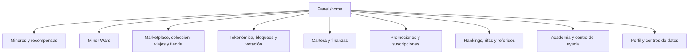

# Guía de ingeniería inversa y réplica local de GoMining

**Fecha de revisión:** 2 de noviembre de 2026  
**Alcance:** aplicación web de `app.gomining.com`; uso local y privado.

**Checklist manual de revisión:** [`gomining-replica-checklist.md`](./gomining-replica-checklist.md)

## Addendum: simplificación del alcance MVP · 2026-11-02

- La navegación activa conserva Panel, Tokenómica, Finanzas, Promociones, Comunidad y Cuenta. Se quitaron los grupos Explorar y Academia; sus definiciones de ruta se mantienen en el catálogo para posible reutilización, pero la aplicación las bloquea.
- En ese corte inicial, los accesos directos a `/marketplace`, `/gominers-collection`, `/travel`, `/shop`, `/nft-sell`, `/launchpad`, `/finance/banking-cards`, `/finance/simple-earn`, `/raffles`, `/offers`, `/goboxes`, `/bonus-miner-v3`, `/leaderboard/nft-rarity`, `/leaderboard/solo-mining`, `/leaderboard/liquidity`, `/academy` y los artículos `/blog/how-to-*` regresaban a `/home`. `/buy` se bloqueaba de forma exacta y `/buy/GOMINING` permanecía en Tokenómica. **Ese estado de `/buy/GOMINING` quedó supersedido por la revalidación del 2-nov-2026 al final de esta guía.**
- La ruta de tarjetas Visa no tiene un componente bancario compartido con el MVP: su única ruta local es `/finance/banking-cards`, que se bloquea. La categoría `Cards` que aparece en el resumen de royalties de referidos describe una clase de recompensa y se conserva separada.
- El componente Marketplace, el catálogo ficticio y el diálogo del carrito quedan en el código como material dormido. No hay enlace al Mercado ni al carrito en la cabecera; Marketplace no se monta y las rutas con productos ficticios están desactivadas. La franja BTC/GOMINING de Inicio es una referencia visual de demo y no permite operar; su etiqueta dice `Referencia de precios · demo` (DOM REA `ev_e9d15833aa8278d710f21d6ff3666e9029f362d70defee3b4f391fb9259071e0`). La sección visible `Comprar GOMINING` explica que no hay cotización ni entrega verificable y no agrega productos a un carrito. La tarjeta Minero Bonus dentro de Mineros se quitó porque abría una ruta ya desactivada.
- En ese corte se conservaban Fondos instantáneos (`/finance/instant-funds`), Resumen de ganancias (`/finance/earn-summary`), Comprar GOMINING (`/buy/GOMINING`), Suscripciones y Trazabilidad/Data centers. El antiguo resumen de Simple Earn (`/finance/simple-earn/overview`) llevaba al Resumen de ganancias, que trata solo actividad local/minera y no presenta rendimiento de Simple Earn. Consulta el estado actual de rutas al final de la guía.
- `/operator-economics` redirige a `/mining-calculator` (`ev_d50bed8f8b489370a67b6dc8a692e82ecf0357a81644a358a8d8a97bc99e765a`). La calculadora permite elegir modelos de compra única del catálogo observado, unidades, eficiencia, disponibilidad, electricidad y mantenimiento. Consulta hashrate y recompensa reciente de Bitcoin y el precio BTC/USD desde la [API pública mempool.space](https://mempool.space/docs/api/rest); los valores se usan para una estimación teórica sin promesa de ingreso ni cobro. Los precios del catálogo son una captura fechada, no una cotización GoMining en vivo.

**Verificación REA a 390 × 844 px:** las sesiones temporales se cerraron con `terminated-owned-process`. Las rutas directas de `/marketplace` y varias secciones retiradas ya se documentaron en el seguimiento: evidencia `ev_4602f537d2fb66ac0ed613862905f2ca854695cfd04cecf6491967870630a6e9`, `ev_913ac6f67f76cd38ec4c2c2ef9a8905585ab23122b1a898be29ba28e3557cd7a`, `ev_a0e8c3f2b6b06b7919fc520b0a8174b5b6f52a11a0ffc026495cd0ee6205032a`, `ev_386e5c40662fa2c24e64a098557850d3ed9118d3cef696584b2d4b95d6400832`. En esta pasada, Rareza, Solo Mining, Ranking de liquidez, Academia, Bitcoin y minería, Configurar 2FA y Retirar recompensas de forma segura terminaron en Inicio (`ev_34d76f047ff41a19c70b5691e9a6b4c7b5df298f98ce7d10d10867100122ba6d`, `ev_b910ff20a8b5bde75836b2554777ea6132f2af0c5dbe8aff670fdf608eae9974`, `ev_58344757349e0f55496147a1752285fd7ebec4c2b56f90bfcc086bf3c2f5f6a1`, `ev_41da8c6e4454d88418cd8d6cd2c1d623e94a44007098ad5b38ed75344de85de1`, `ev_8ad12b6ac5352aef07310c2bdaaf8ce0350285eda939ae0a00a0328c4fda7868`, `ev_5e16947252cce95099222d288fdc8ce2596df497e1d7a3f438ee6568e9f827f6`, `ev_8a409544ee1b0482d8c08b2d4af7e6d61ca3d5c4e02dc14d1bc4edf621382430`). El menú abierto no muestra enlaces a las secciones retiradas (`ev_9ebb2d8d824d8ea34156b177959395d825d6bbc3400aabdc391467958dfef848`); Mineros no muestra tarjeta ni enlace de Minero Bonus (`ev_20eaf02065029d8b7cefca19a516338abc665264c5842a95169a7dd1c3a5f7cc`).

Se comprobó que continúan accesibles Fondos instantáneos, Resumen de ganancias, Comprar GOMINING, Suscripciones y Trazabilidad (`ev_73e370837d9486d444ba6e4be5e93ebe87529644be13580dc798f25044c3c302`, `ev_6625bb3f07e786260f743691918c5bbbc50b6be90d2545cb7aed2fd30cbe7a42`, `ev_7eaaad29496a5737b44edfe0c5e07280d6e2fe8192d3d643fe8c3f6e4ef8db7f`, `ev_1363a160370afed1cd80994b9c660ed22521e4ec220b45b1304095a7f40cb942`, `ev_58e0f03f1e3bcc209b0828a77221385b5e8b3463313a5542923b3a1ab148af2c`). El acceso legado de `/finance/simple-earn/overview` lleva al Resumen de ganancias (`ev_1913a7c8fbe29b4af7cef599f19c8a28d0c20949c6510e1e3c6c0baefdfcb360`). Las lecturas públicas de minería no confirman que haya equipos conectados a GoMining ni generan ingresos contables. Esta simplificación no modifica la configuración Firebase previamente documentada.

## Addendum: estado vigente de MetaMask móvil y Firebase · 2026-11-02

- `src/metamaskConnect.ts` configura `mobile.useDeeplink: !isMobileBrowser()`. En un teléfono el valor es `false`, por lo que MetaMask Connect selecciona el Universal/App Link HTTPS de MWP (`https://metamask.app.link/connect/mwp`); no se usa `metamask://` ni `/dapp/`. El checkout conserva producto/red en `gmPay` antes de Connect. Es una comprobación de configuración/código, no prueba que Android abra la app ni complete el regreso.
- El dominio gratuito ngrok de esta sesión mostró una página de aviso intermedia en solicitudes HTML. El checkout ahora advierte sobre ese host en móvil. Para probar el regreso sin esa pantalla, la réplica queda accesible temporalmente en [Quick Tunnel HTTPS](https://luis-reach-award-publicity.trycloudflare.com/home); ese host es público, efímero y no debe usarse como dominio oficial. El intersticial es una causa plausible del retorno en blanco, no un resultado confirmado en un teléfono.
- REA completó una inspección estática del workspace actual: Evidence resumen `ev_fca8030ec6d03a3836d545034975e83381ea9e8e4cd6ea2c8386f14dce05161d`, padre `ev_73626ea5d1d69812686f2c3fce2e26dd11f76894f16a48ee09b245592ceae7e5`. La vista examinó 9,092 nodos, dejó 19,282 archivos fuera y conserva un grafo parcial; no ejecutó la aplicación. Un análisis posterior acotado de cuatro fuentes llegó al timeout del cliente de 450 s y no produjo Evidence, así que se retiene la pasada completada anterior.
- Tras la autorización Firebase CLI del usuario, `projects:list` y `firestore:databases:list` confirmaron acceso a `salad-miners` y su Firestore Native `(default)` en `nam5`, `freeTier: true`. La consola mostró Auth anónimo habilitado y las reglas Firestore restringidas. `src/firestoreDemoSync.ts` persiste solo snapshot demo privado y conserva respaldo local; no guarda direcciones de wallet ni recibos de cadena.
- `functions:list` devolvió un error genérico, por lo que se desconoce si hay Functions remotas. La configuración raíz no enlaza un codebase de Functions y no contiene backend financiero. Firebase exige Blaze/facturación vinculada para desplegar Cloud Functions ([documentación oficial](https://firebase.google.com/docs/functions/faq-and-troubleshooting)); no se cambió el plan ni se desplegó nada.
- En Computer Use, con viewport 390 × 844, el configurador local cargó su skeleton, mostró el formulario y abrió la revisión al pulsar **Continuar**. Es viewport de escritorio, no Android. `npm run build` pasó tras el cambio móvil; permanece el aviso conocido de Rollup sobre el chunk Solana. No se abrió ninguna wallet, no hubo firma ni transferencia.

## Addendum: guardado demo Firebase, cierre y replay REA · 2026-11-01

- El cliente ya lee la configuración local ignorada por Git del proyecto de prueba y limita el snapshot a campos demo explícitos. No serializa direcciones de wallet ni recibos on-chain. Cuando la nube falla, mantiene una copia por navegador en `localStorage` y explica el estado en Inicio.
- Historial: en el primer intento, Auth anónimo respondió `auth/admin-restricted-operation`, antes de acceder a Firestore. Después de que el usuario autorizó Firebase CLI se habilitó Auth anónimo y se desplegaron las reglas restringidas al proyecto de prueba `salad-miners`. REST, SDK Web y la ida/vuelta de la interfaz pasaron: añadir USD 1 demo mostró `Demo guardado` y el importe reapareció tras recargar en una sesión aislada de `localhost:5173`. Esa prueba deja un snapshot demo en Firebase y no cambió la sesión principal `127.0.0.1`.
- REA reprodujo Inicio → abrir/cerrar configurador a 390 × 844 (evidencia `ev_168c4e79957698e3165b0a924710a07d9ef0f73b508ae2b24766ebad5ff33156`). En un recorrido separado añadió USD 42 demo, recargó la página, comprobó que el balance se conservó y canceló el checkout de Recargar (evidencia `ev_1eb8b5dd6686327d484f0759422794bfbbcf7d77893cf9df06034f7da4012081`). No se conectó una wallet ni se firmó una transacción.
- Registro histórico del 1-nov: los enlaces móviles de Solflare, Phantom, Coinbase, Trust Wallet y TronLink se comprobaron con user-agent simulado; UniSat no tiene uno. En aquel corte MetaMask usaba el deeplink nativo `metamask://connect/mwp`; el estado actual de Universal/App Link HTTPS está documentado en el addendum del 2-nov. Ninguna wallet se probó mediante un handoff real. Solflare y Phantom pueden abrir su navegador integrado mediante enlaces Browse; eso también requiere validación física. Sin encabezado especial, la URL temporal de ngrok mostró `ERR_NGROK_6024`; con el encabezado de omisión, la réplica respondió HTTP 200. Ninguna app wallet se probó con ese intersticial.
- REA/Linux rechazó el primer inventario porque `dist/index.html` cambió durante el build; al analizar solo fuentes estables, completó seis archivos sin errores de parseo (evidencia `ev_771f4fa0989d87672f5dbb2c5c68ebb3f3e1a6e5b060bb32f84fa0ea664f4c1e`). El grafo quedó parcial y 16 archivos inventariados no se seleccionaron. `rea doctor --client codex --json` detectó Node de Windows 22.17.1 por debajo del mínimo 22.23.4, pero la inscripción de Codex estaba alineada. La sesión REA/Linux 6.8.0 terminó sin análisis abierto ni limpieza pendiente; los límites de doctor y la recuperación se detallan en el [informe de seguimiento](./gomining-replica-audit-2026-11-01-seguimiento.md#errores-y-recuperación-de-rea).
- La compilación de producción pasa. Continúa el aviso de Rollup sobre el chunk de Solana de 695.91 kB.

La matriz detallada, los límites y los pasos pendientes están en [`gomining-replica-audit-2026-11-01-seguimiento.md`](./gomining-replica-audit-2026-11-01-seguimiento.md).

## Addendum: rediseño visual premium y móvil · 2026-10-31

- Se actualizó la capa visual local para combinar una presentación contenida y tipografía de sistema con los tonos violeta y las señales de minería de GoMining. El panel conserva marcas claras de demostración y no convierte animaciones en indicadores de operación real.
- Inicio ahora jerarquiza saldo, acciones rápidas, mercado de referencia, estado de granja y retos locales. El progreso se calcula únicamente con mineros y suscripciones demo que existen en la sesión; no entrega recompensas.
- Se añadieron movimiento ambiental suave, estados de foco visibles, transiciones, cargadores esqueléticos para lecturas de pool, y estilos de vacíos/errores. `prefers-reduced-motion` desactiva el movimiento. En pantallas pequeñas la navegación se compacta y las tarjetas se apilan con texto mayor y controles de toque más amplios.
- Tras la captura del modal que el usuario compartió, se corrigió la escala tipográfica global: etiquetas, texto secundario y contenido/tablas parten ahora de 14 px; botones y controles táctiles de 44–48 px; campos de entrada usan 16 px para evitar zoom automático en móvil. Los diálogos de compra y recarga ahora ocupan más ancho disponible y reorganizan sus paneles en móvil.
- Referencias de diseño consultadas: [Apple Design](https://developer.apple.com/design/), [Vercel Geist](https://vercel.com/geist/introduction) y las capturas de GoMining entregadas en esta conversación. Las referencias orientan jerarquía, legibilidad y tratamiento de estados; no se copian recursos propietarios.
- **REA en la iteración del rediseño (31-oct):** la captura controlada de `/home` público falló antes de devolver DOM, accesibilidad o captura visual y reportó `cleanup_incomplete`; ese resultado no se atribuyó a falta de cobertura del producto. En el seguimiento del 1-nov se completaron recorridos REA de la réplica local (interacciones citadas arriba) y análisis estático REA/Linux de seis fuentes. La captura histórica de GoMining público continúa sin obtenerse mediante REA; sus observaciones provienen de las capturas y la navegación autenticada ya documentadas.
- La captura visual local tampoco pudo completarse en esta iteración: Computer Use detuvo el acceso porque no pudo determinar con suficiente confianza la URL activa de Brave. La ruta `/home` local sí respondió HTTP 200; su diseño en pantalla queda pendiente de comprobación visual.

Archivos de diseño afectados: `src/App.tsx` y `src/styles.css`. La compilación pasa y `/home` responde HTTP 200; la revisión visual final de tamaños y quiebres móviles sigue pendiente porque Computer Use no pudo determinar con suficiente confianza la URL activa de Brave.

## Addendum: conexión de wallet móvil y auditoría de cierre · 2026-11-01

- Registro histórico del 1-nov, supersedido por la configuración del 2-nov: MetaMask usaba el deeplink nativo de Connect/MWP en móviles. La conexión no envía fondos; el checkout pide una aprobación aparte. Solflare y Phantom conservan enlaces a sus navegadores dApp; Coinbase, Trust y TronLink usan sus enlaces correspondientes. No se emplea WalletConnect Project ID ni se guarda una clave de integración.
- Se verificaron la ruta de código, la conservación de la selección del checkout y una compilación posterior al ajuste. REA analizó estáticamente los cinco módulos de sesión, enlace, checkout y aplicación; eso no prueba el handoff real. Falta probar que el teléfono abra MetaMask y regrese a un dominio HTTPS accesible, además de conexión y rechazo. UniSat sigue sin enlace móvil directo y requiere su proveedor en el navegador.
- Si la wallet devuelve un rechazo explícito, el checkout se cierra y muestra que no hubo pago. Si queda una solicitud pendiente de conexión o pago, X, Cancelar y Escape cierran la pantalla web y avisan que la wallet puede seguir mostrando la solicitud; la página no puede cancelar la ventana de aprobación de la app.
- El encabezado actual diferencia `Saldo demo` de `Conectar wallet`; en `App.tsx` solo se renderiza un botón de conexión y no hay botones de notificación. Esta revisión no pudo capturar la vista en pantalla por el bloqueo del navegador de Computer Use.
- Se añadió `https://solana-rpc.publicnode.com` como tercer RPC de lectura para obtener blockhash, después de que ambos hosts públicos de Solana respondieran HTTP 403 desde el equipo de revisión. La respuesta de PublicNode fue HTTP 200. Es un RPC compartido sin garantía; no basta para sostener pagos en producción. Ninguna solicitud de transacción se probó.
- REA completó análisis estático de 8 fuentes (evidencia de resumen `ev_c1d0d62ff0981e83d8c827e54303d2cb36626a5bb2677ca5461aa324e6fb28e2`, digest `43c17d1bc7cbb4d0b898c72e5d89a78539172632c63977ed249ff7efcf6974a3`). La captura interactiva de REA terminó `cleanup_incomplete`; `rea doctor` informó registro sano, pero no liberación de la sesión. No se repitió la captura. Computer Use se detuvo antes de actuar porque no pudo determinar la URL activa de Brave.
- Se protegió el estado demo frente a la carrera entre una mutación local y una lectura Firebase tardía. Auth anónimo y las reglas ya se desplegaron en el proyecto de prueba; la app mostró `Demo guardado` después de recargar. Si Firebase falla, se usa el respaldo local por navegador.

Detalle de estados y pruebas: [`gomining-replica-audit-2026-11-01.md`](./gomining-replica-audit-2026-11-01.md), addendum móvil; matriz navegable: [`gomining-replica-checklist.md`](./gomining-replica-checklist.md).

## Estado

La réplica contiene navegación local para las rutas propias activas del mapa de abajo; las secciones fuera del MVP están registradas como rutas detectadas, pero se desactivan y redirigen a Inicio. Inicio sigue la barra superior, el panel de saldo, las acciones rápidas, las tarjetas de beneficios y la cuadrícula promocional de la captura autenticada. Las compras de minero, suscripciones, referidos, depósitos y retiros tienen recorridos locales de demostración. El estado demo se conserva en `localStorage` por navegador y se sincroniza con Firestore mediante una cuenta anónima en el proyecto de prueba `salad-miners`; el servicio, el SDK Web y la vuelta UI de añadir USD 1 demo y restaurarlo tras recargar se comprobaron en una sesión aislada. La vista de conexión prioriza móvil, detección de cuenta/red, lectura de direcciones y controles táctiles amplios. MetaMask Connect selecciona el Universal/App Link HTTPS MWP en teléfonos; la apertura real, la autorización/rechazo y el regreso siguen pendientes de prueba física.

No hay integración de cuenta de GoMining en vivo. La pestaña autenticada permitió leer los precios visibles del configurador, pero no se confirmó una interfaz autenticada que `localhost` pueda consultar sin trasladar cookies o tokens. El adaptador de GoMining conserva una lista permitida vacía. El checkout usa el precio de catálogo observado y vuelve a cotizar la moneda de pago; no sincroniza cambios futuros en el catálogo ni confirma pedidos o entrega productos. La transferencia solo ocurre tras la aprobación del usuario en su wallet.

## Método y evidencia

- Se usó la pestaña autenticada del navegador integrado que proporcionó el usuario. La inspección de esta iteración se hizo en modo de lectura, sin completar compras ni aprobar transacciones.
- La inspección de solo lectura confirmó el panel `/home`, la colección `/nft-miners`, la cartera `/finance/wallets/virtual`, `Viajes` (`/travel`), `Mercancía` (`/shop`) y la vista de bloqueo `/lock/ve-my-lock`.
- La ruta `/nft-rewards` redirigió a `/nft-rewards/solo`; desde allí se observaron las pestañas `Minería` y `Miner Wars` (`/nft-rewards/pool`), además de los controles de ajustes de recompensas, descuento de mantenimiento y tasa histórica de BTC.
- La sesión autenticada confirmó `/subscriptions?subscriptionType=platinum`, `/nft-referral` y `/nft-referral/rewards`. La ruta de referidos ofrece Royalties y Mis amigos; la pantalla de recompensas muestra categorías Electricity, Mining, Cards, Simple Earn y Miner Wars. No se copiaron cantidades ni IDs personales.
- En `/nft-miners` se confirmaron los controles Filtros, Aplicar y Limpiar y un acceso a tareas de Minero bonus. La ruta con `?nftAction=create` se conserva como entrada al diálogo local de creación.
- Una segunda lectura de `/marketplace` confirmó la sección `mineros`, la pestaña `Ofertas`, el orden `Nuevos` y filtros para disponibilidad, precio, tipo de precio, eficiencia energética, energía, colecciones y atributos del minero. No se copiaron anuncios ni valores.
- El menú autenticado también expone `/miner-wars` como acceso propio. La pantalla no se inspeccionó en esta sesión.
- La apertura directa de `/finance/simple-earn` terminó en `/`; el destino se conserva como ruta detectada, con pantalla por confirmar.
- En Mi bloqueo se observaron las pestañas Tokenómica, Mi bloqueo y Votación, la tabla `Fecha`, `Bloqueado`, `Fin`, `Votos`, `Recompensas`, `Dirección`, `Estado`, un estado sin datos y el botón `Obtener votos`. No se avanzó el asistente de gobernanza.
- La portada mostró enlaces a las rutas propias enumeradas abajo. Varios enlaces se intentaron abrir directamente, pero no llegaron a un título accesible dentro del tiempo de observación; se registran como descubiertos por navegación, con contenido por confirmar.
- REA capturó un perfil temporal sin sesión. La navegación pública redirigió a `/auth` (evidencia `ev_090d73cc864b95e036e873e45d9832cc1eff6f5d7c34e5e11d2ac1633f79ad23`). La página expuso scripts servidos bajo `edge-media.gomining.com/.../client-next/`. Ese perfil no tenía acceso a la cuenta y no se usó para inferir estados autenticados.
- Para ampliar las compras se intentó otra captura controlada con `rea_linux` en `/marketplace`. REA devolvió `execution_failure` no reintentable; `rea doctor` señaló que el registro de Codex está alineado, pero no confirmó la identidad del servidor activo. Una consulta pasiva a `http://127.0.0.1:9222`, limitada al origen de GoMining, devolvió `endpoint_unreachable`. No se obtuvo evidencia REA de módulos, solicitudes ni precios de la sesión autenticada con esos intentos.
- La sesión autenticada se inspeccionó con el navegador integrado; no se pudo conectar REA a esa pestaña mediante CDP. Por tanto, los endpoints, módulos autenticados y respuestas de red siguen sin confirmar.
- En esta iteración, `rea_linux.binary_session` confirmó que el servidor REA seguía disponible, pero no reportó un objetivo de navegador abierto. El navegador integrado no expuso un endpoint CDP local. No se repitió la captura controlada que ya había terminado en `execution_failure`; la comprobación visual y de navegación se hizo en la pestaña autenticada y en la réplica local.
- REA/Linux no pudo adjuntarse a la pestaña autenticada porque el endpoint CDP local devolvió `provider_unavailable` / `endpoint_unreachable`; no se atribuyen a REA los siguientes hallazgos. Con el navegador integrado se abrió `/marketplace`, se pulsó `Crear minero` y se inspeccionó el configurador de `/nft-miners?modal=paywall-create`. Los importes del catálogo de compra única se confirmaron en el total del checkout: 1.12 TH = 272.22 MXN; 8.33 TH = 1,878.43 MXN; 21.05 TH = 4,696.35 MXN; 42.44 TH = 9,392.89 MXN. El precio personalizado se confirmó en 20 niveles discretos entre 1 y 5,000 TH. Los precios mensuales observados fueron 3.82 TH hasta por $39.99 USD/mes, 9.61 TH por $99.99, 24.20 TH por $249.99 y 48.66 TH por $499.99. Todas las opciones indicaron 15 W/TH. No se pulsó `Ir al pago` ni se inició una transacción. Los importes son una captura del catálogo a la hora indicada, no un feed continuo.
- El configurador mostró “A pagar hoy” en MXN para la compra única y USD para los planes mensuales. La tarjeta de 1.12 TH mostraba $272.21, mientras el total tras seleccionarla fue 272.22 MXN; el checkout local conserva el total final observado. El tope mostrado en la tarjeta personalizada fue 1,028,898.46, y al seleccionar 5,000 TH el total fue 1,028,898.47 MXN; se usa el total seleccionado y se conserva la discrepancia de un centavo como detalle observado.
- No se copiaron saldos, identificadores de cuenta, direcciones ni tokens al proyecto o a esta guía. La captura del navegador incluye datos personales que se omitieron.
- REA analizó `@viaprotocol/web3-wallets` desde el árbol clonado `rea-via-web3-wallets-20261030` (evidencia `ev_a10ee0e0ca822cfcc4a631468d84f3d1058b6fede8bd028555e41feae8c964f2`; resumen `ev_3a474f0f261e791164fd6cfa0fc12cda5efce917e83717e2671b37fdf3589068`; 532/532 elementos de inventario). La configuración de Solana de ese proyecto enumera Phantom; no contiene un conector Solflare. El proveedor incluye firma/envío y la implementación persiste detalles de cartera en `localStorage`, por lo que se usó como referencia de protocolos y no se incorporó como dependencia.
- REA Linux revisó también el árbol de [Via web3-wallets](https://github.com/viaprotocol/web3-wallets) (evidencia `ev_b1cf1031559869341397d7da1c8496d1dfd7c1ab50fed11429ef1c6707f5251c`; resumen `ev_d1e7639a64c943f0f3408aa4eca4d6f15087a84f3701a47fdc4aeb768f4347dc`). Se analizaron 6 de 6 archivos fuente seleccionados (`src/constants.ts`, `src/context/WalletProvider.tsx`, `src/utils/cosmos.ts`, `src/utils/btc.ts` y los dos archivos `src/provider/xDeFi/`), dentro de un inventario de 170 elementos; quedaron 49 archivos sin seleccionar. El análisis estático confirma referencias de implementación para MetaMask, WalletConnect, Coinbase, Phantom, Keplr, xDeFi y Safe; Astar está incluido en las redes EVM y no como cadena Cosmos. La cobertura del grafo es parcial y permanecen 1.946 incógnitas; REA no ejecutó esos módulos ni confirmó el comportamiento actual de extensiones, así que esta evidencia orienta la integración pero no certifica conexiones en tiempo de ejecución.
- REA Linux revisó `src/networks.ts` del repositorio Via en el commit `44e90aa26487bf7625da771a2f2eaf3e4a05eb98` (evidencia `ev_9de7b394aa61978ad1d6f021bfcf2c945aee47bc859ec132c61f6b86e01c27d6`; recibo del analizador `ev_17cb261c6a1f20318d66f41258c73c21087889a4555c9bdc9e013d19ae05e382`). SHA-256 del archivo: `6405a1c05d02a986ad75bd6c63f50650167050de919f5e07ac24969ba808885e`. El análisis estático identificó `rpcMapping`, `getNetworkById`, `estimateGas` y `supportedNetworkIds`; cubrió un archivo, dejó 54 sin seleccionar, marcó grafo parcial y 686 incógnitas semánticas; no ejecutó el código. Confirma configuración de redes/RPC para la integración Via, pero no añade por sí solo una necesidad a la conexión de solo lectura de direcciones.
- REA Linux analizó el repositorio oficial de `@solflare-wallet/sdk` en el commit `69a82c5d064f9e1c06bc4ea7848ae3d09021c3d3` (evidencia padre `ev_d1667cb55b3b61d46b303c4c10eeb60be8c6b76a8662b130c02d6daf95b8c5af`; vista resumen `ev_4835052a3c22e62f39847684c4ceef7ca2be6153489d3b0c03c3261701d6d548`; SHA-256 del árbol `10ca16dc5494e6bc26865f12ef012a8a86eabecd37b141c2094d4c07cfd170c9`). REA examinó 111/111 elementos de esa vista, 17 archivos relevantes y 12 fuentes JavaScript. No ejecutó el código. La cobertura semántica permanece parcial, con 1056 incógnitas estáticas, así que la evidencia no prueba comportamiento de ejecución.
- El SDK oficial documenta `connect()` y `publicKey` para Solflare web, extensión y móvil ([guía de integración](https://docs.solflare.com/solflare/technical/integrate-solflare/solflare-wallet-sdk)). El checkout usa su método de firma/envío solo después de que el usuario pulsa Pagar; la solicitud aparece en la wallet para su aprobación. El flujo manual de deep links requiere claves de cifrado, `redirect_link` y gestión de sesión ([método Connect](https://docs.solflare.com/solflare/technical/deeplinks/provider-methods/connect)); se eligió el SDK oficial para la conexión del navegador.
- En la revisión visual de carteras se consultaron [Apple Design](https://developer.apple.com/design/) y [Geist Typography](https://vercel.com/geist/typography): jerarquía clara, contraste alto, texto de lectura y controles de toque amplios. REA Linux no produjo captura de esas páginas en esta iteración: `capture_browser_scenario` terminó con `execution_failure` y `cleanup_incomplete` antes de devolver contenido; no se atribuyen hallazgos visuales a esa llamada.

## Mapa de navegación observado



## Rutas de primera parte

“Vista observada” indica que se confirmó contenido visible en la sesión. “Enlace observado” indica que la ruta apareció en la navegación del sitio; no afirma que toda su pantalla quedara inspeccionada.

| Área | Ruta | Evidencia |
|---|---|---|
| Panel | `/home` | Vista observada |
| Panel | `/home?modal=paywall-create` | Acceso de creación confirmado por la navegación; el configurador local ofrece modo de compra única o mensual y revisión antes de simular |
| Panel | `/nft-miners` | Vista observada; contiene filtros y acceso a crear |
| Panel | `/nft-miners?nftAction=create` | Variante observada; abre el diálogo local de creación simulada |
| Panel | `/nft-rewards` | Redirige a `/nft-rewards/solo` |
| Panel | `/nft-rewards/solo` | Vista observada parcialmente: Minería, ajustes y tasa histórica |
| Panel | `/nft-rewards/pool` | Vista observada parcialmente: pestaña Miner Wars |
| Comunidad | `/miner-wars` | Enlace observado; pantalla por confirmar |
| Explorar | `/marketplace` | Filtros y controles observados; anuncios y resultados por confirmar |
| Explorar | `/gominers-collection` | Enlace observado; pantalla por confirmar |
| Explorar | `/travel` | Vista observada: “Viajes” |
| Explorar | `/shop` | Vista observada: “Mercancía”, “Filtros” |
| Explorar | `/nft-sell` | Enlace observado |
| Explorar | `/launchpad` | Enlace observado |
| Tokenómica | `/buy/GOMINING` | Enlace observado |
| Tokenómica | `/liquidity` | Enlace observado |
| Tokenómica | `/ve-tokenomics` | Enlace observado |
| Tokenómica | `/lock/ve-my-lock` | Vista observada; se omiten valores de la cuenta |
| Tokenómica | `/lock/ve-voting` | Enlace observado; pantalla por confirmar |
| Tokenómica | `/gmt-wallets` | Enlace observado |
| Finanzas | `/finance/wallets/virtual` | Vista observada; datos personales omitidos |
| Finanzas | `/finance/wallets/virtual/GOMINING/transactions` | Enlace observado |
| Finanzas | `/finance/banking-cards` | Enlace observado |
| Finanzas | `/finance/instant-funds` | Enlace observado |
| Finanzas | `/finance/instant-funds?source=wallet_button` | Variante observada en navegación |
| Finanzas | `/finance/instant-funds?source=assets_button` | Variante observada en la cartera |
| Finanzas | `/finance/simple-earn` | Enlace observado; apertura directa terminó en `/` |
| Finanzas | `/finance/simple-earn/overview` | Enlace observado |
| Finanzas | `/buy` | Enlace observado |
| Finanzas | `/deposit` | Enlace observado |
| Finanzas | `/withdraw/GOMINING` | Enlace observado |
| Beneficios | `/promos` | Enlace observado |
| Beneficios | `/raffles` | Enlace observado |
| Beneficios | `/offers` | Enlace observado |
| Beneficios | `/goboxes` | Enlace observado |
| Beneficios | `/bonus-miner-v3` | Enlace observado |
| Beneficios | `/subscriptions?subscriptionType=platinum` | Vista observada: Platinum+ mensual; condiciones propias del usuario por confirmar |
| Comunidad | `/leaderboard/nft` | Enlace observado |
| Comunidad | `/leaderboard/nft-rarity` | Enlace observado |
| Comunidad | `/leaderboard/solo-mining` | Intersticial de migración; no se avanzó |
| Comunidad | `/leaderboard/liquidity` | Enlace observado |
| Comunidad | `/raffle/036a5b85-4b51-471b-b639-2ffb9afba920` | Enlace observado |
| Comunidad | `/nft-referral` | Vista observada: royalties y actividad |
| Comunidad | `/nft-referral/rewards` | Vista observada: categorías y tabla de recompensas |
| Comunidad | `/nft-referral/friends` | Enlace observado; pantalla local parcial sin datos |
| Comunidad | `/data-centers` | Intersticial de migración; no se avanzó |
| Comunidad | `/data-centers/pool` | Cotización pública Kryptex PRL y enlace a su perfil de workers |
| Comunidad | `/data-centers/operations` | Historial público de pagos de Kryptex con enlaces por hash a transacciones Pearl |
| Comunidad | `/data-centers/miners` | Workers locales demo; no están provisionados en la pool |
| Comunidad | `/data-centers/farms` | Sin inventario verificable de granjas |
| Cuenta | `/profile` | Enlace observado |
| Academia | `/academy` | Enlace observado; parte de la formación enlaza fuera de la aplicación |
| Academia | `/academy/courses/bitcoin-and-mining` | Enlace observado |
| Academia | `/academy/courses/blockchain-and-crypto-course` | Enlace observado |
| Academia | `/academy/courses/gomining-basics-course` | Enlace observado |
| Ayuda | `/blog/how-to-set-up-2fa` | Enlace observado |
| Ayuda | `/blog/how-to-withdraw-rewards-safely` | Enlace observado |
| Ayuda | artículo “How Miner Wars…” | El vínculo apareció truncado; el slug completo no se registró |

Las páginas enlazadas a tiendas móviles, comunidades, preguntas frecuentes y otros servicios se consideran límites de salida. No se replica el servicio externo.

## Implementación local

- **Stack:** React, TypeScript y Vite. No requiere una capa de servidor porque no se habilitó acceso a lecturas autenticadas.
- **Rutas:** `src/catalog.ts` mantiene el inventario y la navegación. Vite sirve el punto de entrada para URLs directas y React Router dibuja el contenido local.
- **Adaptador de lectura:** `src/readAdapter.ts` exige una coincidencia exacta de origen y ruta en una lista permitida. La lista está vacía hasta confirmar solicitudes `GET` de lectura. Si se habilita una ruta en el futuro, la solicitud usa `credentials: omit` y `cache: no-store`.
- **Acciones:** recargar, retirar, bloquear, votar y vender conservan sus simulaciones locales. Crear minero abre el checkout desde Inicio con los importes observados en el configurador autenticado; la wallet conectada en el encabezado se reutiliza y, si aún no existe conexión, el checkout permite conectarla. Recargar abre el mismo checkout. Una transferencia no acredita saldo ni activa un producto sin verificación de depósitos y asociación de orden. Los pagos mensuales cubren un periodo de 30 días y no crean una renovación automática. El plan anual de Platinum+ está deshabilitado por instrucción del usuario. El 10% directo y el Unilevel siguen siendo simulaciones locales.
- **Carteras directas:** la pantalla `/gmt-wallets` solo conecta y muestra dirección/estado. El checkout aparece desde la compra y Recargar, y reutiliza la conexión existente. Ofrece Solflare y Phantom en Solana, MetaMask/Coinbase/Trust Wallet mediante EIP-1193 en EVM, TronLink en TRON y UniSat en Bitcoin. No requiere WalletConnect, Project ID, Rango, Safe, Keplr ni xDeFi. La wallet debe estar instalada y anunciar un proveedor compatible.
- **Recepción y pagos:** el checkout usa las direcciones entregadas por el operador para BNB, BTC, ETH, TRX, POL o USDT SPL. Los cinco activos nativos usan cotización Binance Spot consultada en memoria y vencida a los 30 segundos. Cuando el catálogo está en MXN, consulta una tasa diaria USD/MXN de Frankfurter para convertirlo; el tipo de cambio no es intradía y se muestra con su fecha. Para redes Bridge se muestra una estimación de tarifa del 1%; la wallet muestra el gas de origen. La transferencia ocurre solo tras pulsar Pagar y aprobarla en la wallet. Un hash no equivale a confirmación Bridge, asociación a pedido o activación de producto.
- **Permisos y recibos:** no se solicita frase semilla ni clave privada. Las direcciones no se guardan en almacenamiento del sitio; los recibos de pago quedan en memoria durante la pestaña. La conexión lee la dirección; enviar invoca el proveedor para firmar y transmitir la transferencia que el usuario aprueba. No se ejecutó ninguna transacción durante la validación.
- **Dependencias y validación:** `@solflare-wallet/sdk` cubre Solflare; `@solana/web3.js` construye la transferencia USDT SPL con instrucciones ATA/TransferChecked codificadas localmente; `buffer` se inicializa antes de web3.js para el entorno navegador. La pantalla de carteras ya no incluye QR ni panel de recepción. La tabla de precios local corresponde a los importes observados el 31 de octubre de 2026 y no se actualiza desde GoMining. El estado de build/auditoría se anota tras la validación de esta iteración.
- **Precios de compra:** `src/minerCatalog.ts` contiene los cuatro totales de compra única, los cuatro planes mensuales y los 20 totales personalizados observados en el catálogo de GoMining el 31 de octubre de 2026. La moneda se conserva: MXN para compra única y USD para planes mensuales. Son importes reales observados en la cuenta en esa fecha; no hay sincronización automática futura con GoMining. La cotización del activo de pago sí se actualiza al abrir el checkout y antes de enviar.
- **Confirmación de compra:** el checkout de wallet no es una simulación: tras revisar la cotización, pulsar Pagar y aprobar en la wallet puede enviar una transferencia real a la dirección configurada. El recibo confirma que el proveedor devolvió un hash de origen; no demuestra por sí solo confirmación final, conversión Bridge, asociación de orden, reserva, emisión de NFT ni activación/entrega del producto. Las alternativas de saldo demo siguen siendo simulaciones separadas.
- **Datos:** los saldos e identificadores de cuenta se muestran como marcadores vacíos. No hay datos reales de cuenta en los archivos.
- **Estados sin datos:** las tablas y colecciones explican que no hay datos conectados. Las pantallas con contenido no observado declaran su cobertura parcial.
- **Servicios externos:** se muestran como puntos de salida informativos, sin imitar operaciones de terceros.

## Análisis del home y viabilidad de las funciones solicitadas

### Diseño observado de `/home`

La vista autenticada observada usa un lienzo azul marino casi negro, paneles redondeados, acentos violetas y una cuadrícula de dos columnas en el viewport estrecho. La jerarquía visible es:

1. Saldo destacado con acciones rápidas para crear minero, recargar, Simple Earn y referidos.
2. Cinta compacta de mercado para BTC y GOMINING.
3. Tarjetas promocionales para Simple Earn, recompensas bonus, minero bonus, nivel VIP, Platinum+ y cashback.
4. Indicador de avance “Siga explorando” y tarjetas horizontales para crear un minero y obtener una tarjeta.
5. Enlace de procedencia de recompensas que menciona Antpool y SpiderPool, más indicadores agregados de minería y promociones.

Las cifras de saldo de la cuenta original no se copiaron. La réplica local sigue esta jerarquía, presenta el saldo con formato `$0.00`, usa una referencia BTC y distingue los datos de pool públicos de Kryptex PRL de los datos demo de la cuenta local. No hay conexión de cuenta GoMining. Añade módulos para pool, suscripción, referidos, cartera, economía y preventa con estados de propuesta o datos desconectados.

La inspección autenticada se realizó con el navegador integrado en modo lectura, no mediante REA. No había un puerto CDP local en el equipo para adjuntar REA Linux a esa pestaña. Por eso no se atribuyen a REA el DOM autenticado, los módulos JavaScript de GoMining ni sus solicitudes de red; esa evidencia sigue pendiente de un perfil REA con CDP autorizado.

### Suscripciones mensuales/anuales

La página Platinum+ de GoMining documenta el precio mensual de $29.99 por ciclo de 30 días. No se confirmó un precio anual ni se observaron allí los beneficios propuestos por el usuario de “1% de potencia de minado” y “sin cola de retiros diarios”; estos deben presentarse como reglas propias de la nueva plataforma, no como condiciones copiadas de GoMining. En esta sesión, la ruta de creación mostró un aviso de migración de datos; no se pulsó `Skip` ni `Migrate data`.

En la simulación local aún se puede ensayar la regla de 1% sobre TH activo y ocultar la cola en retiros demo. El checkout de $29.99 envía fondos al destino seleccionado, pero no activa Platinum+, la suscripción local ni esos beneficios. El plan anual, incluida su simulación, está deshabilitado por indicación del usuario hasta confirmar su importe.

### Referidos y Unilevel

La interfaz de referidos muestra regalías de minería y Simple Earn como conceptos separados. La documentación oficial actualizada de GoMining describe 5% en compras/actualizaciones de mineros y 10% de las recompensas de Simple Earn; la página comercial presenta niveles VIP con regalía de minería que puede subir hasta 15%. Así, el 10% de la propuesta del usuario para recompensas de minería sería una regla nueva de este producto, no una paridad con el 10% de Simple Earn de GoMining. Ver [programa de referidos oficial](https://docs.gomining.com/assets/product/promos/referral-program) y [página pública de referidos](https://gomining.com/referral-program).

La réplica calcula el 10% directo sobre el pago final al minero, no sobre el ingreso bruto de pool. El valor predeterminado reserva un fondo total Unilevel de 20% del pago final: 10% directo y 10% para niveles superiores. Con una base disponible de 100 USD después de costos, el escenario da aproximadamente 83.33 USD al minero y 16.67 USD al fondo; el directo es aproximadamente 8.33 USD. Si no se indica una línea elegible, la parte superior queda retenida. Permite configurar hasta diez niveles, sus pesos relativos y la profundidad elegible. Los pesos `[16,15,14,11,10,9,8,7,6,4]` se recuperaron estáticamente con REA del ejemplo local `unilevel-ejemplo/1nvezt`; sumaban 100% en ese sistema, pero aquí solo sirven como pesos de escenario y no se copió su regla comercial. Este cálculo es una propuesta configurable; su viabilidad económica no está demostrada porque faltan margen neto real, tasas adicionales, topes, moneda, momento de liquidación, anulaciones y controles antifraude.

Recomendación del modelo: acreditar regalías solo al liquidarse una recompensa válida; separar compra de TH, mejora, electricidad y recompensas; registrar para cada línea la operación origen, el nivel, la tasa y el estado `pendiente/liquidada/revertida`; y garantizar que la suma de niveles no exceda el margen disponible después de mantenimiento, electricidad, pool y retiros.

### Trazabilidad de pool, mineros y granjas

La home enlaza recompensas con Antpool y SpiderPool, pero `/data-centers` mostró un intersticial de migración y no se avanzó. No se encontró un mapeo real entre workers y granjas. La réplica consulta la API pública de ingresos diarios de Kryptex para PRL con un hashrate de referencia editable y un endpoint local GET de lista permitida. Esta cifra es una estimación pública, no el ingreso de la cuenta o una liquidación. También enlaza el perfil público de pool y el explorador Pearl; no interpreta sus transacciones como producción de mineros individuales. Los workers creados por compra demo son locales y se muestran desconectados del pool. Granjas y telemetría individual siguen sin fuente verificable.

La cadena puede mostrar pagos y confirmaciones de una dirección pública; no permite inferir por sí sola qué minero o granja produjo el hashrate. Para mostrar estado en tiempo real se necesita telemetría autenticada de pool/worker y un inventario que relacione IDs internos seudonimizados con pool, worker, centro de datos y medidor de energía. Antpool publica una guía de API que contempla curvas de hashrate por worker; SpiderPool publica documentación de API. En esta inspección no se verificaron credenciales, permisos, límites ni endpoints concretos, así que no se conectaron. Referencias: [AntPool API Guide](https://v3.antpool.com/userApiGuide), [SpiderPool API](https://support.spiderpool.com/spiderpool-api).

Esquema mínimo del módulo real: hashrate efectiva y última share aceptada; shares aceptadas/rechazadas; última actividad; estado calculado con un umbral de inactividad; sitio/centro de datos; kW y temperatura solo si existe sensor verificable; eventos de pago con hash de transacción y confirmaciones. La vista local enseña ejemplos de esos campos, no métricas verificadas. Los pagos de blockchain deben etiquetarse como confirmados, mientras que la telemetría puede ser reciente pero todavía no liquidada.

### Modelo de ingresos y costos de operación

La pantalla `/operator-economics` consulta el ingreso diario estimado de Kryptex PRL y permite ingresar costos de potencia `TH`, eficiencia `W/TH`, tarifa eléctrica `$ / kWh`, mantenimiento, infraestructura, retiros e ingresos mensuales de suscripciones/mantenimiento. No precarga precios de electricidad ni mantenimiento. Para potencia `TH`, eficiencia `W/TH`, tarifa eléctrica `$ / kWh` y período `días`:

```text
kWh = TH × (W/TH) ÷ 1000 × 24 × días
costo eléctrico = kWh × tarifa eléctrica
costo de mantenimiento = TH × tarifa de mantenimiento ($/TH/día) × días
ingreso de minería = recompensa minera efectivamente liquidada
neto estimado = suscripciones reconocidas + mantenimiento cobrado + ingreso del pool
              − electricidad − mantenimiento − pago al minero − reserva Unilevel
              − comisión de retiro − soporte/infraestructura − reembolsos
```

La potencia efectiva del escenario incorpora el 1% de beneficio de suscripción (editable entre 0 y 100% para estudiar sensibilidad), y tanto el ingreso PRL como los costos de electricidad/mantenimiento se calculan sobre esa potencia. Los cobros anuales deben reconocerse por período de servicio, no como margen de un único mes. La cola sin costo adicional y una comisión Unilevel deben figurar como obligaciones/costos cuando corresponda. No se puede calcular una rentabilidad confirmada sin tarifa del proveedor, eficiencia, mantenimiento, comisión de pool, rendimiento minero, precio de suscripción, volumen de retiros y tasas de referido.

La réplica ofrece `/operator-economics`: una calculadora en memoria que reconoce ingresos anuales distribuidos en 12 meses y compara ingreso bruto estimado de pool, pagos al cliente y reserva Unilevel. El plan anual de suscripción está deshabilitado en checkout; el campo anual de la calculadora es solo escenario financiero y no lo habilita. El margen se mantiene pendiente hasta ingresar electricidad y mantenimiento, y sigue siendo incompleto si faltan impuestos o costos reales de equipo. La estimación del pool cambia con la API y no equivale a una ganancia efectivamente liquidada.

### Pagos y cartera Solflare

La pantalla Carteras conecta directamente Solflare y Phantom en Solana, MetaMask/Coinbase Wallet/Trust Wallet en EVM, TronLink en TRON y UniSat en Bitcoin. No usa WalletConnect ni Project ID. Conectar lee la dirección pública; **Pagar** construye la transferencia y abre la wallet para que la persona revise red, destino, importe y gas y la firme. MetaMask valida chainId 1, 56 o 137; TronLink valida Mainnet (`0x2b6653dc`); UniSat exige Bitcoin Mainnet.

El checkout admite BNB, BTC, ETH, TRX y POL nativos hacia las direcciones de depósito proporcionadas para BNB Chain, Bitcoin, Ethereum, TRON y Polygon. Binance Spot ofrece las cotizaciones públicas `BNBUSDT`, `BTCUSDT`, `ETHUSDT`, `TRXUSDT` y `POLUSDT`; el checkout las solicita al abrirse y vuelve a cotizar antes de pedir la firma. La cotización local vence a los 30 segundos. La prueba de consulta del 31 de octubre de 2026 confirmó que las cinco rutas respondían; eso no garantiza disponibilidad futura. La guía de Binance documenta sus endpoints públicos de datos de mercado sin clave: [market data only](https://github.com/binance/binance-spot-api-docs/blob/master/faqs/market_data_only.md).

Para las cuatro cadenas Bridge, el cálculo añade 1% como estimación de tarifa y muestra el neto USD estimado. La ruta y el importe final dependen del activo, mínimos, liquidez y slippage; Solflare indica hasta 5% de slippage y cobra el gas de origen aparte. La wallet calcula y presenta el gas final antes de aprobar. En Solana se transfiere **solo USDT SPL** directamente a la dirección proporcionada; no se ofrece SOL ni otros SPL porque llegarían como esos activos y no como USDT. La cuenta que envía puede necesitar SOL para gas y para crear la cuenta de token asociada receptora. Fuentes: [FAQ y tarifas de Bridge](https://help.solflare.com/en/articles/17692854-bridge-faq), [redes, activos y comisiones](https://help.solflare.com/en/articles/17692897-bridge-supported-chains-tokens-and-fees), [TransferChecked de Solana](https://github.com/solana-program/token/blob/main/interface/src/instruction.rs).

Las direcciones permanecen en `src/paymentDestinations.ts`. No se verificó dentro de Solflare que cada dirección esté asignada a la red/token indicado ni que la wallet de Solana tenga el token account requerido; deben confirmarse antes de recibir pagos. La réplica no sigue confirmaciones ni el resultado final de Bridge. El recibo conserva en memoria el producto, importe cotizado, remitente, destino, hash, estado de origen enviado y estado Bridge pendiente; también aparece en Transacciones mientras siga abierta la sesión. No registra el pago en GoMining, no crea una orden on-chain y no activa ni entrega el minero o la suscripción.

El precio mensual de checkout es $29.99, la referencia pública de Platinum+ por cada 30 días; no se observó precio anual, por lo que el plan anual y su demo están deshabilitados. Ese pago solo transfiere fondos a la dirección elegida: no compra Platinum+ ni concede los beneficios propios de +1% y retiro sin cola. El checkout del minero ya está habilitado con los importes que se leyeron en la pantalla autenticada y se muestran con su moneda de origen; como el catálogo puede cambiar, cada tarjeta incluye la fecha de observación. Este dato no es un feed en vivo de GoMining. Referencia de precio de Platinum+: [GoMining oficial](https://docs.gomining.com/en/product/subscriptions/vip-subscription).

La [API Connect de Solflare](https://docs.solflare.com/solflare/technical/deeplinks/provider-methods/connect) establece la conexión pública; el envío requiere una acción distinta y autorización en la wallet. La réplica solicita la firma/envío solo después del clic explícito en Pagar, mediante el proveedor que muestra el detalle para aprobación. El pago no usa WalletConnect ni transmite credenciales o frases semilla.

### Preventa / Launchpad

La navegación autenticada enlaza `/launchpad`, pero no se inspeccionó una campaña activa ni sus términos. La ruta local permite configurar una cantidad y precio ficticios, deduce el costo del saldo demo y añade tokens de ejemplo a la sesión; no emite, reserva ni promete tokens. Una oferta real requiere contrato verificado, red, activo de pago, precio, límites, calendario, asignación, vesting, elegibilidad y reembolsos.

### Estado de implementación derivado

| Capacidad | Evidencia disponible | Estado seguro de la réplica |
|---|---|---|
| Home y accesos visuales | DOM y captura autenticada del navegador integrado | Barra superior, bloque de saldo, acciones rápidas, beneficios y exploración replicados; valores de cuenta no copiados |
| Compra de minero | Configurador autenticado observado el 31-oct-2026; cuatro planes de compra única, cuatro mensuales y 20 niveles personalizados | Checkout habilitado con precios fechados; cotización cripto se actualiza al abrir y antes de aprobar; no hay sincronización de catálogo ni activación automática |
| Suscripción mensual | Requisito del usuario y referencia pública de Platinum+ | Pago con wallet usa $29.99 como referencia, sin alta/renovación ni activación del beneficio local |
| Suscripción anual | Precio no observado; el usuario pidió deshabilitarla | Pago y demo anual deshabilitados |
| Referido 10% de minería | Distinto del 10% de Simple Earn observado | Calcula el 10% y permite acreditarlo únicamente al saldo demo |
| Unilevel | No aparece en UI observada; patrón de pesos recuperado con REA en `1nvezt` | Simulador de hasta diez niveles; el 10% directo se calcula sobre recompensas netas; las capas no elegibles quedan retenidas; no hay pagos |
| Pool PRL | GET público de ingresos Kryptex probado; worker y transacciones se consultan en páginas públicas | Cálculo de ingreso estimado conectado con actualización manual; no se conecta hashrate real, no confirma pagos ni asigna granjas |
| Granjas y workers | No se encontró API/inventario autenticado del operador | Workers locales etiquetados demo; granjas indican explícitamente datos no disponibles |
| Ganancias de desarrolladores | Ingresos y costos reales no confirmados | Calculadora local con cotización PRL y campos de costos editables; neto pendiente si faltan electricidad/mantenimiento |
| Wallets directas | API de cada proveedor; no se autorizó conexión durante la validación | Solflare, Phantom, MetaMask, Coinbase Wallet, Trust Wallet, TronLink y UniSat; sin WalletConnect |
| Cotización spot | Cinco GET públicos de Binance Spot respondieron en esta revisión | Cotización en memoria, válida 30 s; falla cerrada si no hay precio |
| Pago con wallet | Implementación directa de proveedores; sin transferencias reales de prueba | EVM nativo, BTC, TRX y USDT SPL; firma del usuario en su wallet y hash recibido |
| Depósitos Solflare Bridge | Direcciones proporcionadas por el operador; asociación de red/token sin verificar | Estimación Bridge, recibo en memoria y conversión marcada pendiente; sin conciliación ni activación |
| Preventa | Enlace a Launchpad, sin campaña confirmada | Cantidad, precio y tokens de ejemplo en memoria; no emite ni reserva activos |

### Validación de la réplica · 31 de octubre de 2026

- `npm run build` terminó correctamente después de retirar WalletConnect y el SDK SPL con alerta de alta severidad. `npm audit --omit=dev` terminó con 0 vulnerabilidades.
- Una prueba determinista comparó la derivación ATA y las instrucciones Solana idempotente-create y TransferChecked con `@solana/spl-token`; el encoding y las cuentas coincidieron. La prueba no conectó una wallet ni difundió transacciones.
- Las cinco consultas Binance Spot respondieron con precios positivos. No se guardaron los precios en la guía.
- La pestaña local de la réplica volvió a renderizar Inicio y el configurador tras inicializar `Buffer` en el navegador. No se conectó una wallet ni se firmó una transacción.
- El plan anual y su demo están deshabilitados por indicación del usuario. El configurador local muestra los importes observados en el catálogo autenticado y abre el checkout; no se conectó una wallet, no se firmó ni difundió una transferencia.
- Se abrieron 56 URLs basadas en las rutas de `src/catalog.ts` y sus variantes mediante navegación directa local; ninguna terminó en la pantalla de ruta desconocida. La navegación interna también se recorrió para compra, suscripciones, referidos, mineros, trazabilidad y retiros.
- El checkout del minero conserva `272.22 MXN` para 1.12 TH (no `USD`). La acción de pago abre el checkout Connect Wallet; una compra demo por saldo local es un flujo separado que puede añadir el minero a la granja de demostración. No se usó saldo de cuenta real ni se aprobó una transacción.
- Con una granja de 1.00 TH, el plan mensual produjo 0.010 TH de bonificación y 1.010 TH totales. Un retiro demo de 5 USD con costo de red configurable de 0.50 USD mostró 4.50 USD netos y `Sin cola diaria` mientras la suscripción estaba activa.
- El modelo actualizado de Unilevel usa `P = N / 1.2`. Con 100 USD disponibles tras costos, muestra aproximadamente 83.33 USD de pago al minero, 16.67 USD de fondo total y 8.33 USD directos; sin referidos elegibles, reserva el resto. La acreditación directa es solo demo local.
- La preventa demo de 10 tokens a 1 USD requirió recarga local de 500 USD, registró los tokens en la sesión y mostró un recibo ficticio.
- La API pública de Kryptex PRL respondió para 300 TH/s con `USD 5.6480981` y `3.8448377848 PRL` diarios a las 08:18 UTC del 31-oct-2026. Es una estimación consultada que cambia, no un pago ni el hashrate real del operador. La página pública de workers mostró cero hashrate en el momento de lectura; no se atribuyó actividad de usuario.
- Las pestañas de operaciones enlazan al explorador Pearl; mineros y workers locales siguen marcados como demo y no se afirma conexión con Kryptex. Granjas permanecen sin datos verificables.
- El panel de economía calcula la cotización sobre la potencia efectiva con bonus de suscripción, electricidad, mantenimiento, pago al minero y reserva Unilevel; los costos desconocidos se dejan vacíos. No muestra un margen como confirmado.
- El simulador Unilevel parte de 20% de fondo y 10% directo sobre el pago final; reserva el componente de niveles superiores cuando el escenario indica cero referidos elegibles. Los pesos se ajustan solo en la sesión local.
- La inspección de código confirma que Conectar pide la dirección pública y que solo el botón Pagar invoca la solicitud de firma/envío del proveedor; la wallet debe aprobarla. No se conecta GoMining ni se activa el producto con el hash.
- El navegador local mostró el checkout mensual, el anual deshabilitado, BNB con cotización y destino, y Solana con USDT SPL directo y Solflare/Phantom como opciones. No se inició una conexión real ni una transferencia durante la validación.
- La revisión local confirmó que crear un minero personalizado a 1 TH muestra MXN 244.04; `Continuar` abre la revisión y, tras marcar el consentimiento, `Conectar wallet y pagar` abre el checkout con cotización actual. Recargar abre el mismo checkout con el importe elegido. No se conectó una wallet ni se firmó/envió una transacción. La autorización es por origen: conectar una wallet en `app.gomining.com` no concede permiso automático a `localhost`; allí se conecta una vez y la réplica la reutiliza en compras y recargas.
- El usuario indicó que use los precios visibles del dashboard autenticado. Se mantuvieron en el catálogo ambos conjuntos que el configurador muestra: paquetes fijos (1.12 TH por 272.22 MXN) y personalizado (1 TH por 244.04 MXN, con niveles discretos hasta 5,000 TH); todos indican 15 W/TH. Se guarda fecha de observación, no sincronización automática.
- `npm run build` volvió a finalizar correctamente después de integrar la lectura de Kryptex, el cálculo de costos y el escenario de profundidad Unilevel. Sigue el aviso no bloqueante de Rollup por el tamaño del bundle.
- `firestore-schema.md` define colecciones propuestas y límites de validación de pagos. `firestore.rules` limita el acceso de cliente al snapshot demo propio y deniega las otras rutas. Tras la autorización del usuario se desplegaron Auth anónimo y las reglas en el proyecto de prueba; REST, SDK Web y el estado `Demo guardado` tras recargar la app se confirmaron. El error inicial de Auth pertenece al intento previo al despliegue.
- El configurador autenticado en GoMining quedó abierto por el usuario en 1 TH: la vista accesible mostró total **244.04 MXN**, **15 W/TH** y precio unitario mostrado de `$244.03 / TH`. Es una compra personalizada por niveles, distinta del paquete fijo de 1.12 TH por 272.22 MXN. No se avanzó al pago.

### Límites de evidencia

- La inspección de la página autenticada no prueba contratos, APIs ni estados que no aparecen en la pantalla.
- La documentación de GoMining, Antpool, SpiderPool, Via y Solflare es evidencia de terceros, no prueba de que una cuenta de pool o un contrato concreto estén disponibles para este proyecto.
- Los análisis REA Linux de Via son estáticos y parciales; no ejecutan el SDK ni verifican el flujo real de extensiones.
- El navegador integrado aportó evidencia visual/DOM del home, programa de referidos, configurador de creación y réplica local; REA no pudo adjuntarse a la sesión autenticada porque el endpoint CDP no era accesible.
- No se inició sesión adicional, no se migraron datos, no se conectó pool ni wallet durante esta fase y no se efectuaron solicitudes de escritura.

## Cobertura de la réplica

La navegación local incluye las rutas de primera parte identificadas en la tabla y las cuatro subtabs agregadas para trazabilidad; todas están definidas en `src/catalog.ts` y se pueden abrir mediante navegación interna o URL directa. Marketplace, colección GoMiners, viajes, mercancía, compra de GOMINING y GoBoxes ofrecen productos ficticios para completar el recorrido local. Las páginas no observadas por completo usan la estructura visual compartida y mantienen sus datos desconectados o sintéticos; no se atribuyen a GoMining los campos, valores ni reglas propuestos para este proyecto.

## REA Unilevel y modelo de workers · 31 de octubre de 2026

- REA Linux analizó estáticamente `Y:\ChatGPT\go-minning\unilevel-ejemplo\1nvezt` (evidencia `ev_44099cee80357648da18fcdfcb629b40c11be01db2738f50ef08935275e9b581`; vista del módulo `distribution-handler.js`: `ev_84dc5ddc8079a771c0cdfb253826dcf8c7ac39cca195f2a43242dc0a03828d5f`). El análisis seleccionó 9 archivos fuente; dejó 197 sin analizar y 4,397 elementos semánticos desconocidos, por lo que no constituye una auditoría total.
- La vista del código encontró que el trigger distribuye al cambiar una venta a `Completed`, guarda una marca por venta para evitar reprocesarla y usa una recompensa fija de 20,000 tokens con diez pesos `[16, 15, 14, 11, 10, 9, 8, 7, 6, 4]`. Los beneficiarios que faltan se acumulan como `short_upline`; el cashback reemplaza esa ruta. La cadena de referidos usa `referral.referrerBy`; la fuente no detecta ciclos largos entre varios usuarios. Son reglas para token-sales, no un motor de comisiones de ingresos de minería.
- `distribution-handler.js` procesa distribuciones vinculadas a ventas de tokens con hasta diez niveles y pesos `[16, 15, 14, 11, 10, 9, 8, 7, 6, 4]`. No es un sistema de reparto de ingresos de minería, no ofrece la configuración de profundidad que el usuario pide y contempla reglas de liberación/cashback propias de las ventas. La réplica conserva esos números únicamente como referencia de pesos relativos para el escenario de niveles superiores; no copia su distribución de token-sales ni la presenta como regla compatible.
- El escenario de esta réplica separa costos y pago: `N = ingreso de pool asignable - electricidad - mantenimiento`; `P = N / (1 + 20%)`; `U = P × 20%`. El referido directo recibe 10% de `P` dentro de `U`; el 10% restante se reparte con pesos relativos entre niveles 2 hasta la profundidad seleccionada. Sin línea ascendente elegible, la parte correspondiente queda reservada. Es una regla propuesta por el operador y no se ejecuta como liquidación de dinero real.
- Una compra demo asigna un identificador worker a la cuenta. El modo local predeterminado lo activa en demo al completar la compra; se puede seleccionar activación manual y usar “Activar demo” desde la tabla. Esto solo cambia el escenario en memoria y no configura hardware, pool, credencial stratum ni worker real en Kryptex. El ingreso por worker es bruto, antes de costos y Unilevel; es una estimación proporcional sobre la lectura pública, no un pago recibido ni una medición de shares aceptados.
- En una lectura del endpoint público para 300 TH/s, el panel mostró aproximadamente USD 5.69/día (3.844420 PRL/día), consultado el 31-oct-2026 a las 02:37 hora local. Este valor cambia con la API y la pool; sirve para el escenario de ese momento. La cifra de USD 7.64 mencionada como ejemplo no se fija como ingreso actual. Sin costos, el ejemplo de USD 5.69 produce P≈USD 4.74 y U≈USD 0.95 con la regla 20%; no es un pago liquidado.
- Para automatizar una liquidación real hacen falta pagos de pool verificados, periodo exacto, shares aceptados o participación efectiva por worker, costos aprobados y un ledger idempotente. Una división por TH contratado no basta para demostrar trabajo ni calcular una deuda real. El esquema propuesto está documentado en `firestore-schema.md`; todavía no está desplegado.
- **Corte inicial, antes de autorizar Firebase CLI:** Auth devolvió `auth/admin-restricted-operation`. Después de la autorización, se habilitó Auth anónimo y se desplegaron las reglas restringidas de estado demo en `salad-miners`; la persistencia se comprobó por REST, SDK Web y una sesión UI aislada. No hay backend de órdenes o pagos. El ejemplo Unilevel apunta a otro proyecto y no se reutiliza; véase el [informe de seguimiento](./gomining-replica-audit-2026-11-01-seguimiento.md#firebase-y-persistencia).

## Revisión complementaria de ingresos de GPU y API · 1 de noviembre de 2026

En la pestaña `GPUs`, las columnas `TH/s`, `Mining Pool`, `Revenue 1 hr` y `Revenue 24 hrs` tenían valores escritos, no fórmulas. El script de la hoja esperaba que la respuesta de Kryptex fuera un arreglo (`json[0].usd`); en la lectura de API de esa auditoría, 300 TH devolvió un objeto (`{"coin":"PRL","usd":5.72456295,"coins":3.8445879421}`), así que el parser actual produciría “Respuesta inválida”. El objeto observado equivale a unos USD 5.72/día en esa lectura; es una estimación cambiante, no un pago liquidado. No se modificó ninguna celda ni script.

Para usar esa fuente en ingresos por worker, primero hay que corregir el parser para los dos formatos que existan en producción, asociar cada lectura a periodo y shares verificados, y conciliarla contra pagos reales de la pool. Dividir una estimación pública por TH contratado no verifica el trabajo ni permite generar un saldo pagadero.

## Pagos públicos del pool Kryptex PRL · 31 de octubre de 2026

- La ruta local `/data-centers/operations` consulta mediante GET paginado el endpoint público `https://pool.kryptex.com/prl/api/v1/miner/payouts/{address}?page={page}` para la dirección PRL configurada por el operador. En la inspección inicial, Kryptex respondió un recuento de 56 pagos y páginas de 15 registros; el recuento cambia con nuevos pagos y no se fija en la interfaz.
- El adaptador Vite fija la dirección upstream y acepta únicamente `GET /api/pool/payouts?page=N` con página entera acotada. Kryptex entrega `date` como segundos Unix; el adaptador lo normaliza a ISO y valida dirección, estado, importes decimales y hash de 64 caracteres antes de devolver los campos mínimos. No acepta una dirección arbitraria enviada por el navegador. La lectura no requiere cookie ni token y no persiste las respuestas.
- La tabla diferencia importe y comisión en PRL, estado de origen y hash. El estado `FINISHED` se representa como “Confirmado en pool” según la interfaz pública de pagos observada. Cada hash abre la ruta de transacción de Pearl. El campo `received` no se usa porque su significado no quedó confirmado.
- El endpoint CSV público devolvió las columnas `date,tx_id,address,amount_prl`; la interfaz no necesita descargarlo. Una consulta directa al API Blockbook de Pearl rechazó esta dirección con un error de formato, así que no se usa como fuente. El explorador sigue disponible como vínculo por transacción.
- Este historial registra pagos publicados de Kryptex al pool wallet; no prueba el saldo final de Solflare, liquidación Bridge ni la participación de un worker. El endpoint `/api/pool/prl-daily-revenue` sigue siendo una estimación aparte, no una fuente de pagos. No se escribe ningún pago a Firestore ni se distribuye a compradores.
- Validación local: la primera y segunda páginas devolvieron 15 registros cada una, 56 en total y cuatro páginas; el adaptador normalizó la marca de tiempo Unix a ISO. El endpoint local rechazó POST con HTTP 405. La interfaz mostró estado de origen y enlaces transaccionales; no se hicieron solicitudes de escritura a Kryptex, Pearl ni Firebase.

## Incógnitas pendientes

- El conjunto exacto de rutas autenticadas y rutas que se construyen dinámicamente; el mapa depende de enlaces accesibles desde la portada.
- El contenido, los filtros, los estados vacíos y las reglas completas de cada ruta que solo se detectó como enlace.
- Las solicitudes de lectura y su política de autenticación, paginación, errores y caducidad. No se confirmó una solicitud autenticada que pueda incorporarse con seguridad.
- La disponibilidad, impuestos, envío, renovación, cancelación y otras condiciones comerciales del catálogo. Los importes de compra única y mensual de `src/minerCatalog.ts` son una lectura de GoMining fechada el 31-oct-2026; no se refrescan automáticamente y pueden cambiar en el sitio.
- Los estados de confirmación de los pagos reales. La réplica conserva el hash que devuelve la wallet, pero todavía no sigue confirmaciones ni resultados de Bridge y no activa productos.
- El precio anual de suscripción sigue sin confirmarse y el usuario pidió mantener ese plan deshabilitado. REA/Linux no pudo adjuntarse al CDP autenticado; los precios de compra se confirmaron visualmente en el configurador con el navegador integrado, no son hallazgos REA.
- La asociación de las direcciones suministradas a cada red y a la ruta USDT de Solflare Bridge no se verificó dentro de Solflare. La cotización Binance es solo un cálculo spot; no equivale a cotización ni garantía de Bridge. La wallet determina el gas final.
- REA/Linux no pudo adjuntarse a la sesión del navegador integrado (`endpoint_unreachable` en el CDP de loopback). La pestaña local sí se inspeccionó visualmente con el navegador integrado después de corregir el polyfill de `Buffer`.
- Una dirección permanente no identifica una compra. Un flujo de entrega necesita un identificador único por pedido, un verificador de depósitos y reglas de confirmación, expiración, conciliación y reembolso; esos componentes no están implementados.
- La conexión real de cada proveedor depende de que la extensión correspondiente esté instalada y habilitada. No se aprobó ninguna conexión de cartera durante la validación; se comprobó la compilación, los métodos configurados y la interfaz local.
- Los estados de carga y error del backend: no se inició una lectura autenticada. La réplica informa desconexión; sus tablas de pool son sintéticas, no resultados vacíos de una API real.
- Los límites entre pantallas propias y destinos externos para todos los flujos.
- El slug completo del artículo “How Miner Wars…” porque el enlace accesible estaba truncado.

## Uso local

```powershell
npm install
npm run dev
```

Abre la dirección local que muestra Vite. Para compilar la réplica:

```powershell
npm run build
```

## Addendum: handoff nativo de Solflare para conexión y pago · 1-nov-2026

La descripción anterior de los enlaces Browse era válida para el corte previo. **La implementación actual ya no abre la réplica dentro del navegador integrado de Solflare** cuando la persona usa un navegador móvil normal: en HTTPS público, `Conectar Solflare` genera `/ul/v1/connect`, abre la app y devuelve dirección pública + sesión mediante un payload cifrado. En el navegador de Solflare que ya expone el proveedor, se conserva la conexión directa del SDK.

El pago móvil prepara primero la cotización y la transacción USDT SPL sin enviarla. Después aparece el enlace directo **Abrir Solflare y aprobar**. La app muestra la transacción y solo la transmite si el usuario la autoriza. Solflare retorna una firma cifrada; la réplica la convierte en recibo de origen, pero no la confirma en cadena ni activa minero, suscripción o recarga.

La clave X25519 temporal del dapp, la clave pública Solflare y su sesión opaca viven únicamente en `sessionStorage` de esa pestaña para permitir la ida y vuelta. Al desconectar se borran. No se guarda la semilla ni la clave privada de la wallet; tampoco se sincroniza el material de conexión con Firebase o se escribe en un archivo.

**Verificación local:** compilación `npm run build` correcta. Un harness de QA con pares de claves y respuestas ficticios verificó descifrado de conexión, dirección/sesión, cifrado exacto de la transacción, firma de retorno, asociación por estado y limpieza de parámetros de callback. No se abrió Solflare ni se creó una transacción real. REA analizó estáticamente las seis fuentes modificadas, sin ejecutar la app: Evidence padre `ev_cd72d8a1ea3eba724dfde5b6230e4d637836d90aa5309bc6abbdda68e84ac39f`, vista resumen `ev_d8cca11a2fa8ecec54d16aa7745677b6bc4b64e84c87b66cde8819ca20b0f210`; seis fuentes parseadas, cero errores, 34,399 nodos AST y 423 hallazgos. El grafo semántico es parcial y llegó al límite de 100,000 unknowns; 19,207 archivos inventariados no se seleccionaron. Esta evidencia no demuestra el handoff en Android/iOS.

Fuentes oficiales: [Connect](https://docs.solflare.com/solflare/technical/deeplinks/provider-methods/connect), [SignAndSendTransaction](https://docs.solflare.com/solflare/technical/deeplinks/provider-methods/signandsendtransaction), [Encryption](https://docs.solflare.com/solflare/technical/deeplinks/encryption), [Specifying Redirects](https://docs.solflare.com/solflare/technical/deeplinks/specifying-redirects). La apertura, aprobación/rechazo y regreso reales requieren Solflare instalado, dominio HTTPS sin intersticial y prueba en teléfono; siguen pendientes junto con cotización Bridge vigente, conciliación de pagos y activación de productos.

## Revalidación de interfaz y alcance de rutas · 2-nov-2026

Este estado sustituye la nota anterior que mantenía `/buy/GOMINING` activo:

- `/buy/GOMINING`, `/liquidity`, `/ve-tokenomics` y `/lock/ve-my-lock` redirigen a `/home`; `/lock/ve-voting` sigue accesible. Evidencias REA: `ev_5a0d9de3b9718922229564e3b635ae5143e7ed6615ebe6fcadd29e9be2fbe78f`, `ev_15ed752e850be116150948907601f475aadb4ee3821d72fba7439f4e3ce94056`, `ev_3699ea0a5fe7cd434042e8f7216a72094788c1c42fad38b98084467ff8f9362a`, `ev_602e590b27fa97ac2f293c3c67e3545e09d2af6092fc43545024fb671ccdfaa6`, `ev_694598a935a0ae139c4137357ff105f8dd744d568655da2818fa81af99b03cea`.
- El checkout se pudo cerrar con X aun cuando una wallet falsa de QA dejó una solicitud de conexión pendiente. Recargar reutilizó la conexión MetaMask de QA y preseleccionó BNB Chain; Retirar mostró la dirección conectada y permaneció en su ruta. Los Evidence IDs y límites de cada interacción están en el [informe detallado](./gomining-replica-audit-2026-11-02.md#revalidacion-de-interaccion-y-rutas--2-de-noviembre-de-2026) y el [checklist](./gomining-replica-checklist.md).
- El menú a 686 × 477 px abrió, conservó el acceso a Votación y permite desplazamiento cuando su contenido supera la altura visible (`ev_c163f26943ddfbc432dc1b65868b85890613ea61e466bc8f9e9ee39742e5bfb6`; screenshot `ev_2870938b4d405c7b1e551b10d6e87cb4b11318ad39df92b3108f67bc4a2a66d5`). Una inspección previa de cabecera encontró un botón de wallet y cero botones de notificación. No se probó en un teléfono físico.
- `npm run build` pasó con 566 módulos. Sigue un aviso no bloqueante de Rollup por el chunk Solana de 695.66 kB.
- La captura REA/Linux de cierre falló en el proveedor de navegador; REA Windows completó la escena en Brave/Chromium temporal y confirmó `terminated-owned-process`. No se hizo ningún pago ni se desplegó Firebase en esta revalidación.

## Addendum: bugs de checkout, recarga y retiro local · 2-nov-2026

La auditoría adicional verificó con REA/Linux (viewport 390 × 844 px) que el checkout se puede cerrar mientras Connect está pendiente y que un rechazo de un proveedor QA no crea recibo. El modal Recargar muestra los conectores admitidos por red; en BNB aparecen MetaMask, Coinbase Wallet y Trust Wallet, y en Solana, Solflare y Phantom. La conexión simulada de MetaMask se reutiliza en Recargar y la página de retiro toma su dirección sin redirigir a Recargar.

También se completó una solicitud **local** de retiro con saldo de sesión: USD 100 brutos, USD 1 de comisión editable, USD 99 netos y saldo restante USD 400. El recibo es `LOCAL-…`; no se firmó ni envió una transacción. No existe un servicio de tesorería/cobro saliente, por lo que este flujo no es un retiro real. Los Evidence IDs, los casos exactos y los pendientes de wallet real están en el [informe detallado](./gomining-replica-audit-2026-11-02.md#auditoria-adicional-de-bugs-recarga-y-retiro-local--2-de-noviembre-de-2026) y el [checklist funcional](./gomining-replica-checklist.md#cierre-adicional-de-errores-reportados--2-nov-2026).

Las cuatro rutas solicitadas (`/buy/GOMINING`, `/liquidity`, `/ve-tokenomics`, `/lock/ve-my-lock`) redirigen a Inicio; el menú ya no muestra esas entradas. La revisión de interfaz no encontró el literal `DEMO` en las pantallas auditadas y el recibo local usa `LOCAL-`. Esto no equivale a una revisión visual exhaustiva de todos los textos en cada estado. La matriz funcional se mantiene en 70/77; los nuevos recorridos se reportan aparte. Firebase CLI pudo leer `salad-miners` y su base `(default)` después de la autorización del usuario; no se desplegó ningún recurso en esta comprobación.
