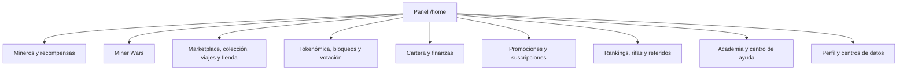

# Guía de ingeniería inversa y réplica local de GoMining

**Fecha de revisión:** 3 de noviembre de 2026
**Alcance:** aplicación web de `app.gomining.com`; uso local y privado.

**Estado vigente del checklist:** 70/77 cumplidas. En Android + Brave/Chrome + ngrok, MetaMask abrió la réplica en su navegador y el usuario reporta que llegó a firmar una transacción; revisa Actividad antes de volver a pagar, porque no tenemos hash ni confirmación. Trust Wallet abrió Inicio sin cargar la réplica. Se quitaron los enlaces automáticos de Trust en móvil y el botón ahora copia la URL para pegarla manualmente en Browser/DApps. Esa carga manual y el permiso de dirección siguen pendientes de prueba. Consulta la [lista punto por punto](./gomining-replica-checklist.md), la [auditoría móvil por wallet y los siete pendientes](./gomining-replica-mobile-wallet-audit-2026-11-03.md) y el [informe detallado anterior](./gomining-replica-audit-2026-11-02.md).

**Checklist manual de revisión:** [`gomining-replica-checklist.md`](./gomining-replica-checklist.md)

**Revisión documental de wallets móviles · 3-nov-2026:** MetaMask fue probado por el usuario hasta la aprobación, sin hash; Trust abrió Inicio y requiere probar Browser/DApps manual. La documentación confirma que Trust en navegador externo requiere WalletConnect v2 y Project ID. La revisión de código encontró además que el pago móvil de Phantom usa el endpoint deeplink que Phantom marca obsoleto, y que Coinbase ahora recomienda su Base Account SDK. Nada de esta revisión documental equivale a prueba en Android. Ver la [matriz móvil completa](./gomining-replica-mobile-wallet-audit-2026-11-03.md#investigación-documental-de-conexión-móvil-por-wallet--3-nov-2026).

## Addendum: simplificación del alcance MVP · 2026-11-02

- La navegación activa conserva Panel, Tokenómica, Finanzas, Promociones, Comunidad y Cuenta. Se quitaron los grupos Explorar y Academia; sus definiciones de ruta se mantienen en el catálogo para posible reutilización, pero la aplicación las bloquea.
- En ese corte inicial, los accesos directos a `/marketplace`, `/gominers-collection`, `/travel`, `/shop`, `/nft-sell`, `/launchpad`, `/finance/banking-cards`, `/finance/simple-earn`, `/raffles`, `/offers`, `/goboxes`, `/bonus-miner-v3`, `/leaderboard/nft-rarity`, `/leaderboard/solo-mining`, `/leaderboard/liquidity`, `/academy` y los artículos `/blog/how-to-*` regresaban a `/home`. `/buy` se bloqueaba de forma exacta y `/buy/GOMINING` permanecía en Tokenómica. **Ese estado de `/buy/GOMINING` quedó supersedido por la revalidación del 2-nov-2026 al final de esta guía.**
- La ruta de tarjetas Visa no tiene un componente bancario compartido con el MVP: su única ruta local es `/finance/banking-cards`, que se bloquea. La categoría `Cards` que aparece en el resumen de royalties de referidos describe una clase de recompensa y se conserva separada.
- El componente Marketplace, el catálogo ficticio y el diálogo del carrito quedan en el código como material dormido. No hay enlace al Mercado ni al carrito en la cabecera; Marketplace no se monta y las rutas con productos ficticios están desactivadas. La franja BTC/GOMINING de Inicio es una referencia visual de demo y no permite operar; su etiqueta dice `Referencia de precios · demo` (DOM REA `ev_e9d15833aa8278d710f21d6ff3666e9029f362d70defee3b4f391fb9259071e0`). La sección visible `Comprar GOMINING` explica que no hay cotización ni entrega verificable y no agrega productos a un carrito. La tarjeta Minero Bonus dentro de Mineros se quitó porque abría una ruta ya desactivada.
- En ese corte se conservaban Fondos instantáneos (`/finance/instant-funds`), Resumen de ganancias (`/finance/earn-summary`), Comprar GOMINING (`/buy/GOMINING`), Suscripciones y Trazabilidad/Data centers. El antiguo resumen de Simple Earn (`/finance/simple-earn/overview`) llevaba al Resumen de ganancias, que trata solo actividad local/minera y no presenta rendimiento de Simple Earn. Consulta el estado actual de rutas al final de la guía.
- `/operator-economics` redirige a `/mining-calculator` (`ev_d50bed8f8b489370a67b6dc8a692e82ecf0357a81644a358a8d8a97bc99e765a`). La calculadora permite elegir modelos de compra única del catálogo observado, unidades, eficiencia, disponibilidad, electricidad y mantenimiento. Consulta hashrate y recompensa reciente de Bitcoin y el precio BTC/USD desde la [API pública mempool.space](https://mempool.space/docs/api/rest); los valores se usan para una estimación teórica sin promesa de ingreso ni cobro. Los precios del catálogo son una captura fechada, no una cotización GoMining en vivo.

**Verificación REA a 390 × 844 px:** las sesiones temporales se cerraron con `terminated-owned-process`. Las rutas directas de `/marketplace` y varias secciones retiradas ya se documentaron en el seguimiento: evidencia `ev_4602f537d2fb66ac0ed613862905f2ca854695cfd04cecf6491967870630a6e9`, `ev_913ac6f67f76cd38ec4c2c2ef9a8905585ab23122b1a898be29ba28e3557cd7a`, `ev_a0e8c3f2b6b06b7919fc520b0a8174b5b6f52a11a0ffc026495cd0ee6205032a`, `ev_386e5c40662fa2c24e64a098557850d3ed9118d3cef696584b2d4b95d6400832`. En esta pasada, Rareza, Solo Mining, Ranking de liquidez, Academia, Bitcoin y minería, Configurar 2FA y Retirar recompensas de forma segura terminaron en Inicio (`ev_34d76f047ff41a19c70b5691e9a6b4c7b5df298f98ce7d10d10867100122ba6d`, `ev_b910ff20a8b5bde75836b2554777ea6132f2af0c5dbe8aff670fdf608eae9974`, `ev_58344757349e0f55496147a1752285fd7ebec4c2b56f90bfcc086bf3c2f5f6a1`, `ev_41da8c6e4454d88418cd8d6cd2c1d623e94a44007098ad5b38ed75344de85de1`, `ev_8ad12b6ac5352aef07310c2bdaaf8ce0350285eda939ae0a00a0328c4fda7868`, `ev_5e16947252cce95099222d288fdc8ce2596df497e1d7a3f438ee6568e9f827f6`, `ev_8a409544ee1b0482d8c08b2d4af7e6d61ca3d5c4e02dc14d1bc4edf621382430`). El menú abierto no muestra enlaces a las secciones retiradas (`ev_9ebb2d8d824d8ea34156b177959395d825d6bbc3400aabdc391467958dfef848`); Mineros no muestra tarjeta ni enlace de Minero Bonus (`ev_20eaf02065029d8b7cefca19a516338abc665264c5842a95169a7dd1c3a5f7cc`).

Se comprobó que continúan accesibles Fondos instantáneos, Resumen de ganancias, Comprar GOMINING, Suscripciones y Trazabilidad (`ev_73e370837d9486d444ba6e4be5e93ebe87529644be13580dc798f25044c3c302`, `ev_6625bb3f07e786260f743691918c5bbbc50b6be90d2545cb7aed2fd30cbe7a42`, `ev_7eaaad29496a5737b44edfe0c5e07280d6e2fe8192d3d643fe8c3f6e4ef8db7f`, `ev_1363a160370afed1cd80994b9c660ed22521e4ec220b45b1304095a7f40cb942`, `ev_58e0f03f1e3bcc209b0828a77221385b5e8b3463313a5542923b3a1ab148af2c`). El acceso legado de `/finance/simple-earn/overview` lleva al Resumen de ganancias (`ev_1913a7c8fbe29b4af7cef599f19c8a28d0c20949c6510e1e3c6c0baefdfcb360`). Las lecturas públicas de minería no confirman que haya equipos conectados a GoMining ni generan ingresos contables. Esta simplificación no modifica la configuración Firebase previamente documentada.

## Addendum: estado vigente de MetaMask móvil y Firebase · 2026-11-02

- **Corte vigente tras la prueba móvil reportada:** en un host ngrok, MetaMask y Trust abren la app sin mostrar el sitio ni un permiso. Para ngrok, el botón ofrece el enlace al navegador DApp; el URL conserva la ruta y los parámetros del checkout. Trust ofrece `open_url` y un enlace HTTPS alternativo. Si la página vuelve con `gmWalletConnect`, la réplica muestra instrucciones y espera un toque explícito en **Conectar**; nunca solicita permiso al montar la página. Conectar lee la dirección; el pago requiere otra aprobación. Estos cambios son revisión de código, no evidencia de teléfono.
- La advertencia de ngrok gratuito puede interrumpir la carga HTML dentro del DApp Browser. El usuario puede pulsar **Visit** si aparece; si la app muestra solo Inicio, debe abrir manualmente el navegador DApp y pegar el enlace de conexión copiado desde el checkout. La causa exacta del handoff fallido no se observó en el teléfono. [Límite oficial del intersticial gratuito](https://ngrok.com/docs/pricing-limits/free-plan-limits#removing-the-interstitial-page).
- REA completó una inspección estática del workspace actual: Evidence resumen `ev_fca8030ec6d03a3836d545034975e83381ea9e8e4cd6ea2c8386f14dce05161d`, padre `ev_73626ea5d1d69812686f2c3fce2e26dd11f76894f16a48ee09b245592ceae7e5`. La vista examinó 9,092 nodos, dejó 19,282 archivos fuera y conserva un grafo parcial; no ejecutó la aplicación. Un análisis posterior acotado de cuatro fuentes llegó al timeout del cliente de 450 s y no produjo Evidence, así que se retiene la pasada completada anterior.
- Tras la autorización Firebase CLI del usuario, `projects:list` y `firestore:databases:list` confirmaron acceso a `salad-miners` y su Firestore Native `(default)` en `nam5`, `freeTier: true`. La consola mostró Auth anónimo habilitado y las reglas Firestore restringidas. `src/firestoreDemoSync.ts` persiste solo snapshot demo privado y conserva respaldo local; no guarda direcciones de wallet ni recibos de cadena.
- `functions:list` devolvió un error genérico, por lo que se desconoce si hay Functions remotas. La configuración raíz no enlaza un codebase de Functions y no contiene backend financiero. Firebase exige Blaze/facturación vinculada para desplegar Cloud Functions ([documentación oficial](https://firebase.google.com/docs/functions/faq-and-troubleshooting)); no se cambió el plan ni se desplegó nada.
- En Computer Use, con viewport 390 × 844, el configurador local cargó su skeleton, mostró el formulario y abrió la revisión al pulsar **Continuar**. Es viewport de escritorio, no Android. El último ajuste de sesión espera hasta 1.5 s las señales del proveedor EVM después del toque explícito. `npm run build` pasó con TypeScript y Vite, 566 módulos; sigue el aviso no bloqueante de Rollup por el chunk Solana de 695.66 kB. El build y la inspección de la pantalla no prueban MetaMask/Trust en teléfono. No se abrió ninguna wallet, no hubo firma ni transferencia en esta revisión.

## Addendum: guardado demo Firebase, cierre y replay REA · 2026-11-01

- El cliente ya lee la configuración local ignorada por Git del proyecto de prueba y limita el snapshot a campos demo explícitos. No serializa direcciones de wallet ni recibos on-chain. Cuando la nube falla, mantiene una copia por navegador en `localStorage` y explica el estado en Inicio.
- Historial: en el primer intento, Auth anónimo respondió `auth/admin-restricted-operation`, antes de acceder a Firestore. Después de que el usuario autorizó Firebase CLI se habilitó Auth anónimo y se desplegaron las reglas restringidas al proyecto de prueba `salad-miners`. REST, SDK Web y la ida/vuelta de la interfaz pasaron: añadir USD 1 demo mostró `Demo guardado` y el importe reapareció tras recargar en una sesión aislada de `localhost:5173`. Esa prueba deja un snapshot demo en Firebase y no cambió la sesión principal `127.0.0.1`.
- REA reprodujo Inicio → abrir/cerrar configurador a 390 × 844 (evidencia `ev_168c4e79957698e3165b0a924710a07d9ef0f73b508ae2b24766ebad5ff33156`). En un recorrido separado añadió USD 42 demo, recargó la página, comprobó que el balance se conservó y canceló el checkout de Recargar (evidencia `ev_1eb8b5dd6686327d484f0759422794bfbbcf7d77893cf9df06034f7da4012081`). No se conectó una wallet ni se firmó una transacción.
- Registro histórico del 1-nov: los enlaces móviles de Solflare, Phantom, Coinbase, Trust Wallet y TronLink se comprobaron con user-agent simulado; UniSat no tiene uno. En aquel corte MetaMask usaba el deeplink nativo `metamask://connect/mwp`; el estado actual de Universal/App Link HTTPS está documentado en el addendum del 2-nov. Ninguna wallet se probó mediante un handoff real. Solflare y Phantom pueden abrir su navegador integrado mediante enlaces Browse; eso también requiere validación física. Sin encabezado especial, la URL temporal de ngrok mostró `ERR_NGROK_6024`; con el encabezado de omisión, la réplica respondió HTTP 200. Ninguna app wallet se probó con ese intersticial.
- REA/Linux rechazó el primer inventario porque `dist/index.html` cambió durante el build; al analizar solo fuentes estables, completó seis archivos sin errores de parseo (evidencia `ev_771f4fa0989d87672f5dbb2c5c68ebb3f3e1a6e5b060bb32f84fa0ea664f4c1e`). El grafo quedó parcial y 16 archivos inventariados no se seleccionaron. `rea doctor --client codex --json` detectó Node de Windows 22.17.1 por debajo del mínimo 22.23.4, pero la inscripción de Codex estaba alineada. La sesión REA/Linux 6.8.0 terminó sin análisis abierto ni limpieza pendiente; los límites de doctor y la recuperación se detallan en el [informe de seguimiento](./gomining-replica-audit-2026-11-01-seguimiento.md#errores-y-recuperación-de-rea).
- La compilación de producción pasa. Continúa el aviso de Rollup sobre el chunk de Solana de 695.91 kB.

La matriz detallada, los límites y los pasos pendientes están en [`gomining-replica-audit-2026-11-01-seguimiento.md`](./gomining-replica-audit-2026-11-01-seguimiento.md).

## Addendum: rediseño visual premium y móvil · 2026-10-31

- Se actualizó la capa visual local para combinar una presentación contenida y tipografía de sistema con los tonos violeta y las señales de minería de GoMining. El panel conserva marcas claras de demostración y no convierte animaciones en indicadores de operación real.
- Inicio ahora jerarquiza saldo, acciones rápidas, mercado de referencia, estado de granja y retos locales. El progreso se calcula únicamente con mineros y suscripciones demo que existen en la sesión; no entrega recompensas.
- Se añadieron movimiento ambiental suave, estados de foco visibles, transiciones, cargadores esqueléticos para lecturas de pool, y estilos de vacíos/errores. `prefers-reduced-motion` desactiva el movimiento. En pantallas pequeñas la navegación se compacta y las tarjetas se apilan con texto mayor y controles de toque más amplios.
- Tras la captura del modal que el usuario compartió, se corrigió la escala tipográfica global: etiquetas, texto secundario y contenido/tablas parten ahora de 14 px; botones y controles táctiles de 44–48 px; campos de entrada usan 16 px para evitar zoom automático en móvil. Los diálogos de compra y recarga ahora ocupan más ancho disponible y reorganizan sus paneles en móvil.
- Referencias de diseño consultadas: [Apple Design](https://developer.apple.com/design/), [Vercel Geist](https://vercel.com/geist/introduction) y las capturas de GoMining entregadas en esta conversación. Las referencias orientan jerarquía, legibilidad y tratamiento de estados; no se copian recursos propietarios.
- **REA en la iteración del rediseño (31-oct):** la captura controlada de `/home` público falló antes de devolver DOM, accesibilidad o captura visual y reportó `cleanup_incomplete`; ese resultado no se atribuyó a falta de cobertura del producto. En el seguimiento del 1-nov se completaron recorridos REA de la réplica local (interacciones citadas arriba) y análisis estático REA/Linux de seis fuentes. La captura histórica de GoMining público continúa sin obtenerse mediante REA; sus observaciones provienen de las capturas y la navegación autenticada ya documentadas.
- La captura visual local tampoco pudo completarse en esta iteración: Computer Use detuvo el acceso porque no pudo determinar con suficiente confianza la URL activa de Brave. La ruta `/home` local sí respondió HTTP 200; su diseño en pantalla queda pendiente de comprobación visual.

Archivos de diseño afectados: `src/App.tsx` y `src/styles.css`. La compilación pasa y `/home` responde HTTP 200; la revisión visual final de tamaños y quiebres móviles sigue pendiente porque Computer Use no pudo determinar con suficiente confianza la URL activa de Brave.

## Addendum: conexión de wallet móvil y auditoría de cierre · 2026-11-01

- Registro histórico del 1-nov, supersedido por la configuración del 2-nov: MetaMask usaba el deeplink nativo de Connect/MWP en móviles. La conexión no envía fondos; el checkout pide una aprobación aparte. Solflare y Phantom conservan enlaces a sus navegadores dApp; Coinbase, Trust y TronLink usan sus enlaces correspondientes. No se emplea WalletConnect Project ID ni se guarda una clave de integración.
- Se verificaron la ruta de código, la conservación de la selección del checkout y una compilación posterior al ajuste. REA analizó estáticamente los cinco módulos de sesión, enlace, checkout y aplicación; eso no prueba el handoff real. Falta probar que el teléfono abra MetaMask y regrese a un dominio HTTPS accesible, además de conexión y rechazo. UniSat sigue sin enlace móvil directo y requiere su proveedor en el navegador.
- Si la wallet devuelve un rechazo explícito, el checkout se cierra y muestra que no hubo pago. Si queda una solicitud pendiente de conexión o pago, X, Cancelar y Escape cierran la pantalla web y avisan que la wallet puede seguir mostrando la solicitud; la página no puede cancelar la ventana de aprobación de la app.
- El encabezado actual diferencia `Saldo demo` de `Conectar wallet`; en `App.tsx` solo se renderiza un botón de conexión y no hay botones de notificación. Esta revisión no pudo capturar la vista en pantalla por el bloqueo del navegador de Computer Use.
- Se añadió `https://solana-rpc.publicnode.com` como tercer RPC de lectura para obtener blockhash, después de que ambos hosts públicos de Solana respondieran HTTP 403 desde el equipo de revisión. La respuesta de PublicNode fue HTTP 200. Es un RPC compartido sin garantía; no basta para sostener pagos en producción. Ninguna solicitud de transacción se probó.
- REA completó análisis estático de 8 fuentes (evidencia de resumen `ev_c1d0d62ff0981e83d8c827e54303d2cb36626a5bb2677ca5461aa324e6fb28e2`, digest `43c17d1bc7cbb4d0b898c72e5d89a78539172632c63977ed249ff7efcf6974a3`). La captura interactiva de REA terminó `cleanup_incomplete`; `rea doctor` informó registro sano, pero no liberación de la sesión. No se repitió la captura. Computer Use se detuvo antes de actuar porque no pudo determinar la URL activa de Brave.
- Se protegió el estado demo frente a la carrera entre una mutación local y una lectura Firebase tardía. Auth anónimo y las reglas ya se desplegaron en el proyecto de prueba; la app mostró `Demo guardado` después de recargar. Si Firebase falla, se usa el respaldo local por navegador.

Detalle de estados y pruebas: [`gomining-replica-audit-2026-11-01.md`](./gomining-replica-audit-2026-11-01.md), addendum móvil; matriz navegable: [`gomining-replica-checklist.md`](./gomining-replica-checklist.md).

## Estado

La réplica contiene navegación local para las rutas propias activas del mapa de abajo; las secciones fuera del MVP están registradas como rutas detectadas, pero se desactivan y redirigen a Inicio. Inicio sigue la barra superior, el panel de saldo, las acciones rápidas, las tarjetas de beneficios y la cuadrícula promocional de la captura autenticada. Las compras de minero, suscripciones, referidos, depósitos y retiros tienen recorridos locales de demostración. El estado demo se conserva en `localStorage` por navegador y se sincroniza con Firestore mediante una cuenta anónima en el proyecto de prueba `salad-miners`; el servicio, el SDK Web y la vuelta UI de añadir USD 1 demo y restaurarlo tras recargar se comprobaron en una sesión aislada. La vista de conexión prioriza móvil, detección de cuenta/red, lectura de direcciones y controles táctiles amplios. MetaMask Connect se usa en HTTPS móvil fuera del host ngrok gratuito; en ngrok se abre la réplica en el navegador DApp y se solicita permiso al detectar el provider. La ruta real de app, la autorización/rechazo y el regreso siguen pendientes de prueba física.

No hay integración de cuenta de GoMining en vivo. La pestaña autenticada permitió leer los precios visibles del configurador, pero no se confirmó una interfaz autenticada que `localhost` pueda consultar sin trasladar cookies o tokens. El adaptador de GoMining conserva una lista permitida vacía. El checkout usa el precio de catálogo observado y vuelve a cotizar la moneda de pago; no sincroniza cambios futuros en el catálogo ni confirma pedidos o entrega productos. La transferencia solo ocurre tras la aprobación del usuario en su wallet.

## Método y evidencia

- Se usó la pestaña autenticada del navegador integrado que proporcionó el usuario. La inspección de esta iteración se hizo en modo de lectura, sin completar compras ni aprobar transacciones.
- La inspección de solo lectura confirmó el panel `/home`, la colección `/nft-miners`, la cartera `/finance/wallets/virtual`, `Viajes` (`/travel`), `Mercancía` (`/shop`) y la vista de bloqueo `/lock/ve-my-lock`.
- La ruta `/nft-rewards` redirigió a `/nft-rewards/solo`; desde allí se observaron las pestañas `Minería` y `Miner Wars` (`/nft-rewards/pool`), además de los controles de ajustes de recompensas, descuento de mantenimiento y tasa histórica de BTC.
- La sesión autenticada confirmó `/subscriptions?subscriptionType=platinum`, `/nft-referral` y `/nft-referral/rewards`. La ruta de referidos ofrece Royalties y Mis amigos; la pantalla de recompensas muestra categorías Electricity, Mining, Cards, Simple Earn y Miner Wars. No se copiaron cantidades ni IDs personales.
- En `/nft-miners` se confirmaron los controles Filtros, Aplicar y Limpiar y un acceso a tareas de Minero bonus. La ruta con `?nftAction=create` se conserva como entrada al diálogo local de creación.
- Una segunda lectura de `/marketplace` confirmó la sección `mineros`, la pestaña `Ofertas`, el orden `Nuevos` y filtros para disponibilidad, precio, tipo de precio, eficiencia energética, energía, colecciones y atributos del minero. No se copiaron anuncios ni valores.
- El menú autenticado también expone `/miner-wars` como acceso propio. La pantalla no se inspeccionó en esta sesión.
- La apertura directa de `/finance/simple-earn` terminó en `/`; el destino se conserva como ruta detectada, con pantalla por confirmar.
- En Mi bloqueo se observaron las pestañas Tokenómica, Mi bloqueo y Votación, la tabla `Fecha`, `Bloqueado`, `Fin`, `Votos`, `Recompensas`, `Dirección`, `Estado`, un estado sin datos y el botón `Obtener votos`. No se avanzó el asistente de gobernanza.
- La portada mostró enlaces a las rutas propias enumeradas abajo. Varios enlaces se intentaron abrir directamente, pero no llegaron a un título accesible dentro del tiempo de observación; se registran como descubiertos por navegación, con contenido por confirmar.
- REA capturó un perfil temporal sin sesión. La navegación pública redirigió a `/auth` (evidencia `ev_090d73cc864b95e036e873e45d9832cc1eff6f5d7c34e5e11d2ac1633f79ad23`). La página expuso scripts servidos bajo `edge-media.gomining.com/.../client-next/`. Ese perfil no tenía acceso a la cuenta y no se usó para inferir estados autenticados.
- Para ampliar las compras se intentó otra captura controlada con `rea_linux` en `/marketplace`. REA devolvió `execution_failure` no reintentable; `rea doctor` señaló que el registro de Codex está alineado, pero no confirmó la identidad del servidor activo. Una consulta pasiva a `http://127.0.0.1:9222`, limitada al origen de GoMining, devolvió `endpoint_unreachable`. No se obtuvo evidencia REA de módulos, solicitudes ni precios de la sesión autenticada con esos intentos.
- La sesión autenticada se inspeccionó con el navegador integrado; no se pudo conectar REA a esa pestaña mediante CDP. Por tanto, los endpoints, módulos autenticados y respuestas de red siguen sin confirmar.
- En esta iteración, `rea_linux.binary_session` confirmó que el servidor REA seguía disponible, pero no reportó un objetivo de navegador abierto. El navegador integrado no expuso un endpoint CDP local. No se repitió la captura controlada que ya había terminado en `execution_failure`; la comprobación visual y de navegación se hizo en la pestaña autenticada y en la réplica local.
- REA/Linux no pudo adjuntarse a la pestaña autenticada porque el endpoint CDP local devolvió `provider_unavailable` / `endpoint_unreachable`; no se atribuyen a REA los siguientes hallazgos. Con el navegador integrado se abrió `/marketplace`, se pulsó `Crear minero` y se inspeccionó el configurador de `/nft-miners?modal=paywall-create`. Los importes del catálogo de compra única se confirmaron en el total del checkout: 1.12 TH = 272.22 MXN; 8.33 TH = 1,878.43 MXN; 21.05 TH = 4,696.35 MXN; 42.44 TH = 9,392.89 MXN. El precio personalizado se confirmó en 20 niveles discretos entre 1 y 5,000 TH. Los precios mensuales observados fueron 3.82 TH hasta por $39.99 USD/mes, 9.61 TH por $99.99, 24.20 TH por $249.99 y 48.66 TH por $499.99. Todas las opciones indicaron 15 W/TH. No se pulsó `Ir al pago` ni se inició una transacción. Los importes son una captura del catálogo a la hora indicada, no un feed continuo.
- El configurador mostró “A pagar hoy” en MXN para la compra única y USD para los planes mensuales. La tarjeta de 1.12 TH mostraba $272.21, mientras el total tras seleccionarla fue 272.22 MXN; el checkout local conserva el total final observado. El tope mostrado en la tarjeta personalizada fue 1,028,898.46, y al seleccionar 5,000 TH el total fue 1,028,898.47 MXN; se usa el total seleccionado y se conserva la discrepancia de un centavo como detalle observado.
- No se copiaron saldos, identificadores de cuenta, direcciones ni tokens al proyecto o a esta guía. La captura del navegador incluye datos personales que se omitieron.
- REA analizó `@viaprotocol/web3-wallets` desde el árbol clonado `rea-via-web3-wallets-20261030` (evidencia `ev_a10ee0e0ca822cfcc4a631468d84f3d1058b6fede8bd028555e41feae8c964f2`; resumen `ev_3a474f0f261e791164fd6cfa0fc12cda5efce917e83717e2671b37fdf3589068`; 532/532 elementos de inventario). La configuración de Solana de ese proyecto enumera Phantom; no contiene un conector Solflare. El proveedor incluye firma/envío y la implementación persiste detalles de cartera en `localStorage`, por lo que se usó como referencia de protocolos y no se incorporó como dependencia.
- REA Linux revisó también el árbol de [Via web3-wallets](https://github.com/viaprotocol/web3-wallets) (evidencia `ev_b1cf1031559869341397d7da1c8496d1dfd7c1ab50fed11429ef1c6707f5251c`; resumen `ev_d1e7639a64c943f0f3408aa4eca4d6f15087a84f3701a47fdc4aeb768f4347dc`). Se analizaron 6 de 6 archivos fuente seleccionados (`src/constants.ts`, `src/context/WalletProvider.tsx`, `src/utils/cosmos.ts`, `src/utils/btc.ts` y los dos archivos `src/provider/xDeFi/`), dentro de un inventario de 170 elementos; quedaron 49 archivos sin seleccionar. El análisis estático confirma referencias de implementación para MetaMask, WalletConnect, Coinbase, Phantom, Keplr, xDeFi y Safe; Astar está incluido en las redes EVM y no como cadena Cosmos. La cobertura del grafo es parcial y permanecen 1.946 incógnitas; REA no ejecutó esos módulos ni confirmó el comportamiento actual de extensiones, así que esta evidencia orienta la integración pero no certifica conexiones en tiempo de ejecución.
- REA Linux revisó `src/networks.ts` del repositorio Via en el commit `44e90aa26487bf7625da771a2f2eaf3e4a05eb98` (evidencia `ev_9de7b394aa61978ad1d6f021bfcf2c945aee47bc859ec132c61f6b86e01c27d6`; recibo del analizador `ev_17cb261c6a1f20318d66f41258c73c21087889a4555c9bdc9e013d19ae05e382`). SHA-256 del archivo: `6405a1c05d02a986ad75bd6c63f50650167050de919f5e07ac24969ba808885e`. El análisis estático identificó `rpcMapping`, `getNetworkById`, `estimateGas` y `supportedNetworkIds`; cubrió un archivo, dejó 54 sin seleccionar, marcó grafo parcial y 686 incógnitas semánticas; no ejecutó el código. Confirma configuración de redes/RPC para la integración Via, pero no añade por sí solo una necesidad a la conexión de solo lectura de direcciones.
- REA Linux analizó el repositorio oficial de `@solflare-wallet/sdk` en el commit `69a82c5d064f9e1c06bc4ea7848ae3d09021c3d3` (evidencia padre `ev_d1667cb55b3b61d46b303c4c10eeb60be8c6b76a8662b130c02d6daf95b8c5af`; vista resumen `ev_4835052a3c22e62f39847684c4ceef7ca2be6153489d3b0c03c3261701d6d548`; SHA-256 del árbol `10ca16dc5494e6bc26865f12ef012a8a86eabecd37b141c2094d4c07cfd170c9`). REA examinó 111/111 elementos de esa vista, 17 archivos relevantes y 12 fuentes JavaScript. No ejecutó el código. La cobertura semántica permanece parcial, con 1056 incógnitas estáticas, así que la evidencia no prueba comportamiento de ejecución.
- El SDK oficial documenta `connect()` y `publicKey` para Solflare web, extensión y móvil ([guía de integración](https://docs.solflare.com/solflare/technical/integrate-solflare/solflare-wallet-sdk)). El checkout usa su método de firma/envío solo después de que el usuario pulsa Pagar; la solicitud aparece en la wallet para su aprobación. El flujo manual de deep links requiere claves de cifrado, `redirect_link` y gestión de sesión ([método Connect](https://docs.solflare.com/solflare/technical/deeplinks/provider-methods/connect)); se eligió el SDK oficial para la conexión del navegador.
- En la revisión visual de carteras se consultaron [Apple Design](https://developer.apple.com/design/) y [Geist Typography](https://vercel.com/geist/typography): jerarquía clara, contraste alto, texto de lectura y controles de toque amplios. REA Linux no produjo captura de esas páginas en esta iteración: `capture_browser_scenario` terminó con `execution_failure` y `cleanup_incomplete` antes de devolver contenido; no se atribuyen hallazgos visuales a esa llamada.

## Mapa de navegación observado



## Rutas de primera parte

“Vista observada” indica que se confirmó contenido visible en la sesión. “Enlace observado” indica que la ruta apareció en la navegación del sitio; no afirma que toda su pantalla quedara inspeccionada.

| Área | Ruta | Evidencia |
|---|---|---|
| Panel | `/home` | Vista observada |
| Panel | `/home?modal=paywall-create` | Acceso de creación confirmado por la navegación; el configurador local ofrece modo de compra única o mensual y revisión antes de simular |
| Panel | `/nft-miners` | Vista observada; contiene filtros y acceso a crear |
| Panel | `/nft-miners?nftAction=create` | Variante observada; abre el diálogo local de creación simulada |
| Panel | `/nft-rewards` | Redirige a `/nft-rewards/solo` |
| Panel | `/nft-rewards/solo` | Vista observada parcialmente: Minería, ajustes y tasa histórica |
| Panel | `/nft-rewards/pool` | Vista observada parcialmente: pestaña Miner Wars |
| Comunidad | `/miner-wars` | Enlace observado; pantalla por confirmar |
| Explorar | `/marketplace` | Filtros y controles observados; anuncios y resultados por confirmar |
| Explorar | `/gominers-collection` | Enlace observado; pantalla por confirmar |
| Explorar | `/travel` | Vista observada: “Viajes” |
| Explorar | `/shop` | Vista observada: “Mercancía”, “Filtros” |
| Explorar | `/nft-sell` | Enlace observado |
| Explorar | `/launchpad` | Enlace observado |
| Tokenómica | `/buy/GOMINING` | Enlace observado |
| Tokenómica | `/liquidity` | Enlace observado |
| Tokenómica | `/ve-tokenomics` | Enlace observado |
| Tokenómica | `/lock/ve-my-lock` | Vista observada; se omiten valores de la cuenta |
| Tokenómica | `/lock/ve-voting` | Enlace observado; pantalla por confirmar |
| Tokenómica | `/gmt-wallets` | Enlace observado |
| Finanzas | `/finance/wallets/virtual` | Vista observada; datos personales omitidos |
| Finanzas | `/finance/wallets/virtual/GOMINING/transactions` | Enlace observado |
| Finanzas | `/finance/banking-cards` | Enlace observado |
| Finanzas | `/finance/instant-funds` | Enlace observado |
| Finanzas | `/finance/instant-funds?source=wallet_button` | Variante observada en navegación |
| Finanzas | `/finance/instant-funds?source=assets_button` | Variante observada en la cartera |
| Finanzas | `/finance/simple-earn` | Enlace observado; apertura directa terminó en `/` |
| Finanzas | `/finance/simple-earn/overview` | Enlace observado |
| Finanzas | `/buy` | Enlace observado |
| Finanzas | `/deposit` | Enlace observado |
| Finanzas | `/withdraw/GOMINING` | Enlace observado |
| Beneficios | `/promos` | Enlace observado |
| Beneficios | `/raffles` | Enlace observado |
| Beneficios | `/offers` | Enlace observado |
| Beneficios | `/goboxes` | Enlace observado |
| Beneficios | `/bonus-miner-v3` | Enlace observado |
| Beneficios | `/subscriptions?subscriptionType=platinum` | Vista observada: Platinum+ mensual; condiciones propias del usuario por confirmar |
| Comunidad | `/leaderboard/nft` | Enlace observado |
| Comunidad | `/leaderboard/nft-rarity` | Enlace observado |
| Comunidad | `/leaderboard/solo-mining` | Intersticial de migración; no se avanzó |
| Comunidad | `/leaderboard/liquidity` | Enlace observado |
| Comunidad | `/raffle/036a5b85-4b51-471b-b639-2ffb9afba920` | Enlace observado |
| Comunidad | `/nft-referral` | Vista observada: royalties y actividad |
| Comunidad | `/nft-referral/rewards` | Vista observada: categorías y tabla de recompensas |
| Comunidad | `/nft-referral/friends` | Enlace observado; pantalla local parcial sin datos |
| Comunidad | `/data-centers` | Intersticial de migración; no se avanzó |
| Comunidad | `/data-centers/pool` | Cotización pública Kryptex PRL y enlace a su perfil de workers |
| Comunidad | `/data-centers/operations` | Historial público de pagos de Kryptex con enlaces por hash a transacciones Pearl |
| Comunidad | `/data-centers/miners` | Workers locales demo; no están provisionados en la pool |
| Comunidad | `/data-centers/farms` | Sin inventario verificable de granjas |
| Cuenta | `/profile` | Enlace observado |
| Academia | `/academy` | Enlace observado; parte de la formación enlaza fuera de la aplicación |
| Academia | `/academy/courses/bitcoin-and-mining` | Enlace observado |
| Academia | `/academy/courses/blockchain-and-crypto-course` | Enlace observado |
| Academia | `/academy/courses/gomining-basics-course` | Enlace observado |
| Ayuda | `/blog/how-to-set-up-2fa` | Enlace observado |
| Ayuda | `/blog/how-to-withdraw-rewards-safely` | Enlace observado |
| Ayuda | artículo “How Miner Wars…” | El vínculo apareció truncado; el slug completo no se registró |

Las páginas enlazadas a tiendas móviles, comunidades, preguntas frecuentes y otros servicios se consideran límites de salida. No se replica el servicio externo.

## Implementación local

- **Stack:** React, TypeScript y Vite. No requiere una capa de servidor porque no se habilitó acceso a lecturas autenticadas.
- **Rutas:** `src/catalog.ts` mantiene el inventario y la navegación. Vite sirve el punto de entrada para URLs directas y React Router dibuja el contenido local.
- **Adaptador de lectura:** `src/readAdapter.ts` exige una coincidencia exacta de origen y ruta en una lista permitida. La lista está vacía hasta confirmar solicitudes `GET` de lectura. Si se habilita una ruta en el futuro, la solicitud usa `credentials: omit` y `cache: no-store`.
- **Acciones:** recargar, retirar, bloquear, votar y vender conservan sus simulaciones locales. Crear minero abre el checkout desde Inicio con los importes observados en el configurador autenticado; la wallet conectada en el encabezado se reutiliza y, si aún no existe conexión, el checkout permite conectarla. Recargar abre el mismo checkout. Una transferencia no acredita saldo ni activa un producto sin verificación de depósitos y asociación de orden. Los pagos mensuales cubren un periodo de 30 días y no crean una renovación automática. El plan anual de Platinum+ está deshabilitado por instrucción del usuario. El 10% directo y el Unilevel siguen siendo simulaciones locales.
- **Carteras directas:** la pantalla `/gmt-wallets` solo conecta y muestra dirección/estado. El checkout aparece desde la compra y Recargar, y reutiliza la conexión existente. Ofrece Solflare y Phantom en Solana, MetaMask/Coinbase/Trust Wallet mediante EIP-1193 en EVM, TronLink en TRON y UniSat en Bitcoin. No requiere WalletConnect, Project ID, Rango, Safe, Keplr ni xDeFi. La wallet debe estar instalada y anunciar un proveedor compatible.
- **Recepción y pagos:** el checkout usa las direcciones entregadas por el operador para BNB, BTC, ETH, TRX, POL o USDT SPL. Los cinco activos nativos usan cotización Binance Spot consultada en memoria y vencida a los 30 segundos. Cuando el catálogo está en MXN, consulta una tasa diaria USD/MXN de Frankfurter para convertirlo; el tipo de cambio no es intradía y se muestra con su fecha. Para redes Bridge se muestra una estimación de tarifa del 1%; la wallet muestra el gas de origen. La transferencia ocurre solo tras pulsar Pagar y aprobarla en la wallet. Un hash no equivale a confirmación Bridge, asociación a pedido o activación de producto.
- **Permisos y recibos:** no se solicita frase semilla ni clave privada. Las direcciones no se guardan en almacenamiento del sitio; los recibos de pago quedan en memoria durante la pestaña. La conexión lee la dirección; enviar invoca el proveedor para firmar y transmitir la transferencia que el usuario aprueba. No se ejecutó ninguna transacción durante la validación.
- **Dependencias y validación:** `@solflare-wallet/sdk` cubre Solflare; `@solana/web3.js` construye la transferencia USDT SPL con instrucciones ATA/TransferChecked codificadas localmente; `buffer` se inicializa antes de web3.js para el entorno navegador. La pantalla de carteras ya no incluye QR ni panel de recepción. La tabla de precios local corresponde a los importes observados el 31 de octubre de 2026 y no se actualiza desde GoMining. El estado de build/auditoría se anota tras la validación de esta iteración.
- **Precios de compra:** `src/minerCatalog.ts` contiene los cuatro totales de compra única, los cuatro planes mensuales y los 20 totales personalizados observados en el catálogo de GoMining el 31 de octubre de 2026. La moneda se conserva: MXN para compra única y USD para planes mensuales. Son importes reales observados en la cuenta en esa fecha; no hay sincronización automática futura con GoMining. La cotización del activo de pago sí se actualiza al abrir el checkout y antes de enviar.
- **Confirmación de compra:** el checkout de wallet no es una simulación: tras revisar la cotización, pulsar Pagar y aprobar en la wallet puede enviar una transferencia real a la dirección configurada. El recibo confirma que el proveedor devolvió un hash de origen; no demuestra por sí solo confirmación final, conversión Bridge, asociación de orden, reserva, emisión de NFT ni activación/entrega del producto. Las alternativas de saldo demo siguen siendo simulaciones separadas.
- **Datos:** los saldos e identificadores de cuenta se muestran como marcadores vacíos. No hay datos reales de cuenta en los archivos.
- **Estados sin datos:** las tablas y colecciones explican que no hay datos conectados. Las pantallas con contenido no observado declaran su cobertura parcial.
- **Servicios externos:** se muestran como puntos de salida informativos, sin imitar operaciones de terceros.

## Análisis del home y viabilidad de las funciones solicitadas

### Diseño observado de `/home`

La vista autenticada observada usa un lienzo azul marino casi negro, paneles redondeados, acentos violetas y una cuadrícula de dos columnas en el viewport estrecho. La jerarquía visible es:

1. Saldo destacado con acciones rápidas para crear minero, recargar, Simple Earn y referidos.
2. Cinta compacta de mercado para BTC y GOMINING.
3. Tarjetas promocionales para Simple Earn, recompensas bonus, minero bonus, nivel VIP, Platinum+ y cashback.
4. Indicador de avance “Siga explorando” y tarjetas horizontales para crear un minero y obtener una tarjeta.
5. Enlace de procedencia de recompensas que menciona Antpool y SpiderPool, más indicadores agregados de minería y promociones.

Las cifras de saldo de la cuenta original no se copiaron. La réplica local sigue esta jerarquía, presenta el saldo con formato `$0.00`, usa una referencia BTC y distingue los datos de pool públicos de Kryptex PRL de los datos demo de la cuenta local. No hay conexión de cuenta GoMining. Añade módulos para pool, suscripción, referidos, cartera, economía y preventa con estados de propuesta o datos desconectados.

La inspección autenticada se realizó con el navegador integrado en modo lectura, no mediante REA. No había un puerto CDP local en el equipo para adjuntar REA Linux a esa pestaña. Por eso no se atribuyen a REA el DOM autenticado, los módulos JavaScript de GoMining ni sus solicitudes de red; esa evidencia sigue pendiente de un perfil REA con CDP autorizado.

### Suscripciones mensuales/anuales

La página Platinum+ de GoMining documenta el precio mensual de $29.99 por ciclo de 30 días. No se confirmó un precio anual ni se observaron allí los beneficios propuestos por el usuario de “1% de potencia de minado” y “sin cola de retiros diarios”; estos deben presentarse como reglas propias de la nueva plataforma, no como condiciones copiadas de GoMining. En esta sesión, la ruta de creación mostró un aviso de migración de datos; no se pulsó `Skip` ni `Migrate data`.

En la simulación local aún se puede ensayar la regla de 1% sobre TH activo y ocultar la cola en retiros demo. El checkout de $29.99 envía fondos al destino seleccionado, pero no activa Platinum+, la suscripción local ni esos beneficios. El plan anual, incluida su simulación, está deshabilitado por indicación del usuario hasta confirmar su importe.

### Referidos y Unilevel

La interfaz de referidos muestra regalías de minería y Simple Earn como conceptos separados. La documentación oficial actualizada de GoMining describe 5% en compras/actualizaciones de mineros y 10% de las recompensas de Simple Earn; la página comercial presenta niveles VIP con regalía de minería que puede subir hasta 15%. Así, el 10% de la propuesta del usuario para recompensas de minería sería una regla nueva de este producto, no una paridad con el 10% de Simple Earn de GoMining. Ver [programa de referidos oficial](https://docs.gomining.com/assets/product/promos/referral-program) y [página pública de referidos](https://gomining.com/referral-program).

La réplica calcula el 10% directo sobre el pago final al minero, no sobre el ingreso bruto de pool. El valor predeterminado reserva un fondo total Unilevel de 20% del pago final: 10% directo y 10% para niveles superiores. Con una base disponible de 100 USD después de costos, el escenario da aproximadamente 83.33 USD al minero y 16.67 USD al fondo; el directo es aproximadamente 8.33 USD. Si no se indica una línea elegible, la parte superior queda retenida. Permite configurar hasta diez niveles, sus pesos relativos y la profundidad elegible. Los pesos `[16,15,14,11,10,9,8,7,6,4]` se recuperaron estáticamente con REA del ejemplo local `unilevel-ejemplo/1nvezt`; sumaban 100% en ese sistema, pero aquí solo sirven como pesos de escenario y no se copió su regla comercial. Este cálculo es una propuesta configurable; su viabilidad económica no está demostrada porque faltan margen neto real, tasas adicionales, topes, moneda, momento de liquidación, anulaciones y controles antifraude.

Recomendación del modelo: acreditar regalías solo al liquidarse una recompensa válida; separar compra de TH, mejora, electricidad y recompensas; registrar para cada línea la operación origen, el nivel, la tasa y el estado `pendiente/liquidada/revertida`; y garantizar que la suma de niveles no exceda el margen disponible después de mantenimiento, electricidad, pool y retiros.

### Trazabilidad de pool, mineros y granjas

La home enlaza recompensas con Antpool y SpiderPool, pero `/data-centers` mostró un intersticial de migración y no se avanzó. No se encontró un mapeo real entre workers y granjas. La réplica consulta la API pública de ingresos diarios de Kryptex para PRL con un hashrate de referencia editable y un endpoint local GET de lista permitida. Esta cifra es una estimación pública, no el ingreso de la cuenta o una liquidación. También enlaza el perfil público de pool y el explorador Pearl; no interpreta sus transacciones como producción de mineros individuales. Los workers creados por compra demo son locales y se muestran desconectados del pool. Granjas y telemetría individual siguen sin fuente verificable.

La cadena puede mostrar pagos y confirmaciones de una dirección pública; no permite inferir por sí sola qué minero o granja produjo el hashrate. Para mostrar estado en tiempo real se necesita telemetría autenticada de pool/worker y un inventario que relacione IDs internos seudonimizados con pool, worker, centro de datos y medidor de energía. Antpool publica una guía de API que contempla curvas de hashrate por worker; SpiderPool publica documentación de API. En esta inspección no se verificaron credenciales, permisos, límites ni endpoints concretos, así que no se conectaron. Referencias: [AntPool API Guide](https://v3.antpool.com/userApiGuide), [SpiderPool API](https://support.spiderpool.com/spiderpool-api).

Esquema mínimo del módulo real: hashrate efectiva y última share aceptada; shares aceptadas/rechazadas; última actividad; estado calculado con un umbral de inactividad; sitio/centro de datos; kW y temperatura solo si existe sensor verificable; eventos de pago con hash de transacción y confirmaciones. La vista local enseña ejemplos de esos campos, no métricas verificadas. Los pagos de blockchain deben etiquetarse como confirmados, mientras que la telemetría puede ser reciente pero todavía no liquidada.

### Modelo de ingresos y costos de operación

La pantalla `/operator-economics` consulta el ingreso diario estimado de Kryptex PRL y permite ingresar costos de potencia `TH`, eficiencia `W/TH`, tarifa eléctrica `$ / kWh`, mantenimiento, infraestructura, retiros e ingresos mensuales de suscripciones/mantenimiento. No precarga precios de electricidad ni mantenimiento. Para potencia `TH`, eficiencia `W/TH`, tarifa eléctrica `$ / kWh` y período `días`:

```text
kWh = TH × (W/TH) ÷ 1000 × 24 × días
costo eléctrico = kWh × tarifa eléctrica
costo de mantenimiento = TH × tarifa de mantenimiento ($/TH/día) × días
ingreso de minería = recompensa minera efectivamente liquidada
neto estimado = suscripciones reconocidas + mantenimiento cobrado + ingreso del pool
              − electricidad − mantenimiento − pago al minero − reserva Unilevel
              − comisión de retiro − soporte/infraestructura − reembolsos
```

La potencia efectiva del escenario incorpora el 1% de beneficio de suscripción (editable entre 0 y 100% para estudiar sensibilidad), y tanto el ingreso PRL como los costos de electricidad/mantenimiento se calculan sobre esa potencia. Los cobros anuales deben reconocerse por período de servicio, no como margen de un único mes. La cola sin costo adicional y una comisión Unilevel deben figurar como obligaciones/costos cuando corresponda. No se puede calcular una rentabilidad confirmada sin tarifa del proveedor, eficiencia, mantenimiento, comisión de pool, rendimiento minero, precio de suscripción, volumen de retiros y tasas de referido.

La réplica ofrece `/operator-economics`: una calculadora en memoria que reconoce ingresos anuales distribuidos en 12 meses y compara ingreso bruto estimado de pool, pagos al cliente y reserva Unilevel. El plan anual de suscripción está deshabilitado en checkout; el campo anual de la calculadora es solo escenario financiero y no lo habilita. El margen se mantiene pendiente hasta ingresar electricidad y mantenimiento, y sigue siendo incompleto si faltan impuestos o costos reales de equipo. La estimación del pool cambia con la API y no equivale a una ganancia efectivamente liquidada.

### Pagos y cartera Solflare

La pantalla Carteras conecta directamente Solflare y Phantom en Solana, MetaMask/Coinbase Wallet/Trust Wallet en EVM, TronLink en TRON y UniSat en Bitcoin. No usa WalletConnect ni Project ID. Conectar lee la dirección pública; **Pagar** construye la transferencia y abre la wallet para que la persona revise red, destino, importe y gas y la firme. MetaMask valida chainId 1, 56 o 137; TronLink valida Mainnet (`0x2b6653dc`); UniSat exige Bitcoin Mainnet.

El checkout admite BNB, BTC, ETH, TRX y POL nativos hacia las direcciones de depósito proporcionadas para BNB Chain, Bitcoin, Ethereum, TRON y Polygon. Binance Spot ofrece las cotizaciones públicas `BNBUSDT`, `BTCUSDT`, `ETHUSDT`, `TRXUSDT` y `POLUSDT`; el checkout las solicita al abrirse y vuelve a cotizar antes de pedir la firma. La cotización local vence a los 30 segundos. La prueba de consulta del 31 de octubre de 2026 confirmó que las cinco rutas respondían; eso no garantiza disponibilidad futura. La guía de Binance documenta sus endpoints públicos de datos de mercado sin clave: [market data only](https://github.com/binance/binance-spot-api-docs/blob/master/faqs/market_data_only.md).

Para las cuatro cadenas Bridge, el cálculo añade 1% como estimación de tarifa y muestra el neto USD estimado. La ruta y el importe final dependen del activo, mínimos, liquidez y slippage; Solflare indica hasta 5% de slippage y cobra el gas de origen aparte. La wallet calcula y presenta el gas final antes de aprobar. En Solana se transfiere **solo USDT SPL** directamente a la dirección proporcionada; no se ofrece SOL ni otros SPL porque llegarían como esos activos y no como USDT. La cuenta que envía puede necesitar SOL para gas y para crear la cuenta de token asociada receptora. Fuentes: [FAQ y tarifas de Bridge](https://help.solflare.com/en/articles/17692854-bridge-faq), [redes, activos y comisiones](https://help.solflare.com/en/articles/17692897-bridge-supported-chains-tokens-and-fees), [TransferChecked de Solana](https://github.com/solana-program/token/blob/main/interface/src/instruction.rs).

Las direcciones permanecen en `src/paymentDestinations.ts`. No se verificó dentro de Solflare que cada dirección esté asignada a la red/token indicado ni que la wallet de Solana tenga el token account requerido; deben confirmarse antes de recibir pagos. La réplica no sigue confirmaciones ni el resultado final de Bridge. El recibo conserva en memoria el producto, importe cotizado, remitente, destino, hash, estado de origen enviado y estado Bridge pendiente; también aparece en Transacciones mientras siga abierta la sesión. No registra el pago en GoMining, no crea una orden on-chain y no activa ni entrega el minero o la suscripción.

El precio mensual de checkout es $29.99, la referencia pública de Platinum+ por cada 30 días; no se observó precio anual, por lo que el plan anual y su demo están deshabilitados. Ese pago solo transfiere fondos a la dirección elegida: no compra Platinum+ ni concede los beneficios propios de +1% y retiro sin cola. El checkout del minero ya está habilitado con los importes que se leyeron en la pantalla autenticada y se muestran con su moneda de origen; como el catálogo puede cambiar, cada tarjeta incluye la fecha de observación. Este dato no es un feed en vivo de GoMining. Referencia de precio de Platinum+: [GoMining oficial](https://docs.gomining.com/en/product/subscriptions/vip-subscription).

La [API Connect de Solflare](https://docs.solflare.com/solflare/technical/deeplinks/provider-methods/connect) establece la conexión pública; el envío requiere una acción distinta y autorización en la wallet. La réplica solicita la firma/envío solo después del clic explícito en Pagar, mediante el proveedor que muestra el detalle para aprobación. El pago no usa WalletConnect ni transmite credenciales o frases semilla.

### Preventa / Launchpad

La navegación autenticada enlaza `/launchpad`, pero no se inspeccionó una campaña activa ni sus términos. La ruta local permite configurar una cantidad y precio ficticios, deduce el costo del saldo demo y añade tokens de ejemplo a la sesión; no emite, reserva ni promete tokens. Una oferta real requiere contrato verificado, red, activo de pago, precio, límites, calendario, asignación, vesting, elegibilidad y reembolsos.

### Estado de implementación derivado

| Capacidad | Evidencia disponible | Estado seguro de la réplica |
|---|---|---|
| Home y accesos visuales | DOM y captura autenticada del navegador integrado | Barra superior, bloque de saldo, acciones rápidas, beneficios y exploración replicados; valores de cuenta no copiados |
| Compra de minero | Configurador autenticado observado el 31-oct-2026; cuatro planes de compra única, cuatro mensuales y 20 niveles personalizados | Checkout habilitado con precios fechados; cotización cripto se actualiza al abrir y antes de aprobar; no hay sincronización de catálogo ni activación automática |
| Suscripción mensual | Requisito del usuario y referencia pública de Platinum+ | Pago con wallet usa $29.99 como referencia, sin alta/renovación ni activación del beneficio local |
| Suscripción anual | Precio no observado; el usuario pidió deshabilitarla | Pago y demo anual deshabilitados |
| Referido 10% de minería | Distinto del 10% de Simple Earn observado | Calcula el 10% y permite acreditarlo únicamente al saldo demo |
| Unilevel | No aparece en UI observada; patrón de pesos recuperado con REA en `1nvezt` | Simulador de hasta diez niveles; el 10% directo se calcula sobre recompensas netas; las capas no elegibles quedan retenidas; no hay pagos |
| Pool PRL | GET público de ingresos Kryptex probado; worker y transacciones se consultan en páginas públicas | Cálculo de ingreso estimado conectado con actualización manual; no se conecta hashrate real, no confirma pagos ni asigna granjas |
| Granjas y workers | No se encontró API/inventario autenticado del operador | Workers locales etiquetados demo; granjas indican explícitamente datos no disponibles |
| Ganancias de desarrolladores | Ingresos y costos reales no confirmados | Calculadora local con cotización PRL y campos de costos editables; neto pendiente si faltan electricidad/mantenimiento |
| Wallets directas | API de cada proveedor; no se autorizó conexión durante la validación | Solflare, Phantom, MetaMask, Coinbase Wallet, Trust Wallet, TronLink y UniSat; sin WalletConnect |
| Cotización spot | Cinco GET públicos de Binance Spot respondieron en esta revisión | Cotización en memoria, válida 30 s; falla cerrada si no hay precio |
| Pago con wallet | Implementación directa de proveedores; sin transferencias reales de prueba | EVM nativo, BTC, TRX y USDT SPL; firma del usuario en su wallet y hash recibido |
| Depósitos Solflare Bridge | Direcciones proporcionadas por el operador; asociación de red/token sin verificar | Estimación Bridge, recibo en memoria y conversión marcada pendiente; sin conciliación ni activación |
| Preventa | Enlace a Launchpad, sin campaña confirmada | Cantidad, precio y tokens de ejemplo en memoria; no emite ni reserva activos |

### Validación de la réplica · 31 de octubre de 2026

- `npm run build` terminó correctamente después de retirar WalletConnect y el SDK SPL con alerta de alta severidad. `npm audit --omit=dev` terminó con 0 vulnerabilidades.
- Una prueba determinista comparó la derivación ATA y las instrucciones Solana idempotente-create y TransferChecked con `@solana/spl-token`; el encoding y las cuentas coincidieron. La prueba no conectó una wallet ni difundió transacciones.
- Las cinco consultas Binance Spot respondieron con precios positivos. No se guardaron los precios en la guía.
- La pestaña local de la réplica volvió a renderizar Inicio y el configurador tras inicializar `Buffer` en el navegador. No se conectó una wallet ni se firmó una transacción.
- El plan anual y su demo están deshabilitados por indicación del usuario. El configurador local muestra los importes observados en el catálogo autenticado y abre el checkout; no se conectó una wallet, no se firmó ni difundió una transferencia.
- Se abrieron 56 URLs basadas en las rutas de `src/catalog.ts` y sus variantes mediante navegación directa local; ninguna terminó en la pantalla de ruta desconocida. La navegación interna también se recorrió para compra, suscripciones, referidos, mineros, trazabilidad y retiros.
- El checkout del minero conserva `272.22 MXN` para 1.12 TH (no `USD`). La acción de pago abre el checkout Connect Wallet; una compra demo por saldo local es un flujo separado que puede añadir el minero a la granja de demostración. No se usó saldo de cuenta real ni se aprobó una transacción.
- Con una granja de 1.00 TH, el plan mensual produjo 0.010 TH de bonificación y 1.010 TH totales. Un retiro demo de 5 USD con costo de red configurable de 0.50 USD mostró 4.50 USD netos y `Sin cola diaria` mientras la suscripción estaba activa.
- El modelo actualizado de Unilevel usa `P = N / 1.2`. Con 100 USD disponibles tras costos, muestra aproximadamente 83.33 USD de pago al minero, 16.67 USD de fondo total y 8.33 USD directos; sin referidos elegibles, reserva el resto. La acreditación directa es solo demo local.
- La preventa demo de 10 tokens a 1 USD requirió recarga local de 500 USD, registró los tokens en la sesión y mostró un recibo ficticio.
- La API pública de Kryptex PRL respondió para 300 TH/s con `USD 5.6480981` y `3.8448377848 PRL` diarios a las 08:18 UTC del 31-oct-2026. Es una estimación consultada que cambia, no un pago ni el hashrate real del operador. La página pública de workers mostró cero hashrate en el momento de lectura; no se atribuyó actividad de usuario.
- Las pestañas de operaciones enlazan al explorador Pearl; mineros y workers locales siguen marcados como demo y no se afirma conexión con Kryptex. Granjas permanecen sin datos verificables.
- El panel de economía calcula la cotización sobre la potencia efectiva con bonus de suscripción, electricidad, mantenimiento, pago al minero y reserva Unilevel; los costos desconocidos se dejan vacíos. No muestra un margen como confirmado.
- El simulador Unilevel parte de 20% de fondo y 10% directo sobre el pago final; reserva el componente de niveles superiores cuando el escenario indica cero referidos elegibles. Los pesos se ajustan solo en la sesión local.
- La inspección de código confirma que Conectar pide la dirección pública y que solo el botón Pagar invoca la solicitud de firma/envío del proveedor; la wallet debe aprobarla. No se conecta GoMining ni se activa el producto con el hash.
- El navegador local mostró el checkout mensual, el anual deshabilitado, BNB con cotización y destino, y Solana con USDT SPL directo y Solflare/Phantom como opciones. No se inició una conexión real ni una transferencia durante la validación.
- La revisión local confirmó que crear un minero personalizado a 1 TH muestra MXN 244.04; `Continuar` abre la revisión y, tras marcar el consentimiento, `Conectar wallet y pagar` abre el checkout con cotización actual. Recargar abre el mismo checkout con el importe elegido. No se conectó una wallet ni se firmó/envió una transacción. La autorización es por origen: conectar una wallet en `app.gomining.com` no concede permiso automático a `localhost`; allí se conecta una vez y la réplica la reutiliza en compras y recargas.
- El usuario indicó que use los precios visibles del dashboard autenticado. Se mantuvieron en el catálogo ambos conjuntos que el configurador muestra: paquetes fijos (1.12 TH por 272.22 MXN) y personalizado (1 TH por 244.04 MXN, con niveles discretos hasta 5,000 TH); todos indican 15 W/TH. Se guarda fecha de observación, no sincronización automática.
- `npm run build` volvió a finalizar correctamente después de integrar la lectura de Kryptex, el cálculo de costos y el escenario de profundidad Unilevel. Sigue el aviso no bloqueante de Rollup por el tamaño del bundle.
- `firestore-schema.md` define colecciones propuestas y límites de validación de pagos. `firestore.rules` limita el acceso de cliente al snapshot demo propio y deniega las otras rutas. Tras la autorización del usuario se desplegaron Auth anónimo y las reglas en el proyecto de prueba; REST, SDK Web y el estado `Demo guardado` tras recargar la app se confirmaron. El error inicial de Auth pertenece al intento previo al despliegue.
- El configurador autenticado en GoMining quedó abierto por el usuario en 1 TH: la vista accesible mostró total **244.04 MXN**, **15 W/TH** y precio unitario mostrado de `$244.03 / TH`. Es una compra personalizada por niveles, distinta del paquete fijo de 1.12 TH por 272.22 MXN. No se avanzó al pago.

### Límites de evidencia

- La inspección de la página autenticada no prueba contratos, APIs ni estados que no aparecen en la pantalla.
- La documentación de GoMining, Antpool, SpiderPool, Via y Solflare es evidencia de terceros, no prueba de que una cuenta de pool o un contrato concreto estén disponibles para este proyecto.
- Los análisis REA Linux de Via son estáticos y parciales; no ejecutan el SDK ni verifican el flujo real de extensiones.
- El navegador integrado aportó evidencia visual/DOM del home, programa de referidos, configurador de creación y réplica local; REA no pudo adjuntarse a la sesión autenticada porque el endpoint CDP no era accesible.
- No se inició sesión adicional, no se migraron datos, no se conectó pool ni wallet durante esta fase y no se efectuaron solicitudes de escritura.

## Cobertura de la réplica

La navegación local incluye las rutas de primera parte identificadas en la tabla y las cuatro subtabs agregadas para trazabilidad; todas están definidas en `src/catalog.ts` y se pueden abrir mediante navegación interna o URL directa. Marketplace, colección GoMiners, viajes, mercancía, compra de GOMINING y GoBoxes ofrecen productos ficticios para completar el recorrido local. Las páginas no observadas por completo usan la estructura visual compartida y mantienen sus datos desconectados o sintéticos; no se atribuyen a GoMining los campos, valores ni reglas propuestos para este proyecto.

## REA Unilevel y modelo de workers · 31 de octubre de 2026

- REA Linux analizó estáticamente `Y:\ChatGPT\go-minning\unilevel-ejemplo\1nvezt` (evidencia `ev_44099cee80357648da18fcdfcb629b40c11be01db2738f50ef08935275e9b581`; vista del módulo `distribution-handler.js`: `ev_84dc5ddc8079a771c0cdfb253826dcf8c7ac39cca195f2a43242dc0a03828d5f`). El análisis seleccionó 9 archivos fuente; dejó 197 sin analizar y 4,397 elementos semánticos desconocidos, por lo que no constituye una auditoría total.
- La vista del código encontró que el trigger distribuye al cambiar una venta a `Completed`, guarda una marca por venta para evitar reprocesarla y usa una recompensa fija de 20,000 tokens con diez pesos `[16, 15, 14, 11, 10, 9, 8, 7, 6, 4]`. Los beneficiarios que faltan se acumulan como `short_upline`; el cashback reemplaza esa ruta. La cadena de referidos usa `referral.referrerBy`; la fuente no detecta ciclos largos entre varios usuarios. Son reglas para token-sales, no un motor de comisiones de ingresos de minería.
- `distribution-handler.js` procesa distribuciones vinculadas a ventas de tokens con hasta diez niveles y pesos `[16, 15, 14, 11, 10, 9, 8, 7, 6, 4]`. No es un sistema de reparto de ingresos de minería, no ofrece la configuración de profundidad que el usuario pide y contempla reglas de liberación/cashback propias de las ventas. La réplica conserva esos números únicamente como referencia de pesos relativos para el escenario de niveles superiores; no copia su distribución de token-sales ni la presenta como regla compatible.
- El escenario de esta réplica separa costos y pago: `N = ingreso de pool asignable - electricidad - mantenimiento`; `P = N / (1 + 20%)`; `U = P × 20%`. El referido directo recibe 10% de `P` dentro de `U`; el 10% restante se reparte con pesos relativos entre niveles 2 hasta la profundidad seleccionada. Sin línea ascendente elegible, la parte correspondiente queda reservada. Es una regla propuesta por el operador y no se ejecuta como liquidación de dinero real.
- Una compra demo asigna un identificador worker a la cuenta. El modo local predeterminado lo activa en demo al completar la compra; se puede seleccionar activación manual y usar “Activar demo” desde la tabla. Esto solo cambia el escenario en memoria y no configura hardware, pool, credencial stratum ni worker real en Kryptex. El ingreso por worker es bruto, antes de costos y Unilevel; es una estimación proporcional sobre la lectura pública, no un pago recibido ni una medición de shares aceptados.
- En una lectura del endpoint público para 300 TH/s, el panel mostró aproximadamente USD 5.69/día (3.844420 PRL/día), consultado el 31-oct-2026 a las 02:37 hora local. Este valor cambia con la API y la pool; sirve para el escenario de ese momento. La cifra de USD 7.64 mencionada como ejemplo no se fija como ingreso actual. Sin costos, el ejemplo de USD 5.69 produce P≈USD 4.74 y U≈USD 0.95 con la regla 20%; no es un pago liquidado.
- Para automatizar una liquidación real hacen falta pagos de pool verificados, periodo exacto, shares aceptados o participación efectiva por worker, costos aprobados y un ledger idempotente. Una división por TH contratado no basta para demostrar trabajo ni calcular una deuda real. El esquema propuesto está documentado en `firestore-schema.md`; todavía no está desplegado.
- **Corte inicial, antes de autorizar Firebase CLI:** Auth devolvió `auth/admin-restricted-operation`. Después de la autorización, se habilitó Auth anónimo y se desplegaron las reglas restringidas de estado demo en `salad-miners`; la persistencia se comprobó por REST, SDK Web y una sesión UI aislada. No hay backend de órdenes o pagos. El ejemplo Unilevel apunta a otro proyecto y no se reutiliza; véase el [informe de seguimiento](./gomining-replica-audit-2026-11-01-seguimiento.md#firebase-y-persistencia).

## Revisión complementaria de ingresos de GPU y API · 1 de noviembre de 2026

En la pestaña `GPUs`, las columnas `TH/s`, `Mining Pool`, `Revenue 1 hr` y `Revenue 24 hrs` tenían valores escritos, no fórmulas. El script de la hoja esperaba que la respuesta de Kryptex fuera un arreglo (`json[0].usd`); en la lectura de API de esa auditoría, 300 TH devolvió un objeto (`{"coin":"PRL","usd":5.72456295,"coins":3.8445879421}`), así que el parser actual produciría “Respuesta inválida”. El objeto observado equivale a unos USD 5.72/día en esa lectura; es una estimación cambiante, no un pago liquidado. No se modificó ninguna celda ni script.

Para usar esa fuente en ingresos por worker, primero hay que corregir el parser para los dos formatos que existan en producción, asociar cada lectura a periodo y shares verificados, y conciliarla contra pagos reales de la pool. Dividir una estimación pública por TH contratado no verifica el trabajo ni permite generar un saldo pagadero.

## Pagos públicos del pool Kryptex PRL · 31 de octubre de 2026

- La ruta local `/data-centers/operations` consulta mediante GET paginado el endpoint público `https://pool.kryptex.com/prl/api/v1/miner/payouts/{address}?page={page}` para la dirección PRL configurada por el operador. En la inspección inicial, Kryptex respondió un recuento de 56 pagos y páginas de 15 registros; el recuento cambia con nuevos pagos y no se fija en la interfaz.
- El adaptador Vite fija la dirección upstream y acepta únicamente `GET /api/pool/payouts?page=N` con página entera acotada. Kryptex entrega `date` como segundos Unix; el adaptador lo normaliza a ISO y valida dirección, estado, importes decimales y hash de 64 caracteres antes de devolver los campos mínimos. No acepta una dirección arbitraria enviada por el navegador. La lectura no requiere cookie ni token y no persiste las respuestas.
- La tabla diferencia importe y comisión en PRL, estado de origen y hash. El estado `FINISHED` se representa como “Confirmado en pool” según la interfaz pública de pagos observada. Cada hash abre la ruta de transacción de Pearl. El campo `received` no se usa porque su significado no quedó confirmado.
- El endpoint CSV público devolvió las columnas `date,tx_id,address,amount_prl`; la interfaz no necesita descargarlo. Una consulta directa al API Blockbook de Pearl rechazó esta dirección con un error de formato, así que no se usa como fuente. El explorador sigue disponible como vínculo por transacción.
- Este historial registra pagos publicados de Kryptex al pool wallet; no prueba el saldo final de Solflare, liquidación Bridge ni la participación de un worker. El endpoint `/api/pool/prl-daily-revenue` sigue siendo una estimación aparte, no una fuente de pagos. No se escribe ningún pago a Firestore ni se distribuye a compradores.
- Validación local: la primera y segunda páginas devolvieron 15 registros cada una, 56 en total y cuatro páginas; el adaptador normalizó la marca de tiempo Unix a ISO. El endpoint local rechazó POST con HTTP 405. La interfaz mostró estado de origen y enlaces transaccionales; no se hicieron solicitudes de escritura a Kryptex, Pearl ni Firebase.

## Incógnitas pendientes

- El conjunto exacto de rutas autenticadas y rutas que se construyen dinámicamente; el mapa depende de enlaces accesibles desde la portada.
- El contenido, los filtros, los estados vacíos y las reglas completas de cada ruta que solo se detectó como enlace.
- Las solicitudes de lectura y su política de autenticación, paginación, errores y caducidad. No se confirmó una solicitud autenticada que pueda incorporarse con seguridad.
- La disponibilidad, impuestos, envío, renovación, cancelación y otras condiciones comerciales del catálogo. Los importes de compra única y mensual de `src/minerCatalog.ts` son una lectura de GoMining fechada el 31-oct-2026; no se refrescan automáticamente y pueden cambiar en el sitio.
- Los estados de confirmación de los pagos reales. La réplica conserva el hash que devuelve la wallet, pero todavía no sigue confirmaciones ni resultados de Bridge y no activa productos.
- El precio anual de suscripción sigue sin confirmarse y el usuario pidió mantener ese plan deshabilitado. REA/Linux no pudo adjuntarse al CDP autenticado; los precios de compra se confirmaron visualmente en el configurador con el navegador integrado, no son hallazgos REA.
- La asociación de las direcciones suministradas a cada red y a la ruta USDT de Solflare Bridge no se verificó dentro de Solflare. La cotización Binance es solo un cálculo spot; no equivale a cotización ni garantía de Bridge. La wallet determina el gas final.
- REA/Linux no pudo adjuntarse a la sesión del navegador integrado (`endpoint_unreachable` en el CDP de loopback). La pestaña local sí se inspeccionó visualmente con el navegador integrado después de corregir el polyfill de `Buffer`.
- Una dirección permanente no identifica una compra. Un flujo de entrega necesita un identificador único por pedido, un verificador de depósitos y reglas de confirmación, expiración, conciliación y reembolso; esos componentes no están implementados.
- La conexión real de cada proveedor depende de que la extensión correspondiente esté instalada y habilitada. No se aprobó ninguna conexión de cartera durante la validación; se comprobó la compilación, los métodos configurados y la interfaz local.
- Los estados de carga y error del backend: no se inició una lectura autenticada. La réplica informa desconexión; sus tablas de pool son sintéticas, no resultados vacíos de una API real.
- Los límites entre pantallas propias y destinos externos para todos los flujos.
- El slug completo del artículo “How Miner Wars…” porque el enlace accesible estaba truncado.

## Uso local

```powershell
npm install
npm run dev
```

Abre la dirección local que muestra Vite. Para compilar la réplica:

```powershell
npm run build
```

## Addendum: handoff nativo de Solflare para conexión y pago · 1-nov-2026

La descripción anterior de los enlaces Browse era válida para el corte previo. **La implementación actual ya no abre la réplica dentro del navegador integrado de Solflare** cuando la persona usa un navegador móvil normal: en HTTPS público, `Conectar Solflare` genera `/ul/v1/connect`, abre la app y devuelve dirección pública + sesión mediante un payload cifrado. En el navegador de Solflare que ya expone el proveedor, se conserva la conexión directa del SDK.

El pago móvil prepara primero la cotización y la transacción USDT SPL sin enviarla. Después aparece el enlace directo **Abrir Solflare y aprobar**. La app muestra la transacción y solo la transmite si el usuario la autoriza. Solflare retorna una firma cifrada; la réplica la convierte en recibo de origen, pero no la confirma en cadena ni activa minero, suscripción o recarga.

La clave X25519 temporal del dapp, la clave pública Solflare y su sesión opaca viven únicamente en `sessionStorage` de esa pestaña para permitir la ida y vuelta. Al desconectar se borran. No se guarda la semilla ni la clave privada de la wallet; tampoco se sincroniza el material de conexión con Firebase o se escribe en un archivo.

**Verificación local:** compilación `npm run build` correcta. Un harness de QA con pares de claves y respuestas ficticios verificó descifrado de conexión, dirección/sesión, cifrado exacto de la transacción, firma de retorno, asociación por estado y limpieza de parámetros de callback. No se abrió Solflare ni se creó una transacción real. REA analizó estáticamente las seis fuentes modificadas, sin ejecutar la app: Evidence padre `ev_cd72d8a1ea3eba724dfde5b6230e4d637836d90aa5309bc6abbdda68e84ac39f`, vista resumen `ev_d8cca11a2fa8ecec54d16aa7745677b6bc4b64e84c87b66cde8819ca20b0f210`; seis fuentes parseadas, cero errores, 34,399 nodos AST y 423 hallazgos. El grafo semántico es parcial y llegó al límite de 100,000 unknowns; 19,207 archivos inventariados no se seleccionaron. Esta evidencia no demuestra el handoff en Android/iOS.

Fuentes oficiales: [Connect](https://docs.solflare.com/solflare/technical/deeplinks/provider-methods/connect), [SignAndSendTransaction](https://docs.solflare.com/solflare/technical/deeplinks/provider-methods/signandsendtransaction), [Encryption](https://docs.solflare.com/solflare/technical/deeplinks/encryption), [Specifying Redirects](https://docs.solflare.com/solflare/technical/deeplinks/specifying-redirects). La apertura, aprobación/rechazo y regreso reales requieren Solflare instalado, dominio HTTPS sin intersticial y prueba en teléfono; siguen pendientes junto con cotización Bridge vigente, conciliación de pagos y activación de productos.

## Revalidación de interfaz y alcance de rutas · 2-nov-2026

Este estado sustituye la nota anterior que mantenía `/buy/GOMINING` activo:

- `/buy/GOMINING`, `/liquidity`, `/ve-tokenomics` y `/lock/ve-my-lock` redirigen a `/home`; `/lock/ve-voting` sigue accesible. Evidencias REA: `ev_5a0d9de3b9718922229564e3b635ae5143e7ed6615ebe6fcadd29e9be2fbe78f`, `ev_15ed752e850be116150948907601f475aadb4ee3821d72fba7439f4e3ce94056`, `ev_3699ea0a5fe7cd434042e8f7216a72094788c1c42fad38b98084467ff8f9362a`, `ev_602e590b27fa97ac2f293c3c67e3545e09d2af6092fc43545024fb671ccdfaa6`, `ev_694598a935a0ae139c4137357ff105f8dd744d568655da2818fa81af99b03cea`.
- El checkout se pudo cerrar con X aun cuando una wallet falsa de QA dejó una solicitud de conexión pendiente. Recargar reutilizó la conexión MetaMask de QA y preseleccionó BNB Chain; Retirar mostró la dirección conectada y permaneció en su ruta. Los Evidence IDs y límites de cada interacción están en el [informe detallado](./gomining-replica-audit-2026-11-02.md#revalidacion-de-interaccion-y-rutas--2-de-noviembre-de-2026) y el [checklist](./gomining-replica-checklist.md).
- El menú a 686 × 477 px abrió, conservó el acceso a Votación y permite desplazamiento cuando su contenido supera la altura visible (`ev_c163f26943ddfbc432dc1b65868b85890613ea61e466bc8f9e9ee39742e5bfb6`; screenshot `ev_2870938b4d405c7b1e551b10d6e87cb4b11318ad39df92b3108f67bc4a2a66d5`). Una inspección previa de cabecera encontró un botón de wallet y cero botones de notificación. No se probó en un teléfono físico.
- `npm run build` pasó con 566 módulos. Sigue un aviso no bloqueante de Rollup por el chunk Solana de 695.66 kB.
- La captura REA/Linux de cierre falló en el proveedor de navegador; REA Windows completó la escena en Brave/Chromium temporal y confirmó `terminated-owned-process`. No se hizo ningún pago ni se desplegó Firebase en esta revalidación.

## Addendum: bugs de checkout, recarga y retiro local · 2-nov-2026

La auditoría adicional verificó con REA/Linux (viewport 390 × 844 px) que el checkout se puede cerrar mientras Connect está pendiente y que un rechazo de un proveedor QA no crea recibo. El modal Recargar muestra los conectores admitidos por red; en BNB aparecen MetaMask, Coinbase Wallet y Trust Wallet, y en Solana, Solflare y Phantom. La conexión simulada de MetaMask se reutiliza en Recargar y la página de retiro toma su dirección sin redirigir a Recargar.

También se completó una solicitud **local** de retiro con saldo de sesión: USD 100 brutos, USD 1 de comisión editable, USD 99 netos y saldo restante USD 400. El recibo es `LOCAL-…`; no se firmó ni envió una transacción. No existe un servicio de tesorería/cobro saliente, por lo que este flujo no es un retiro real. Los Evidence IDs, los casos exactos y los pendientes de wallet real están en el [informe detallado](./gomining-replica-audit-2026-11-02.md#auditoria-adicional-de-bugs-recarga-y-retiro-local--2-de-noviembre-de-2026) y el [checklist funcional](./gomining-replica-checklist.md#cierre-adicional-de-errores-reportados--2-nov-2026).

### Handoff móvil · corte anterior, sustituido el 2-nov-2026

MetaMask Connect (`@metamask/connect-evm`) es la ruta principal en teléfono y precarga el cliente antes del toque. El botón llama `client.connect()` para pedir acceso mediante MetaMask Mobile; no firma ni paga. Si la app solo muestra su pantalla principal, el enlace alternativo `https://link.metamask.io/dapp/{dappUrl}` abre la réplica en el navegador DApp, donde se necesita tocar **Conectar MetaMask**. La query se adjunta al deeplink, pero no está confirmado que MetaMask la conserve al regresar. No hay Project ID. La aprobación, el rechazo y el regreso de la solicitud siguen sin observarse en un teléfono.

Trust Wallet usa `trust://open_url` como enlace principal y `https://link.trustwallet.com/open_url` como fallback para abrir la página en su navegador DApp. Ninguno conecta automáticamente: la réplica debe cargar dentro del navegador y el usuario toca **Conectar Trust Wallet** para que el proveedor inyectado pida autorización. Este camino no usa Project ID; el flujo de Trust Wallet móvil desde un navegador externo sí se documenta con WalletConnect v2 y no se incluye. Coinbase Wallet conserva su conector EIP-1193 y un deeplink legado, pero la documentación actual se ha movido a Base Account SDK y no encontré confirmación oficial vigente del enlace móvil `go.cb-w.com/dapp`; esa apertura sigue como no validada. TronLink usa `action=open` para llevar la página a su DApp Explorer y, dentro de él, se toca **Conectar**. Su alternativa `action=login` requiere callback y `actionId`, no implementados aquí.

Solflare y Phantom mantienen los protocolos móviles cifrados de conexión y envío. Phantom fue actualizado a los Universal Links `phantom.com`, el host recomendado actualmente por su documentación. UniSat solo se conecta mediante el proveedor inyectado; su documentación exige iniciar `requestAccounts()` por acción directa del usuario y no se encontró un enlace oficial de conexión móvil para un navegador general.

El host ngrok gratuito de la prueba mostró una página intermedia antes de la aplicación. El usuario reportó después que MetaMask abre la app y Trust Wallet abre la app sin mostrar Connect en ese enlace. No se confirmó si la réplica llegó a cargar dentro del navegador DApp; el intersticial puede detener esa carga. Usa un dominio HTTPS sin aviso antes de evaluar el prompt. No se probó ninguna wallet en teléfono en esta revisión; apertura, prompt, rechazo y regreso siguen pendientes de validación física. REA/Linux no produjo una captura nueva utilizable y el análisis estático limitado agotó su tiempo sin Evidence. Consulta el [checklist](./gomining-replica-checklist.md#handoff-movil-metamask-y-trust-wallet--2-nov-2026) y el [informe de auditoría](./gomining-replica-audit-2026-11-02.md).

Fuentes primarias revisadas: [MetaMask deeplinks](https://github.com/MetaMask/metamask-docs/blob/main/metamask-connect/evm/guides/metamask-exclusive/use-deeplinks.md), [Trust Wallet deep linking](https://developer.trustwallet.com/developer/develop-for-trust/deeplinking), [Trust Wallet EVM provider](https://developer.trustwallet.com/developer/develop-for-trust/browser-extension/evm), [Coinbase Wallet SDK](https://docs.cdp.coinbase.com/coinbase-wallet/overview), [Solflare Connect](https://docs.solflare.com/solflare/technical/deeplinks/provider-methods/connect), [Phantom deep links](https://docs.phantom.com/phantom-deeplinks/deeplinks-ios-and-android), [TronLink DeepLink](https://docs.tronlink.org/mobile/deeplink/) y [UniSat Wallet API](https://docs.unisat.io/developer-support/open-api-documentation/unisat-wallet).

## Corte anterior del conector móvil · 2-nov-2026 (sustituido tras reporte del usuario)

- **MetaMask:** en ese corte, cuando no existía un proveedor inyectado, `walletSession` reutilizaba `@metamask/connect-evm` y llamaba `client.connect()` desde el gesto explícito. Este método queda como flujo para HTTPS móvil fuera de ngrok; dentro de ngrok el CTA ahora abre primero el navegador DApp.
- **Coinbase Wallet:** se integró `@coinbase/wallet-sdk@4.4.0`. Si no hay proveedor de extensión, se usa `createCoinbaseWalletSDK()` con nombre, icono y redes 1/56/137; no se configura Project ID ni WalletConnect. El indicador local para restaurar sesión no contiene dirección, token ni secreto.
- **Trust Wallet:** el código vigente prioriza `trust://open_url` para ir al DApp Browser; el Universal Link HTTPS queda como fallback. Si la página carga con `gmWalletConnect` y hay provider Trust inyectado, se solicita permiso para leer la dirección. Trust documenta WalletConnect v2 para conectar desde un navegador externo y requiere un Project ID; no está habilitado.
- **ngrok:** ngrok gratuito puede mostrar su intersticial a la navegación HTML; si aparece, hay que pulsar **Visit**. Para Trust, MetaMask y TronLink, el DApp Browser debe recibir el HTML de la réplica directamente; si solo aparece Inicio, la ruta no terminó en el navegador web de la wallet.
- **Validación local:** `npm run build` pasa con TypeScript y Vite, 945 módulos. Rollup avisa que el chunk de Solana tiene 695.66 kB. No se conectó wallet ni se envió transacción.
- **Límite REA:** esta actualización no generó captura REA nueva. La sesión REA previa del intento móvil terminó con `cleanup_incomplete` sin confirmación de que el proceso temporal se hubiera liberado; se evitó abrir otro escenario REA. Se conserva la evidencia anterior de la interfaz web a 390 × 844 px, que no representa una app wallet ni un teléfono.

## Actualización posterior al reporte de pantalla principal · 2-nov-2026

MetaMask y Trust abrieron únicamente su pantalla de inicio desde el enlace ngrok; no se obtuvo provider, dirección ni permiso. Se cambió la ruta para ngrok: MetaMask abre directamente el DApp Browser con los parámetros del checkout preservados; Trust usa su esquema directo `trust://open_url` y conserva el Universal Link como alternativa. Cuando el navegador DApp carga la página con intención `gmWalletConnect` y un provider compatible, la réplica solicita automáticamente solo acceso a la dirección. El pago sigue en una acción separada.

La validación de código pasó con `npm run build` y `git diff --check`. No hay evidencia REA nueva ni teléfono conectado, por lo que la casilla de interacción móvil permanece abierta. Si el teléfono vuelve a mostrar Inicio, abre manualmente **Browser/DApps** dentro de la wallet y pega el enlace de conexión copiado desde la réplica; acepta **Visit** si ngrok lo muestra. [Documentación de MetaMask para DApp deeplinks](https://docs.metamask.io/metamask-connect/evm/guides/metamask-exclusive/use-deeplinks/) · [Trust Wallet deep links](https://developer.trustwallet.com/developer/develop-for-trust/deeplinking) · [ngrok interstitial gratuito](https://ngrok.com/docs/pricing-limits/free-plan-limits#removing-the-interstitial-page).

Fuentes primarias: [MetaMask Connect EVM](https://docs.metamask.io/metamask-connect/evm/), [Trust Wallet deep links](https://developer.trustwallet.com/developer/develop-for-trust/deeplinking), [Trust Wallet Mobile / WalletConnect](https://developer.trustwallet.com/developer/develop-for-trust/mobile) y [Coinbase Wallet SDK](https://github.com/coinbase/coinbase-wallet-sdk). El checklist conserva 70/77 comprobaciones confirmadas y 7 pendientes; la [sección 4 de Connect Wallet](./gomining-replica-checklist.md#4-connect-wallet) y el [informe de auditoría](./gomining-replica-audit-2026-11-02.md#correccion-de-handoff-movil-despues-de-confirmar-que-abren-la-pantalla-principal--2-nov-2026) desglosan la prueba que falta.

Las cuatro rutas solicitadas (`/buy/GOMINING`, `/liquidity`, `/ve-tokenomics`, `/lock/ve-my-lock`) redirigen a Inicio; el menú ya no muestra esas entradas. La revisión de interfaz no encontró el literal `DEMO` en las pantallas auditadas y el recibo local usa `LOCAL-`. Esto no equivale a una revisión visual exhaustiva de todos los textos en cada estado. La matriz funcional se mantiene en 70/77; los nuevos recorridos se reportan aparte. Firebase CLI pudo leer `salad-miners` y su base `(default)` después de la autorización del usuario; no se desplegó ningún recurso en esta comprobación.

## Addendum previo: wallet móvil que abre la pantalla principal · corte histórico

El usuario reportó que MetaMask y Trust Wallet abren su pantalla principal sin mostrar una solicitud cuando la réplica se abre mediante ngrok. La lectura HTTP confirmó que el host ngrok gratuito antepone un aviso y solo entrega la app si recibe `ngrok-skip-browser-warning`; el navegador DApp no puede adjuntar esa cabecera automáticamente. Agregar el parámetro `?ngrok-skip-browser-warning=1` tampoco omitió el intersticial. El Quick Tunnel temporal volvió a verificarse durante esta revisión: `/gmt-wallets` entrega `HTTP 200 text/html` con el título de la réplica. Es público y temporal, no sustituye un dominio oficial.

El botón principal de MetaMask usa `@metamask/connect-evm` y `client.connect()` para pedir acceso mediante MetaMask Connect; la inicialización del SDK se precarga antes del toque. MetaMask documenta deeplinks móviles, pero el usuario reporta que en su teléfono solo aparece la pantalla principal, por lo que el prompt no quedó confirmado. El enlace separado `https://link.metamask.io/dapp/{dappUrl}` abre el sitio dentro del navegador MetaMask; cuando carga la réplica, se necesita otro toque en **Conectar**. Trust Wallet ahora prueba primero `trust://open_url`, documentado para abrir directamente una página en su navegador DApp, y deja `https://link.trustwallet.com/open_url` de fallback. Ambos solo abren la página; el proveedor solicita permiso cuando se toca **Conectar** dentro de la wallet. El host ngrok gratuito probado sirve una página intermedia, de modo que no es válido para evaluar si el navegador DApp cargó la réplica. REA verificó la interfaz web a 390 × 844 px y el build, pero no ejecutó las apps ni el handoff real. El checklist queda en 70/77: prompt, aceptar/rechazar y regreso móvil siguen pendientes de un teléfono. Fuentes: [MetaMask Connect](https://docs.metamask.io/metamask-connect/), [deeplink MetaMask al navegador DApp](https://github.com/MetaMask/metamask-docs/blob/main/metamask-connect/evm/guides/metamask-exclusive/use-deeplinks.md), [deeplink open_url de Trust Wallet](https://developer.trustwallet.com/developer/develop-for-trust/deeplinking).

Detalle, Evidence IDs y forma recomendada de probarlo: [auditoría de handoff móvil](./gomining-replica-audit-2026-11-02.md#resultado-del-handoff-reportado-en-android--2-de-noviembre) y [checklist funcional](./gomining-replica-checklist.md#revalidacion-tras-confirmar-que-solo-abre-la-pantalla-principal--2-nov-2026).

### Handoff móvil después del último reporte · 2-nov-2026

MetaMask y Trust Wallet mostraron solo su pantalla principal al usar el enlace ngrok. El host ngrok gratuito sirve una pantalla intermedia `text/plain`; el navegador interno de la wallet no añade la cabecera que ngrok requiere para omitirla. El Quick Tunnel temporal entrega directamente el HTML de la réplica. Abre [Carteras en el Quick Tunnel](https://luis-reach-award-publicity.trycloudflare.com/gmt-wallets) o usa un dominio propio sin una página intermedia.

En móviles, MetaMask Connect intenta la conexión desde un dominio HTTPS que entrega la réplica directamente. Si la app solo abre su pantalla principal, no hay conexión ni dirección autorizada. La alternativa `https://link.metamask.io/dapp/{dappUrl}` abre la página dentro del navegador de MetaMask; allí el usuario toca **Conectar** y la wallet expone el proveedor. El botón de conexión queda bloqueado en el ngrok gratuito porque su aviso intermedio no entrega la réplica al navegador de la wallet. Trust Wallet sin Project ID también requiere cargar la réplica en su navegador DApp y tocar **Conectar**.

`npm run build` pasó con TypeScript y Vite. REA tiene evidencia de la página a viewport móvil, pero no un teléfono con las apps MetaMask o Trust Wallet; no se ha observado el prompt ni el regreso en dispositivo. Esas comprobaciones siguen pendientes; el checklist permanece en **70/77**. El Quick Tunnel es público y temporal.

### Resultado de la prueba reportada por el usuario · 2-nov-2026

El usuario confirmó que, desde el enlace ngrok, MetaMask y Trust Wallet solo abren la pantalla principal. Esa observación no es una solicitud Connect: no se autorizó ninguna dirección y no se firmó nada. Al volver a consultar las direcciones, ngrok respondió `200 text/plain` con el intersticial; el Quick Tunnel temporal respondió `200 text/html` con la réplica.

Se ajustó Carteras y el checkout para bloquear MetaMask en el host ngrok gratuito, donde la navegación de regreso no puede omitir el intersticial. En un HTTPS que sirve la aplicación directamente queda disponible `client.connect()` de MetaMask Connect; la alternativa `/dapp/` abre el navegador interno, y después se requiere pulsar **Conectar** en la página cargada. Trust `open_url` también abre el navegador DApp, no autoriza por sí solo. La documentación oficial describe el soporte móvil y el método `connect` de MetaMask Connect ([EVM Connect](https://docs.metamask.io/metamask-connect/evm/), [administrar cuentas](https://docs.metamask.io/metamask-connect/evm/guides/manage-user-accounts/)); el deeplink `/dapp/{dappUrl}` solo navega a una DApp dentro del navegador ([deeplinks MetaMask](https://docs.metamask.io/metamask-connect/evm/guides/metamask-exclusive/use-deeplinks/)). Trust documenta `open_url` como apertura del navegador DApp ([deeplinks Trust Wallet](https://developer.trustwallet.com/developer/develop-for-trust/deeplinking)).

La URL directa para una prueba manual es [Carteras en el Quick Tunnel](https://luis-reach-award-publicity.trycloudflare.com/gmt-wallets). El host es público y temporal. No se ha visto una solicitud real ni el regreso de la app en un teléfono. No se generó nueva Evidence REA porque la captura anterior dejó `cleanup_incomplete` sin dueño/liberación confirmados; se conserva la evidencia histórica y no se afirma una nueva auditoría REA. Estado del checklist: **70/77, siete pendientes**.


### Corrección del handoff de wallet móvil · 2-nov-2026

MetaMask Connect ahora selecciona su Universal Link HTTPS en móvil; la configuración anterior forzaba el esquema nativo y el usuario solo veía el inicio de la app. Trust Wallet ahora prioriza https://link.trustwallet.com/open_url y conserva trust://open_url como alternativa. Abrir la app no equivale a conectar: Trust debe cargar la réplica en su navegador DApp y el comprador debe pulsar Conectar.

Se permite iniciar el flujo desde un host ngrok gratuito, pero ngrok puede mostrar “You are about to visit” dentro del navegador de la wallet. Hay que aceptar esa visita para que aparezca la página, y luego conectar. La consulta actual con User-Agent móvil confirmó HTTP 200 text/plain e intersticial. Ngrok documenta que Visit guarda una cookie por siete días; no se aplicó ningún bypass. [Documentación oficial de ngrok](https://ngrok.com/docs/pricing-limits/free-plan-limits).

npm run build pasó (945 módulos); se mantiene el aviso Rollup del chunk Solana. El intento nuevo de análisis estático REA se canceló sin Evidence; sigue sin realizarse una captura móvil en REA porque el perfil de navegador previo no tiene liberación confirmada. La prueba con MetaMask y Trust en teléfono permanece pendiente. Consulta el [informe de auditoría del 2 de noviembre](./gomining-replica-audit-2026-11-02.md) y el [checklist](./gomining-replica-checklist.md).

### Matriz documental de conexión móvil · 2-nov-2026

| Wallet | Flujo web móvil documentado | Requisito para mostrar autorización | Estado y límite en esta réplica |
| --- | --- | --- | --- |
| MetaMask | `@metamask/connect-evm` usa `client.connect()` para el handoff a la app; alternativamente, un deeplink `/dapp/` carga el sitio en el navegador interno. | HTTPS que entregue la réplica sin intersticial. `connect()`/`eth_requestAccounts` debe recibir una respuesta de la wallet. | Conexión directa queda pausada en dominios gratuitos de ngrok. Dentro del navegador MetaMask se puede conectar con el proveedor inyectado. La solicitud móvil sigue sin probarse en teléfono. |
| Coinbase Wallet / Base App | Coinbase Wallet SDK crea proveedor EIP-1193 y solicita `eth_requestAccounts`; el README del SDK describe conexión móvil al navegador de la app. | HTTPS accesible y app compatible. No usa WalletConnect Project ID en esta integración. | Está implementado en la app, pero el handoff móvil y la respuesta no se han observado en dispositivo. |
| Trust Wallet | `open_url` lleva una URL al navegador DApp; después, el proveedor inyectado solicita cuentas con `eth_requestAccounts`. | La réplica debe cargar dentro del navegador DApp y la persona debe tocar Conectar. El salto externo WalletConnect v2 requiere `projectId`. | Sin Project ID, el flujo cruzado directo desde otro navegador no está habilitado. En ngrok se pausa el enlace automático y se ofrece copiar/pegar la URL al navegador DApp. |
| Solflare | Deeplink `/ul/v1/connect`: la wallet pide permiso, devuelve la clave pública y una sesión cifradas, y retorna al enlace HTTPS. | URL de app, clave de cifrado efímera, `redirect_link` y destino HTTPS accesible. | El flujo cifrado está implementado; no se ha vuelto a validar el regreso móvil en esta auditoría. |
| Phantom | Deeplink `/ul/v1/connect` solicita permiso y devuelve clave pública/sesión cifradas. | URL de app, clave efímera y `redirect_link`. Con un retorno HTTPS, Phantom documenta que vuelve al navegador móvil. | El flujo cifrado está implementado; no se ha probado este retorno en el teléfono. |
| TronLink | `action: "open"` abre la DApp en DApp Explorer; allí el proveedor solicita autorización. `action: "login"` puede enviar una dirección a un callback HTTPS. | Para el flujo web inyectado: página dentro de DApp Explorer. Para el deeplink de login: callback HTTPS y `actionId` correlacionado. | Está implementada la apertura de DApp, no el callback directo de `login`. No se integra un callback/backend en esta versión. |
| UniSat | La API web documentada detecta `window.unisat` y pide conexión mediante `requestAccounts()` tras un toque explícito. | Extensión/proveedor de UniSat en el navegador. | No se encontró una integración web móvil documentada para la app externa; en móvil queda no disponible. |

Fuentes primarias: [MetaMask Connect](https://docs.metamask.io/metamask-connect/), [Trust Wallet Mobile/WalletConnect](https://developer.trustwallet.com/developer/develop-for-trust/mobile), [Trust Wallet deeplinks](https://developer.trustwallet.com/developer/develop-for-trust/deeplinking), [Coinbase Wallet SDK](https://github.com/coinbase/coinbase-wallet-sdk), [Solflare Connect](https://docs.solflare.com/solflare/technical/deeplinks/provider-methods/connect), [Phantom Connect](https://docs.phantom.com/phantom-deeplinks/provider-methods/connect), [TronLink deeplinks](https://docs.tronlink.org/mobile/deeplink/) y [UniSat Wallet API](https://docs.unisat.io/developer-support/open-api-documentation/unisat-wallet).

En la revalidación HTTP con User-Agent Android, `https://sprinkler-wooing-graceful.ngrok-free.dev/gmt-wallets` devolvió `200 text/plain` con el intersticial ngrok; `https://luis-reach-award-publicity.trycloudflare.com/gmt-wallets` devolvió `200 text/html` con la réplica. En el código `mobileTargetCanOpenWallet()` ahora rechaza los dominios ngrok gratuitos para no lanzar una solicitud que no pueda regresar a la página. En Carteras y checkout, la pantalla explica que hay que abrir la URL dentro del navegador DApp y ofrece copiarla. El Quick Tunnel es público y temporal; úsalo solo para la prueba y sustitúyelo por el dominio oficial.

Esta matriz se basa en documentación oficial y código local, no en una autorización observada. No se creó Evidence REA nueva: el intento REA previo quedó en `cleanup_incomplete`, sin confirmación de liberación del perfil. La matriz general sigue en **70/77** hasta que se prueben conexión, rechazo y regreso en teléfonos reales.

### Resultado más reciente de MetaMask y Trust Wallet en móvil · 2-nov-2026

El usuario probó ambas desde el enlace ngrok y reportó que la app solo abre en su pantalla principal: no aparece la solicitud de conexión ni se devuelve una dirección. Por tanto, la conexión desde ese enlace no funciona en el dispositivo probado. En MetaMask se debe probar también cargando el sitio dentro del navegador propio (**Explorar → navegador**); la ayuda de MetaMask advierte que otros navegadores móviles pueden no permitir conectar una dapp. En Trust Wallet, el flujo sin WalletConnect Project ID depende de cargar la réplica dentro de su navegador DApp y tocar **Conectar**. `open_url` abre una página; no autoriza una cuenta.

El dominio gratuito ngrok antepone un aviso de visita al sitio; la verificación HTTP previa encontró el intersticial en vez del HTML de la réplica. Se actualizó el texto de ayuda en Carteras y checkout con los pasos de navegador interno y la diferencia entre abrir la app y autorizar. La réplica no marca la wallet conectada hasta recibir la dirección del proveedor.

Siguiente comprobación: con la réplica servida por HTTPS sin intersticial, abrir `/gmt-wallets` en el navegador integrado de MetaMask y Trust, cargar la página, pulsar **Conectar** y registrar si aparece el permiso, qué ocurre al aceptar/rechazar y si vuelve la dirección. Hasta entonces, el handoff físico queda **no verificado**. Fuentes: [navegador móvil de MetaMask](https://support.metamask.io/configure/wallet/how-to-use-the-metamask-mobile-browser/), [MetaMask Connect](https://docs.metamask.io/metamask-connect/) y [límites del plan gratuito ngrok](https://ngrok.com/docs/pricing-limits/free-plan-limits).

### Ajuste actual después del reporte del usuario · 2-nov-2026

MetaMask Connect se inicia desde el botón en un dominio HTTPS que sirve directamente la réplica. Los dominios ngrok gratuitos conocidos quedan pausados porque su aviso previo interrumpe la carga/regreso. Si MetaMask solo abre Inicio, no se recibió autorización. Como alternativa, **Abrir la réplica en MetaMask** lleva el sitio a su navegador interno; al cargar, se toca **Conectar**.

Trust Wallet ahora prioriza el Universal Link oficial `https://link.trustwallet.com/open_url`, con `trust://open_url` como alternativa. Ambos abren el navegador DApp, no conceden acceso ni firman. Una vez que la réplica cargue dentro de Trust, toca **Conectar**. WalletConnect continúa fuera del alcance porque el usuario excluyó los flujos con Project ID. El handoff se pausa en dominios ngrok gratuitos conocidos; esta implementación no intenta omitir el aviso.

Revalidación HTTP actual: ngrok devolvió `HTTP 200 text/plain` con `ERR_NGROK_6024`; el Quick Tunnel temporal devolvió `HTTP 200 text/html` con título `GoMining · réplica local`. `npm run build` pasó después del cambio. El prompt y regreso de MetaMask/Trust siguen sin confirmación física. No se abrió una captura nueva de REA por el `cleanup_incomplete` previo sin liberación confirmada. El análisis estático REA de cinco fuentes venció el límite del cliente a los 450 s y no devolvió Evidence; no se repitió. El control de Brave falló dos veces al resolver la ventana y no realizó ninguna acción; estos límites se anotan también en el [informe](./gomining-replica-audit-2026-11-02.md) y en el [checklist](./gomining-replica-checklist.md).

## Matriz extendida de carteras sin WalletConnect · 2-nov-2026

La réplica acepta activos por red. Conectar una cuenta no convierte por sí solo monedas de una cadena a otra; la wallet de origen y el destino Solflare Bridge son partes distintas del pago.

| Wallet/protocolo | Acceso que no necesita WalletConnect Project ID | Redes aplicables a esta réplica | Estado aquí |
| --- | --- | --- | --- |
| MetaMask Connect | En HTTPS público limpio, `client.connect()` inicia el flujo móvil de MetaMask Connect. En ngrok, esta versión abre `/dapp/{dappUrl}` para cargar la página dentro del navegador de MetaMask; ese enlace navega, no concede acceso. Ya dentro, el provider inyectado solicita la dirección tras tocar **Conectar**. | BNB, Ethereum, Polygon | Integrado sin WalletConnect Project ID. El usuario reportó que el flujo previo desde Brave/Chrome solo abría Inicio; la versión actual prioriza el navegador DApp en ngrok. Retest de Android pendiente. |
| Coinbase Wallet | La app actual conserva `@coinbase/wallet-sdk` EIP-1193; no requiere WalletConnect Project ID. La documentación vigente de Coinbase recomienda `@base-org/account` hasta que esté listo el SDK de nueva generación. | BNB, Ethereum, Polygon | Hay conector heredado implementado; no se validó en móvil ni se migró al SDK recomendado actualmente. Tratar el flujo móvil como no confirmado. |
| Trust Wallet | Extensión o navegador DApp con proveedor inyectado. `open_url` solo navega; conectar desde Brave/Chrome externos mediante WalletConnect v2 requiere `projectId`. | EVM para el checkout actual | Sin Project ID, la página debe estar cargada dentro de Browser/DApps y se pulsa **Conectar** allí. El usuario reportó que el enlace ngrok abrió Inicio; el botón de copia permite pegar la URL dentro de la wallet. Retest pendiente. |
| Solflare | Protocolo cifrado de deeplink para conectar y volver al sitio. | Solana, USDT SPL | Implementado; falta comprobar solicitud y regreso en la app real. |
| Phantom | Protocolo cifrado de deeplink para conectar y volver al sitio. | Solana, USDT SPL | Implementado; falta comprobar solicitud y regreso en la app real. |
| TronLink | Proveedor de extensión o navegador DApp. `action: open` navega; `action: login` puede devolver dirección mediante callback HTTPS y `actionId`. | TRON, TRX | Apertura y proveedor del navegador implementados; el callback `login` no está integrado. |
| UniSat | Extensión: `window.unisat.requestAccounts()`. App móvil: `unisat://request?method=connect...`; la respuesta documentada vuelve como `unisat://response?...&nonce=...`. | Bitcoin, BTC | Extensión conectable desde esta web. El deeplink móvil oficial existe, pero el retorno usa un esquema de app; la SPA no tiene una app nativa/callback que reciba la respuesta, así que el flujo móvil no está integrado. |
| Keplr | Proveedor Cosmos de la extensión y navegador DApp integrado en Keplr Mobile; no es una solución WalletConnect genérica. | Cosmos, Osmosis, Astar | No integrado: esos destinos no están admitidos por el checkout. Su navegador interno facilita dapps Cosmos, pero no cambia las redes/activos aceptados aquí. |
| xDeFi / Ctrl | El adaptador de Via accede al proveedor `window.xfi.ethereum`; su código también instancia el adaptador xDeFi para enumerar wallets Bitcoin. La marca XDEFI migró a CTRL. | EVM y BTC coinciden parcialmente con los pagos actuales; BCH/LTC no están habilitados en el checkout. | Buen candidato de extensión sin Project ID para BNB/ETH/POL y, previa comprobación de método/dirección, BTC. No está implementado en esta réplica; el comportamiento móvil de la app CTRL no quedó verificado. |
| Safe | El conector de Via crea `SafeAppsSDK`/`SafeAppProvider` y solo intenta autoconectar desde un iframe/Safe App context. Safe es una cuenta EVM multisig, no un proveedor genérico de extensión. | Redes EVM si se carga como Safe App | No integrado. Para una dapp en un navegador normal no hay contexto Safe; integrar este soporte exigiría el flujo y manifiesto Safe, no añadir un botón Connect universal. |
| WalletConnect / Reown AppKit | Conecta wallets compatibles desde navegador externo, incluida Trust Wallet, mediante un `projectId`. | Depende de namespaces/redes habilitados | Excluido por preferencia de no crear ID. Reown publica Starter gratis y Pro a USD 89/mes (o USD 890/año); los 500 MAU del plan Starter son para Auth/SIWX o wallets embebidas, y los MAU de wallets autocustodiadas aparecen “within acceptable limits”. La licencia SDK también fija umbrales de 2.5 M RPC o 500 MAU autenticadas; Multi-wallet Linking empieza en Pro. No equivale a un límite plano de 500 conexiones autocustodiadas. |

Fuentes: [MetaMask Connect EVM](https://docs.metamask.io/metamask-connect/evm/guides/manage-user-accounts/), [MetaMask Mobile Browser](https://support.metamask.io/es/configure/wallet/how-to-use-the-metamask-mobile-browser/), [Coinbase Wallet SDK actual](https://docs.cdp.coinbase.com/coinbase-wallet/overview), [Trust Wallet móvil/WalletConnect](https://developer.trustwallet.com/developer/develop-for-trust/mobile), [Trust deep links](https://developer.trustwallet.com/developer/develop-for-trust/deeplinking), [Solflare Connect](https://docs.solflare.com/solflare/technical/deeplinks/provider-methods/connect), [Phantom Connect](https://docs.phantom.com/phantom-deeplinks/provider-methods/connect), [TronLink deep links](https://docs.tronlink.org/mobile/deeplink/), [UniSat Mobile Connect](https://docs.unisat.io/developer-support/open-api-documentation/unisat-wallet/connect-with-unisat-mobile-wallet), [Keplr Mobile Browser](https://help.keplr.app/mobile-app/5R3bMyjtr3iKzMhqyCqu56/explore-dapps-with-keplr-mobile%E2%80%99s-browser/), [Via wallet connector implementation](https://github.com/viaprotocol/web3-wallets/blob/main/src/context/WalletProvider.tsx), [Via network list](https://github.com/viaprotocol/web3-wallets/blob/main/src/networks.ts), [CTRL / former XDEFI](https://ctrlwallet.to/), [Safe Apps glossary](https://docs.safe.global/home/glossary), [Reown pricing](https://reown.com/pricing) y [Reown SDK terms](https://reown.com/terms-of-service).

La lista `networks.ts` de Via es una configuración de cadenas y símbolos, no un servicio de cotización ni una promesa de que un conector habilite pagos para todas esas redes. La aplicación solo puede cobrar en los activos/destinos configurados en su propio checkout.

## Addendum REA después del reporte de conexión móvil · 2-nov-2026

El usuario confirma que MetaMask y Trust Wallet, abiertos desde ngrok, muestran solo la pantalla principal: no aparece autorización ni se devuelve una dirección. La app abierta no equivale a una sesión conectada.

Se retiró el enlace alternativo de MetaMask al navegador DApp cuando el host es ngrok gratuito. Ese enlace podía abrir la app sin cargar la réplica. En Carteras y checkout, el handoff de MetaMask ya estaba bloqueado para ngrok; ahora también queda oculto el enlace que abría la pantalla inicial. El texto indica copiar la URL y abrirla manualmente en el navegador de MetaMask. Trust Wallet conserva el flujo manual: cargar la réplica dentro de su navegador DApp y tocar **Conectar**. No se intenta omitir el intersticial de ngrok.

REA capturó la ruta local `/gmt-wallets` en Chromium temporal a 390 × 844 px. La evidencia `ev_536edf81046fe338e1535541ad1de0ac9332d298485dbd8c2cdde6c64c24aef1` incluye screenshot, DOM y accesibilidad tras renderizar las opciones; el proceso temporal terminó correctamente. El perfil estaba vacío, sin proveedor de wallet. Esto verifica la vista web y sus textos, no conexión, firma ni pago móvil. `binary_session` indicó `cleanup_pending: false` antes del recorrido y la captura terminó con `terminated-owned-process`.

La matriz base sigue en **70/77**, con siete comprobaciones abiertas. La sección anterior que dice que no se capturó REA corresponde al corte previo y queda reemplazada por este addendum. Consulta [el checklist](./gomining-replica-checklist.md) para las siete pendientes y [el informe REA](./gomining-replica-audit-2026-11-02.md) para la evidencia y sus límites.

## Correcciones documentales y resultado móvil confirmado · 2-nov-2026

El usuario confirma que al abrir MetaMask o Trust Wallet desde el enlace ngrok solo ve la pantalla principal. **No hubo conexión**: la réplica no recibió una cuenta, permiso ni firma. La URL de ngrok consultada previamente devuelve una pantalla intermedia de visita en vez del HTML de la aplicación. Eso explica una causa probable del salto incompleto, pero solo la prueba en el teléfono puede confirmar qué ocurrió durante el handoff.

- **MetaMask:** su documentación de ayuda recomienda cargar la dapp dentro del navegador integrado de la wallet cuando un navegador móvil externo no conecta. Desde Explore se abre el navegador, se carga la URL, luego el usuario toca **Conectar** en la página; solo entonces se pide la dirección. El SDK MetaMask Connect hace el handoff desde HTTPS, pero esta sesión con ngrok terminó en Inicio y no es evidencia de éxito. [Navegador móvil](https://support.metamask.io/es/configure/wallet/how-to-use-the-metamask-mobile-browser/) · [Connect EVM](https://docs.metamask.io/metamask-connect/evm/guides/manage-user-accounts/).
- **Trust Wallet:** `open_url` solo abre una página en DApp Browser; el usuario debe tocar **Conectar** una vez cargada la réplica. Conexión desde navegador externo mediante WalletConnect v2 requiere un `projectId`, excluido por la preferencia del producto. [Deep links](https://developer.trustwallet.com/developer/develop-for-trust/deeplinking) · [Integración móvil WalletConnect](https://developer.trustwallet.com/developer/develop-for-trust/mobile).
- **UniSat:** sí tiene deeplink oficial de conexión móvil `unisat://request?method=connect...` y respuesta `unisat://response?data|error=...&nonce=...`. La documentación describe un retorno a un esquema de app; esta SPA web no registra una app/callback nativa para recibirlo. Por eso la integración móvil sigue deshabilitada y la conexión disponible aquí continúa siendo la extensión. [UniSat Mobile Connect](https://docs.unisat.io/developer-support/open-api-documentation/unisat-wallet/connect-with-unisat-mobile-wallet).
- **Coinbase:** la réplica usa actualmente `@coinbase/wallet-sdk`; la documentación vigente de Coinbase recomienda `@base-org/account` hasta que esté listo el SDK de siguiente generación. No hay prueba del handoff móvil en teléfono ni migración del conector. [Documentación actual de Coinbase](https://docs.cdp.coinbase.com/coinbase-wallet/overview).
- **xDeFi / CTRL:** el ejemplo de Via conecta EVM usando `window.xfi.ethereum` y tiene adaptador adicional para BTC. CTRL indica que la extensión XDEFI migró a CTRL. Es el mejor candidato identificado para ampliar conexiones directas de escritorio sin WalletConnect Project ID; la app móvil y el retorno al sitio no se verificaron. [Conector de Via](https://github.com/viaprotocol/web3-wallets/blob/main/src/context/WalletProvider.tsx) · [CTRL](https://ctrlwallet.to/).
- **Keplr:** incluye navegador DApp móvil, pero el caso de uso documentado es Cosmos. Las redes Cosmos/Osmosis/Astar no forman parte de las opciones de pago configuradas en la réplica. [Navegador Keplr](https://help.keplr.app/mobile-app/5R3bMyjtr3iKzMhqyCqu56/explore-dapps-with-keplr-mobile%E2%80%99s-browser/).
- **Safe:** el código de Via crea el `SafeAppsSDK`/`SafeAppProvider` al detectar un iframe; no ofrece un proveedor Connect normal desde un navegador externo. Safe es una cuenta EVM multisig y necesita que el sitio se ejecute como Safe App para usar ese canal. [Safe Apps](https://docs.safe.global/home/glossary) · [Implementación Via](https://github.com/viaprotocol/web3-wallets/blob/main/src/context/WalletProvider.tsx).
- **WalletConnect / Reown:** Trust Wallet confirma que el enlace móvil WalletConnect usa un Project ID. Reown publica Starter de USD 0 y Pro de USD 89/mes o USD 890/año. Starter lista 500 MAU para Auth/SIWX o wallets embebidas, mientras que su tabla muestra los MAU autocustodiados como “within acceptable limits”; los términos SDK mencionan el umbral de licencia de 2.5 M RPC o 500 MAU tal como se define en la licencia. Multi-wallet Linking aparece desde Pro. Por tanto, USD 89 no equivale simplemente a “más de 500 conexiones autocustodiadas”, pero WalletConnect sigue excluido por requerir Project ID. [Precios](https://reown.com/pricing) · [Términos](https://reown.com/terms-of-service) · [Multi-wallet Linking](https://reown.com/learn/how-to-connect-multiple-wallets-to-crypto-apps).

`networks.ts` de Via es un catálogo de cadenas y parámetros de red, no un cotizador ni una ruta de depósito para cada activo. El checkout conserva su lista explícita de redes/tokens y ninguna wallet convierte automáticamente un activo a USDT Solana.

La interfaz móvil mantiene como evidencia REA `ev_536edf81046fe338e1535541ad1de0ac9332d298485dbd8c2cdde6c64c24aef1` (390 × 844 px; perfil vacío; cleanup correcto). Es captura del sitio, no de la app MetaMask/Trust ni de una autorización real. El checklist continúa en **70/77; 7 pendientes**. Siguen sin demostrarse conexiones reales, el retorno de las wallets en teléfono, recibos on-chain, rutas vigentes de Solflare Bridge, tokens adicionales, KYC/eligibilidad de proveedores y conciliación/activación en backend. Ver [la matriz](./gomining-replica-checklist.md#checklist-funcional-réplica-gomining) y [el informe de auditoría](./gomining-replica-audit-2026-11-02.md).

## Ajuste posterior para conectar desde ngrok · 2-nov-2026

Este ajuste supersede las notas anteriores que ocultaban por completo los enlaces al navegador DApp en ngrok o ponían `trust://open_url` como alternativa secundaria.

- **MetaMask:** si la URL de ngrok no permite completar el retorno del SDK, el botón principal abre la réplica dentro del navegador integrado de MetaMask mediante el Universal Link `/dapp/`. La URL conserva la pantalla de checkout y sus parámetros de producto; al cargar el sitio en MetaMask, el comprador toca **Conectar** y ve la solicitud del proveedor inyectado. Ver Inicio de MetaMask sigue sin significar conexión. La solicitud directa MetaMask Connect se mantiene para HTTPS limpio.
- **Trust Wallet:** el botón usa primero `trust://open_url` porque el usuario ya confirmó que tiene instalada la app; el Universal Link `https://link.trustwallet.com/open_url` queda de respaldo. Ambos solo abren una página dentro de DApp Browser. Cuando el checkout carga, se toca **Conectar**; WalletConnect v2 queda excluido por requerir `projectId`.
- **TronLink:** el deeplink `action: "open"` abre la página en DApp Browser y pide una segunda acción de conexión. El deeplink `login` no se habilitó porque la especificación requiere un `callbackUrl` HTTPS receptor; esta SPA local no tiene ese callback. El proveedor inyectado sí puede atender la solicitud dentro del navegador TronLink.
- **Otros conectores:** Solflare y Phantom conservan su handoff nativo cifrado y requieren retorno HTTPS limpio. Coinbase se mantiene como SDK + proveedor inyectado; UniSat requiere extensión en esta SPA. Keplr y Safe quedan fuera de los activos de cobro actuales; xDeFi/CTRL sigue siendo candidato sin integración.

La compilación y la inspección de la página local confirman el código y la interfaz; no prueban que la app wallet abra el prompt. El usuario reportó que MetaMask y Trust solo muestran Inicio al usar ngrok. REA/Linux no pudo adjuntarse al CDP local durante este ajuste (el endpoint loopback 9222 no respondió); no se crea una nueva Evidence de REA ni se da por superada la prueba física. Fuentes: [MetaMask Connect](https://docs.metamask.io/metamask-connect/), [navegador móvil de MetaMask](https://support.metamask.io/es/configure/wallet/how-to-use-the-metamask-mobile-browser/), [deeplinks Trust Wallet](https://developer.trustwallet.com/developer/develop-for-trust/deeplinking), [Trust Wallet móvil](https://developer.trustwallet.com/developer/develop-for-trust/mobile), [deeplinks TronLink](https://docs.tronlink.org/mobile/deeplink/).

### Corrección móvil para ngrok · 2-nov-2026

El teléfono reportó que MetaMask y Trust Wallet solo muestran Inicio. Se ajustó MetaMask para que en dominios ngrok gratuitos abra primero el navegador DApp; allí el comprador debe tocar **Conectar** después de cargar la réplica. En HTTPS limpio se mantiene `@metamask/connect-evm` y `client.connect()`. Trust usa el enlace oficial `open_url`, que abre su navegador DApp. Sin WalletConnect Project ID, Trust no ofrece a esta página una sesión desde un navegador móvil externo; si la página no carga dentro de Trust, no aparecerá autorización.

La autorización de Connect no es una firma de mensaje: solo permite leer una dirección. El pago requiere una aprobación de transacción separada. La página no debe marcar conectada una wallet hasta recibir una dirección.

La sesión REA/Linux confirmó `open: false` y `cleanup_pending: false`, pero no había CDP de Android ni un teléfono disponible para observar la pantalla de autorización. No se obtuvo Evidence nueva de la app wallet. El resultado reportado antes del ajuste sigue siendo un fallo y el cambio aún necesita prueba posterior en dispositivo. [MetaMask Connect](https://docs.metamask.io/metamask-connect/) · [MetaMask Quickstart](https://docs.metamask.io/quickstart/) · [Trust Wallet deep links](https://developer.trustwallet.com/developer/develop-for-trust/deeplinking) · [Trust Wallet móvil](https://developer.trustwallet.com/developer/develop-for-trust/mobile).

### Ajuste de la ruta principal móvil · 2-nov-2026

La observación del usuario se mantiene: desde ngrok, MetaMask y Trust mostraron Inicio y no devolvieron dirección. MetaMask Connect se invoca desde el botón principal en HTTPS público, incluido ngrok; el Universal Link que abre la dapp en el navegador interno queda como alternativa manual. Trust Wallet usa `trust://open_url` en primer lugar, puesto que la app está instalada, y conserva el Universal Link HTTPS como respaldo. Trust no solicita permiso al cargar la dapp: la persona toca **Conectar** después de que cargue el proveedor; abrir la app no establece conexión.

La compilación de este ajuste pasó (945 módulos; aviso no bloqueante por chunk Solana de 695.66 kB). La integración queda **pendiente de validación en el teléfono**: no hay dispositivo o proveedor wallet conectado a esta sesión ni evidencia de un prompt, rechazo/aprobación, dirección o regreso después del cambio. El índice sigue en 70/77, con siete pendientes; véase el cierre actualizado en [checklist](./gomining-replica-checklist.md) e [informe](./gomining-replica-audit-2026-11-02.md).

### Corrección posterior del enlace móvil · 2-nov-2026

Esta nota supersede la indicación anterior que usaba `client.connect()` en ngrok y `trust://open_url` como ruta principal.

- **MetaMask en ngrok:** abre primero la réplica en su navegador DApp mediante el Universal Link oficial. Allí el usuario toca **Conectar**; abrir la app en Inicio no es una conexión. En HTTPS que sirve directamente la aplicación se conserva la solicitud de MetaMask Connect.
- **Trust Wallet:** el Universal Link oficial `https://link.trustwallet.com/open_url` es ahora el primer intento; `trust://open_url` queda como alternativa. La conexión sin Project ID requiere que la página esté cargada en el navegador DApp de Trust y que el proveedor inyectado devuelva la dirección.
- **Checkout:** las rutas de minero y Recargar preservan la URL del producto, el importe, la moneda, la red y la wallet. La conexión solo obtiene la dirección; el usuario revisa y aprueba la transferencia aparte en **Pagar**.
- **Validación:** el build pasó con 945 módulos; el aviso de Rollup por el chunk Solana de 695.66 kB sigue sin bloquear la compilación. `git diff --check` pasó. No se realizó una conexión ni transferencia con wallet real.
- **REA:** la llamada enfocada a cuatro módulos no devolvió Evidence en más de cinco minutos; se detuvo la espera y no se repitió. La evidencia anterior cubre la interfaz Chromium a viewport móvil, no el handoff del teléfono.

La casilla móvil permanece abierta dentro de las siete comprobaciones pendientes. Fuentes: [MetaMask Connect Quickstart](https://docs.metamask.io/quickstart/), [deeplink de MetaMask](https://docs.metamask.io/metamask-connect/evm/guides/metamask-exclusive/use-deeplinks/), [deep links de Trust Wallet](https://developer.trustwallet.com/developer/develop-for-trust/deeplinking) y [Trust Wallet móvil](https://developer.trustwallet.com/developer/develop-for-trust/mobile).

## Flujo móvil actualizado después del reporte de pantalla principal · 2-nov-2026

El último reporte fue que MetaMask y Trust Wallet abrían Inicio desde ngrok, sin mostrar conexión. El código anterior explica por qué: ngrok desviaba MetaMask a un enlace que solo abría el navegador DApp, mientras la app Trust podía abrir sin cargar la ruta solicitada.

- **MetaMask:** el botón principal ahora invoca MetaMask Connect en cualquier HTTPS público, incluido ngrok. El botón alternativo abre esta ruta dentro del navegador DApp. Si solo se ve Inicio, usa ese enlace; la conexión se completa cuando la réplica carga y aparece el permiso. [MetaMask Connect](https://docs.metamask.io/metamask-connect/), [deep link al navegador DApp](https://docs.metamask.io/metamask-connect/evm/guides/metamask-exclusive/use-deeplinks/).
- **Trust Wallet:** el enlace principal usa `trust://open_url` porque el usuario confirmó que tiene instalada la aplicación. La alternativa HTTPS sigue disponible. Ambas rutas abren una página en el navegador DApp; la página solicita acceso cuando carga. Conectar desde Brave directamente requiere WalletConnect, que necesita Project ID y no está configurado. [Deep links de Trust Wallet](https://developer.trustwallet.com/developer/develop-for-trust/deeplinking), [integración móvil de Trust Wallet](https://developer.trustwallet.com/developer/develop-for-trust/mobile).
- **Solflare y Phantom:** para ngrok, el botón abre su navegador DApp mediante el enlace Browse y añade la intención de conexión a la URL. La página no puede recibir el proveedor hasta que cargue dentro de la wallet; luego se toca Conectar. [Solflare Browse](https://docs.solflare.com/solflare/technical/deeplinks/other-methods/browse), [Phantom Browse](https://docs.phantom.com/phantom-deeplinks/other-methods/browse).

Conectar solicita permiso para leer la dirección; no firma un mensaje ni envía fondos. La transacción de compra/recarga se revisa y firma en un paso posterior. El botón no debe mostrar “Conectada” hasta que se reciba una dirección.

La build local pasa y `git diff --check` está limpio. No se ha probado el prompt o el retorno en un teléfono; el reporte de “solo Inicio” todavía requiere repetir el flujo después de actualizar la app local.

### Límite de REA en el ajuste más reciente

El análisis rea_linux de dos módulos venció después de 450 s sin producir Evidence. El segundo análisis estático de un solo archivo en REA Windows tampoco devolvió resultado antes de cancelar la espera. El resumen conservó 78 registros históricos, no evidencia de esta modificación. Este corte queda como revisión de código + build; no hubo interacción de REA con MetaMask, Trust Wallet o teléfono.

## Handoff móvil tras confirmar pantalla principal · 2-nov-2026

El reporte de que MetaMask y Trust Wallet solo mostraban Inicio se conserva como un fallo real de la versión probada. El código actualizado envía al navegador DApp de la wallet y marca el regreso con `gmWalletConnect`. Cuando la página termina de cargar y el proveedor aparece, se solicita acceso a la dirección. La conexión no firma mensajes, no transmite fondos y no activa compras. Si no se inyecta el proveedor, la interfaz permite reabrir el enlace y copiar la URL para pegarla manualmente en el navegador interno.

`src/walletSession.ts` consulta primero, sin espera, los proveedores ya inyectados; así `eth_requestAccounts` comienza durante la interacción disponible en el DApp Browser. `/gmt-wallets` y el checkout observan durante un periodo breve la llegada tardía del proveedor. Los pagos se mantienen como una acción posterior dentro del checkout.

**Límite:** `npm run build` pasó y el Vite local sirve el código nuevo (`200`), pero no hay verificación posterior en un teléfono. La Evidence REA `ev_536edf81046fe338e1535541ad1de0ac9332d298485dbd8c2cdde6c64c24aef1` cubre Chromium vacío a viewport móvil, no el navegador de MetaMask/Trust ni una autorización. El checklist permanece en **70/77** hasta que el teléfono cargue la réplica en DApp Browser, permita aprobar/rechazar y devuelva la dirección. Si solo aparece Inicio, hay que abrir el navegador DApp manualmente, pegar la URL copiada, aceptar `Visit` de ngrok si aparece y esperar a que cargue la página.

MetaMask recomienda su navegador móvil integrado cuando el navegador externo no puede conectar; su deeplink `/dapp/{dappUrl}` abre allí la URL. Trust documenta `open_url` para cargar el DApp Browser, mientras su conexión móvil desde un navegador externo usa WalletConnect v2 y `projectId`, excluido por el requisito del proyecto. [MetaMask móvil](https://support.metamask.io/configure/wallet/how-to-use-the-metamask-mobile-browser/) · [MetaMask deeplink](https://docs.metamask.io/metamask-connect/evm/guides/metamask-exclusive/use-deeplinks/) · [Trust deep links](https://developer.trustwallet.com/developer/develop-for-trust/deeplinking) · [Trust WalletConnect móvil](https://developer.trustwallet.com/developer/develop-for-trust/mobile).

## Corrección del botón y solicitud explícita de conexión · 2-nov-2026

El usuario confirmó que desde ngrok MetaMask y Trust Wallet solo mostraban la pantalla inicial. La causa de código era que el CTA principal de MetaMask abría `/dapp/` en el navegador interno, sin llamar a MetaMask Connect; el CTA del checkout tampoco llegaba al `client.connect()` mientras existía el enlace de app. Una app abierta en Inicio no recibe datos de la página ni muestra autorización.

- MetaMask ahora llama a `client.connect()` directamente desde el botón **Conectar** en HTTPS público, incluido ngrok. El deep link `/dapp/` está disponible como alternativa para cargar la página manualmente en su navegador integrado. Las guías oficiales indican que `client.connect()` realiza el flujo multiplataforma; el deep link `/dapp/` solo navega a la página. [MetaMask Connect Quickstart](https://docs.metamask.io/quickstart/) · [Deep links](https://docs.metamask.io/metamask-connect/evm/guides/metamask-exclusive/use-deeplinks/).
- Trust Wallet intenta primero el esquema de app `trust://open_url` y conserva el Universal Link como respaldo. Esas rutas abren el DApp Browser, pero no conceden permiso; Trust indica WalletConnect v2 con Project ID para conectar desde un navegador móvil externo, servicio que el proyecto no configura. [Trust deep links](https://developer.trustwallet.com/developer/develop-for-trust/deeplinking) · [Trust móvil](https://developer.trustwallet.com/developer/develop-for-trust/mobile).
- Se quitaron los `useEffect` que pedían permiso automáticamente tras abrir la réplica desde un enlace DApp. Al cargar dentro de la wallet, el usuario debe pulsar **Conectar**; la autorización lee únicamente la dirección. El checkout y **Pagar** permanecen separados.

La compilación pasó (`tsc -b && vite build`, 945 módulos transformados). Rollup sigue avisando del bundle Solana de 695.66 kB. REA/Linux intentó capturar la página local, pero el escenario terminó con `cleanup_incomplete` y sin Evidence; no se repitió. No se observó una app wallet ni se probó un teléfono. El checklist sigue en **70/77, siete comprobaciones pendientes**.

## Estado vigente del enlace móvil · 2-nov-2026

El usuario confirmó que tanto MetaMask como Trust Wallet abrían únicamente Inicio desde ngrok. En el código, ngrok enviaba MetaMask Connect SDK como acción principal y usaba `trust://open_url` primero; eso no aseguró que el destino web cargara dentro del navegador de cada wallet. El ajuste vigente abre el sitio en el navegador DApp de MetaMask y prioriza el Universal Link HTTPS `open_url` de Trust, con el esquema de app como alternativa. El enlace conserva los parámetros del checkout.

Al cargar la página por el enlace generado después de tocar **Conectar**, la réplica intenta solicitar acceso a la dirección automáticamente en MetaMask y Trust. Si la wallet no muestra el permiso, el botón manual **Conectar** sigue disponible. La conexión no firma mensajes ni paga. Después **Pagar** inicia otra confirmación para transferir. Ver Inicio sin que la réplica cargue sigue siendo un handoff fallido.

La build y `git diff --check` pasaron. No hubo teléfono ni prompt físico disponible para repetir el flujo; el usuario debe comprobar que el sitio cargue dentro de cada DApp Browser y que se pueda aceptar/rechazar y devolver una dirección. No se generó una nueva captura REA de las apps. Las notas previas de este archivo que indican SDK principal en ngrok o esquema Trust principal están supersedidas por esta sección. [Universal Link de MetaMask](https://docs.metamask.io/metamask-connect/evm/guides/metamask-exclusive/use-deeplinks/) · [Universal Link de Trust Wallet](https://developer.trustwallet.com/developer/develop-for-trust/deeplinking).

## Matriz de conexión móvil y proveedores sin Project ID · 2-nov-2026

Esta revisión compara los métodos de los proveedores con las redes de pago de la réplica: BNB Chain, Bitcoin, Ethereum, TRON, Solana con USDT SPL y Polygon. `networks.ts` de Via declara datos de redes y chain IDs; el conector real está en `WalletProvider.tsx`. La lista de redes por sí sola no garantiza que cualquier wallet pueda conectarse o pagar en ellas.

| Wallet | Método sin Project ID de WalletConnect | Qué hace en móvil | Encaje con este checkout | Estado en esta réplica |
|---|---|---|---|---|
| MetaMask | Proveedor EIP-1193 en extensión o navegador DApp; MetaMask Connect también ofrece handoff móvil. | El deeplink `/dapp/{url}` solo abre la web en su navegador interno. La autorización de dirección viene después, cuando la web hace Connect. | BNB, ETH y Polygon. | Conector y checkout implementados; en ngrok se abre el navegador DApp y la intención `gmWalletConnect` pide la dirección al cargar. El usuario vio Inicio en una versión anterior; requiere repetirlo en teléfono con la versión actual. |
| Trust Wallet | EIP-1193 inyectado dentro de su navegador DApp; no necesita Project ID en ese contexto. | `open_url` necesita `coin_id` y URL. La web externa requiere WalletConnect v2 y `projectId`. | EVM para BNB, ETH y Polygon. Las guías también enumeran Solana, pero el selector de checkout no habilita Trust para USDT SPL. | En Android + Brave/Chrome + ngrok, el usuario reportó que Trust abre Inicio sin cargar la página ni pedir conexión. Se corrigió el `coin_id` de BNB Smart Chain a `20000714`; falta reintentar. Si vuelve a Inicio, abrir Browser/DApps y pegar la URL copiada. WalletConnect queda excluido. |
| Coinbase Wallet / Base App | `@coinbase/wallet-sdk` crea proveedor sin WalletConnect Project ID. La documentación vigente recomienda `@base-org/account` para una integración nueva. | La documentación histórica describe Universal Link al DApp Browser y un enlace móvil experimental del SDK; la documentación vigente no confirma ese handoff para el paquete instalado. | EVM: BNB, ETH y Polygon. | Proveedor del SDK legado y detección EIP-1193 presentes. El salto móvil no está validado; revisar migración antes de darlo por listo. |
| Phantom | Proveedor Solana inyectado en extensión/navegador DApp; el protocolo móvil nativo cifra la sesión y usa callback, sin Project ID de WalletConnect. | El link Browse abre la página, no conecta por sí solo. También se puede usar solicitud cifrada con retorno HTTPS. | Solana, solo USDT SPL. | Proveedor, deeplink nativo y pagos implementados; requiere teléfono para confirmar ida/vuelta. |
| Solflare | Proveedor inyectado o deeplink nativo cifrado; usa una clave pública temporal de la dApp, no Project ID de WalletConnect. | `/browse/` abre la página dentro de Solflare; `/connect` solicita la cuenta y retorna sesión cifrada al enlace HTTPS. Abrir Browse no es Connect. | Solana, solo USDT SPL directo. | Proveedor y flujo cifrado de conexión/pago implementados; requiere teléfono y RPC Solana accesible. |
| TronLink | Proveedor `tron` dentro de DApp Explorer; no requiere Project ID en ese contexto. | `action=open` abre la página y el sitio pide conexión al proveedor. `action=login` puede devolver la dirección, pero requiere endpoint HTTPS de callback y `actionId`. | TRON, TRX. | Se usa `action=open` más proveedor inyectado. El callback `login` no está implementado. Requiere teléfono para validar permiso y retorno. |
| UniSat | Extensión con `window.unisat.requestAccounts()`, iniciada por acción directa del usuario; no requiere ID externo. | La app móvil documenta `unisat://request` y devuelve por `unisat://response`. Una SPA web normal no puede consumir ese callback nativo; no se confirmó proveedor móvil inyectado. | Bitcoin, BTC. | Conector de extensión implementado. La ruta móvil de app no está integrada; UniSat indica no iniciar Connect al cargar. |
| Keplr | Proveedor Cosmos `window.keplr` en extensión o navegador interno; sin Project ID en conexión directa. | Keplr tiene navegador DApp móvil y recomienda abrir las dApps desde él para disponer del proveedor. | No coincide con los destinos actuales: el conector Via lo limita a Cosmos; aquí no se cobra ATOM/OSMO ni se define destino Cosmos. | No aparece en selector ni checkout. Añadirlo solo tendría sentido con activo, destino y cotización Cosmos propios. |
| CTRL (antes xDeFi) | El código público de Via toma `window.xfi`, solicita `eth_requestAccounts` para EVM y adapta Bitcoin. Esto documenta el proveedor de extensión, no un servicio de pago. | No se confirmó en las fuentes primarias revisadas una conexión móvil directa que evite WalletConnect o callback nativo. | Candidato potencial para BNB, ETH, Polygon y BTC; falta confirmar compatibilidad de red en la versión actual de CTRL. | No está integrado. Candidato desktop sin Project ID de WalletConnect; móvil desconocido hasta confirmar docs y probar dispositivo. |
| Safe | Safe Apps usa `SafeAppsSDK`/`SafeAppProvider` dentro del contexto de una Safe App; no es un proveedor genérico en cualquier página. | La web debe abrirse como Safe App para recibir `safe.getInfo()` y el proveedor. Las transacciones pueden requerir un umbral de firmantes. | Puede cubrir EVM, pero el checkout no está cargado como Safe App. | No integrado. No mostrar **Conectar Safe** como botón general sin crear y probar el contexto Safe App. |
| WalletConnect | La conexión móvil que Trust documenta requiere un Project ID de WalletConnect Cloud. | Conecta desde navegadores móviles externos por QR/deeplink y una sesión remota. | Multicartera, sujeto a redes y namespaces permitidos. | Excluido por la preferencia de no depender de Project ID. No se confirma aquí la tarifa de USD 89 por más de 500 usuarios. |

### Conclusiones de alcance

- La ruta sin servicio externo que mejor conserva la condición “sin IDs” es abrir la página dentro del navegador DApp de la wallet y conectar por proveedor inyectado. La wallet autoriza leer una dirección; **no se firma para conectar**. El pago requiere otra aprobación.
- La prueba reportada desde ngrok sigue siendo fallida: solo apareció Inicio en MetaMask y Trust. El enlace debe cargar la réplica dentro del navegador DApp. Si ngrok muestra su intersticial, ese paso puede no llegar a la web. El código incluye copiar enlace, pero no puede forzar que la aplicación respete el destino.
- Solflare y Phantom pueden usar sus protocolos nativos sin WalletConnect Project ID; sus respuestas requieren callback HTTPS y una prueba en teléfono. TronLink permite DApp Browser sin backend si el proveedor inyectado conecta; su alternativa `login` sí requiere callback servidor.
- Keplr y Safe no deben presentarse como métodos de pago para las rutas actuales. CTRL/xDeFi es una opción por investigar para EVM/BTC en extensión, no una integración móvil ya verificada.
- `networks.ts` de Via es un registro de redes (por ejemplo, BSC chain ID 56, Polygon 137 y Cosmos IDs), no un cotizador, puente ni garantía de que cada conector admita todos esos activos.

Fuentes primarias revisadas: [MetaMask deeplinks](https://docs.metamask.io/metamask-connect/evm/guides/metamask-exclusive/use-deeplinks/), [MetaMask plataformas](https://docs.metamask.io/metamask-connect/supported-platforms/), [Trust deep links](https://developer.trustwallet.com/developer/develop-for-trust/deeplinking), [Trust Mobile / WalletConnect](https://developer.trustwallet.com/developer/develop-for-trust/mobile), [Coinbase SDK actual](https://docs.cdp.coinbase.com/coinbase-wallet/overview), [Coinbase SDK histórico y deep link móvil](https://main.d39g7xymw2r1c0.amplifyapp.com/wallet-sdk/docs/deep-link), [Phantom integración Solana](https://docs.phantom.com/solana/integrating-phantom), [Phantom deep links](https://docs.phantom.com/phantom-deeplinks/deeplinks-ios-and-android), [Phantom Browse](https://docs.phantom.com/phantom-deeplinks/other-methods/browse), [Phantom encryption](https://docs.phantom.com/phantom-deeplinks/encryption), [Solflare Connect](https://docs.solflare.com/solflare/technical/deeplinks/provider-methods/connect), [Solflare Browse](https://docs.solflare.com/solflare/technical/deeplinks/other-methods/browse), [TronLink deep link](https://docs.tronlink.org/mobile/deeplink/), [UniSat API](https://docs.unisat.io/developer-support/open-api-documentation/unisat-wallet), [UniSat mobile connect](https://docs.unisat.io/developer-support/open-api-documentation/unisat-wallet/connect-with-unisat-mobile-wallet), [Keplr mobile browser](https://help.keplr.app/mobile-app/5R3bMyjtr3iKzMhqyCqu56/explore-dapps-with-keplr-mobile%E2%80%99s-browser/5So5gM41LhZn5CZxJZKmLv), [Via redes](https://github.com/viaprotocol/web3-wallets/blob/main/src/networks.ts), [Via conectores](https://github.com/viaprotocol/web3-wallets/blob/main/src/context/WalletProvider.tsx), [Safe SDK](https://docs.safe.global/sdk/overview).

Esto es investigación documental y de código; no es prueba de wallet instalada, prompt móvil, firma, pago real ni auditoría REA del teléfono. La interacción móvil permanece dentro de las siete casillas abiertas del checklist.

Validación local de este corte: `npm run build` pasó con TypeScript y Vite (945 módulos); permanece el aviso no bloqueante por el chunk Solana de 695.66 kB. `git diff --check` terminó con código 0; Git solo mostró avisos de conversión LF/CRLF. No se conectó una wallet real.

### Ajuste del flujo móvil después del reporte de ngrok · 2-nov-2026

El usuario confirmó que los botones anteriores abrían la pantalla principal de MetaMask o Trust Wallet sin cargar la réplica ni producir la solicitud. En el código anterior, el retorno marcado con `gmWalletConnect` también iniciaba `eth_requestAccounts` desde un efecto de carga. Se retiró ese inicio automático para mantener el consentimiento ligado a un toque del usuario.

- **MetaMask:** el botón principal invoca MetaMask Connect desde HTTPS público, incluido ngrok; el deeplink `/dapp/` sigue como alternativa para abrir manualmente la web dentro del navegador de MetaMask.
- **Trust Wallet:** la primera opción usa `trust://open_url?coin_id=…&url=…`, ruta recomendada por Trust para usuarios con app instalada; `https://link.trustwallet.com/open_url` queda como alternativa web. Una vez que la réplica cargue dentro del DApp Browser, toca **Conectar** para mostrar el permiso.
- **Checkout:** la intención sigue llevando nombre/importe/red/wallet y regresa a la compra. El retorno no conecta automáticamente. El comprador toca **Conectar**, comprueba que la dirección aparezca y luego puede revisar **Pagar** como operación separada.
- **Limitación de ngrok:** la URL gratuita puede mostrar un intersticial. Si la app vuelve a mostrar Inicio, usa **Copiar URL** y pégala en el navegador DApp; no se afirma que la app haya conectado mientras no aparezca una dirección.

MetaMask recomienda una acción explícita del usuario para conectar y desaconseja autoconectar al cargar; revisar [Manage User Accounts](https://docs.metamask.io/metamask-connect/evm/guides/manage-user-accounts/). Trust documenta que `trust://` abre directamente la ruta en-app para usuarios con la wallet instalada y que `open_url` puede abrir un sitio y red: [Deep Linking](https://developer.trustwallet.com/developer/develop-for-trust/deeplinking). Para Trust desde navegador móvil externo, la alternativa documentada es WalletConnect v2 con Project ID; el proyecto la mantiene fuera del alcance.

Verificación del código: `npm run build` pasó (`tsc -b` y Vite; 945 módulos). `git diff --check` pasó, con avisos de finales de línea LF/CRLF. REA no pudo adjuntarse al Brave existente: `rea_linux.list_browser_targets` devolvió `provider_unavailable` para el CDP local `127.0.0.1:9222`. No había teléfono como target; por eso el permiso, el rechazo y el regreso desde las apps móviles permanecen sin validar. El conteo del checklist sigue en 70/77.

## Estado vigente tras el reporte de Android · 2-nov-2026

El usuario reportó que MetaMask no mostraba una solicitud y Trust Wallet abría solo su pantalla de inicio desde el enlace de ngrok. Eso significa **handoff fallido**: la web no cargó en el navegador DApp, no llegó permiso, no se devolvió dirección y no hubo firma ni transferencia. Ver la app abierta nunca equivale a conectar.

### Ajuste local más reciente

- En el host ngrok, MetaMask deja de usar el handoff de MetaMask Connect como CTA principal y abre la URL de la réplica dentro de su navegador DApp. En un HTTPS sin ese host temporal se conserva `client.connect()` del SDK. Si la web carga dentro de MetaMask, el usuario toca **Conectar** y el proveedor inyectado solicita permiso para leer la dirección.
- Trust Wallet usa ahora `https://link.trustwallet.com/open_url` como primer enlace y `trust://open_url` como alternativa. Ambos intentan abrir una página en su navegador DApp, pero no conectan por sí solos. Sin Project ID, el permiso se solicita con el proveedor de Trust dentro del DApp Browser. Desde un navegador móvil externo, la guía oficial de Trust documenta WalletConnect v2, que requiere `projectId`.
- La conexión no requiere ni debe mostrar una firma. `eth_requestAccounts` o el método de conexión Solana autoriza acceso a la dirección. La firma/transacción es un paso diferente al tocar **Pagar**.
- Si un enlace solo abre Inicio, copiar la URL completa y abrirla desde la pestaña **Browser/DApps** de la wallet es el fallback. En un dominio ngrok puede aparecer `Visit`; debe aceptarse para que cargue la réplica. Esta explicación es plausible pero no se comprobó como causa en el teléfono.

La modificación se validó con `npm run build` (`tsc -b && vite build`, 945 módulos); Rollup conserva el aviso no bloqueante del bloque Solana de 695.66 kB. El flujo de la app wallet no se repitió en un teléfono después del cambio. REA/Linux no produjo evidencia nueva del prompt móvil: la captura anterior solo observó Chromium y la sesión de esta tarea no tiene una wallet/dispositivo como target. Se mantiene el resultado **no validado en móvil**.

### Evaluación de wallets sin WalletConnect Project ID

> **Estado consolidado · 2-nov-2026:** la matriz anterior recoge opciones, no garantiza que el enlace abra el DApp Browser en cada teléfono. MetaMask es el único EVM que se intenta iniciar desde el botón mediante MetaMask Connect; Trust, sin Project ID, necesita que la web ya esté cargada en su navegador DApp. Ver el inicio de una wallet sigue contando como fallo de handoff. El código y el resultado del usuario se separan debajo.

| Wallet | Opción sin Project ID | Límite para este proyecto | Estado local |
|---|---|---|---|
| MetaMask | MetaMask Connect desde la pulsación del comprador o proveedor EIP-1193 dentro de su navegador DApp; MetaMask Connect no requiere un WalletConnect Project ID. | Abrir la app no concede acceso. El botón intenta la solicitud Connect también en HTTPS/ngrok. El enlace `/dapp/{dappUrl}` es una alternativa que solo abre la página; dentro de ella hay que pulsar **Conectar**. | El flujo directo se ajustó; aún requiere repetirlo en teléfono. [MetaMask Connect](https://docs.metamask.io/metamask-connect/) · [deeplink DApp](https://docs.metamask.io/metamask-connect/evm/guides/metamask-exclusive/use-deeplinks/). |
| Trust Wallet | Proveedor EIP-1193 dentro de su navegador DApp; `open_url` abre una página y red. | El navegador móvil externo requiere WalletConnect v2 con `projectId`. Si el deep link deja la app en Inicio, hay que navegar a su Browser/DApps y abrir allí el URL; Inicio no muestra Connect. | Enlace HTTPS y fallback `trust://` presentes, pero el usuario reporta que solo llega a Inicio desde ngrok. No verificado en el teléfono tras la última edición. [Deep links](https://developer.trustwallet.com/developer/develop-for-trust/deeplinking) · [Mobile/WalletConnect](https://developer.trustwallet.com/developer/develop-for-trust/mobile). |
| Coinbase Wallet / Base App | Proveedor de extensión o SDK con conexión EIP-1193; el SDK instalado no pide WalletConnect `projectId`. | La documentación vigente recomienda `@base-org/account` hasta que esté listo el nuevo Coinbase Wallet SDK. No confirma que el SDK heredado de este proyecto conecte móvil a BNB/ETH/Polygon. | El proveedor heredado sigue en código; móvil y redes de checkout no están validados. [Docs actuales](https://docs.cdp.coinbase.com/coinbase-wallet/overview). |
| Phantom | Provider en el DApp Browser/extensión o deep link Solana cifrado y con retorno. | Browse solo carga la página; la conexión nativa completa requiere responder el flujo cifrado. La documentación limita el deep link provider a Solana. | Flujo implementado, sin prueba física de callback. [Phantom mobile deep links](https://docs.phantom.com/phantom-deeplinks/deeplinks-ios-and-android) · [Browse](https://docs.phantom.com/phantom-deeplinks/other-methods/browse). |
| Solflare | Provider en su navegador DApp/extensión o deep link Connect cifrado con callback. | Browse abre la página; Connect es la solicitud que devuelve la clave pública/sesión. Requiere que el callback HTTPS y el RPC estén accesibles. | Flujo en código; móvil y el RPC aún requieren prueba. [Connect](https://docs.solflare.com/solflare/technical/deeplinks/provider-methods/connect) · [Browse](https://docs.solflare.com/solflare/technical/deeplinks/other-methods/browse). |
| TronLink | Provider inyectado al cargar el DApp en TronLink Explorer. | Deep link `action=open` navega; su `action=login` usa callback HTTPS de servidor. | El código usa `open` y espera el provider; sin ID, pero sin prueba móvil. [DeepLink oficial](https://docs.tronlink.org/mobile/deeplink/). |
| UniSat | Provider de extensión o protocolo de app móvil con solicitud/respuesta. | La app móvil devuelve por `unisat://response`; la SPA no tiene una app/callback que reciba ese esquema. | BTC con extensión; conexión móvil sin integrar. [Mobile Connect](https://docs.unisat.io/developer-support/open-api-documentation/unisat-wallet/connect-with-unisat-mobile-wallet). |
| Keplr | Provider `window.keplr` y navegador DApp integrado, sin WalletConnect. | Está orientado a Cosmos/Osmosis; no cubre los destinos habilitados de este checkout. Keplr recomienda su propio navegador para cargar dApps móviles. | No está en el checkout por incompatibilidad de redes. [Navegador móvil](https://help.keplr.app/mobile-app/5R3bMyjtr3iKzMhqyCqu56/explore-dapps-with-keplr-mobile%E2%80%99s-browser/5So5gM41LhZn5CZxJZKmLv). |
| CTRL (antes xDeFi) | Via usa `window.xfi` directamente para el provider de extensión; no necesita WalletConnect en esa ruta. | El repo Via no prueba un handoff móvil actual ni cobertura de todas las redes cobradas. | No está integrado; candidato solo después de validar el provider y chain support. [Via WalletProvider](https://github.com/viaprotocol/web3-wallets/blob/main/src/context/WalletProvider.tsx). |
| Safe | Safe Apps SDK dentro del contexto de Safe App. | El sitio tendría que abrirse como Safe App; no es una conexión móvil genérica desde Chrome/Brave. | No es opción para el selector general del checkout. [Safe SDK](https://docs.safe.global/sdk/overview) · [Safe Apps](https://docs.safe.global/home/glossary). |
| WalletConnect | Protocolo de conexión entre navegador móvil y apps de wallet. | Trust requiere `projectId` para iniciar sesión móvil desde un navegador externo; contradice el requisito de quitar servicios que necesitan IDs. | No habilitado. [Trust Mobile](https://developer.trustwallet.com/developer/develop-for-trust/mobile). |

### Qué permiten las demás carteras sin una cuenta de proveedor

Las carteras EVM que implementan EIP-1193/EIP-6963 pueden conectarse sin un relay desde su extensión o desde el navegador DApp de la propia cartera. MetaMask, Trust, Coinbase, Rabby, OKX, Binance Web3 Wallet y otras pueden exponer un proveedor compatible, pero el nombre de la wallet no garantiza que esa versión o navegador lo inyecte. La réplica solo expone conectores explícitos de MetaMask, Coinbase y Trust para EVM; no presenta todavía un selector universal EIP-6963. [EIP-6963](https://eips.ethereum.org/EIPS/eip-6963) · [EIP-1193](https://eips.ethereum.org/EIPS/eip-1193).

Para Solana, Phantom, Solflare y otras carteras pueden exponer proveedores Wallet Standard o Solana Wallet Adapter dentro de sus extensiones/DApp Browsers. La conexión móvil nativa fuera del navegador requiere el protocolo/callback específico de cada cartera; un deeplink **Browse** solo abre la página. Para Bitcoin, UniSat usa extensión o su devolución `unisat://response`, que un sitio web ordinario no puede recibir como una app nativa. TronLink **Open DApp** abre Explorer; su método nativo **Login** documenta un callback HTTPS de backend. Keplr se orienta a Cosmos; Safe necesita abrir la app como Safe App. Ninguno amplía por sí mismo las redes de pago del checkout. [Solana Wallet Standard](https://github.com/anza-xyz/wallet-standard) · [UniSat Mobile](https://docs.unisat.io/developer-support/open-api-documentation/unisat-wallet/connect-with-unisat-mobile-wallet) · [TronLink DeepLink](https://docs.tronlink.org/mobile/deeplink/) · [Safe Apps SDK](https://docs.safe.global/sdk/overview).

En conclusión, no hay un único conector web que abra cualquier wallet móvil, reciba una autorización y no use ni WalletConnect Project ID ni protocolos/callbacks particulares. Si no se desea gestionar IDs, la vía interoperable es **abrir la dApp en el navegador interno de cada wallet y conectar allí**, o mantener integraciones nativas específicas, validadas por wallet. MetaMask Connect ofrece un flujo directo para MetaMask; Trust Wallet exige WalletConnect desde navegador externo o su DApp Browser para conexión sin ID. [MetaMask Connect](https://docs.metamask.io/metamask-connect/) · [Trust Wallet Mobile](https://developer.trustwallet.com/developer/develop-for-trust/mobile).

`viaprotocol/web3-wallets/src/networks.ts` enumera redes y chain IDs; la lógica de conexión está en `WalletProvider.tsx`. Esa lista no es un conector automático, no ofrece cotización y no hace que una wallet autorice una transacción. [Redes Via](https://github.com/viaprotocol/web3-wallets/blob/main/src/networks.ts) · [Provider Via](https://github.com/viaprotocol/web3-wallets/blob/main/src/context/WalletProvider.tsx).

**Checklist:** no se cierra ninguna comprobación por esta investigación. El total conserva **70/77 y siete pendientes**, incluyendo conectar wallets/dispositivos reales. Un teléfono es necesario para verificar que la réplica carga en el DApp Browser, aparece el permiso, se puede rechazar/aceptar y vuelve una dirección.

### Nota vigente tras el resultado móvil en ngrok · 2-nov-2026

El usuario vio únicamente el inicio de MetaMask y Trust Wallet. En ngrok, MetaMask ahora abre primero la URL de la réplica en su navegador DApp; la persona toca **Conectar** después de que cargue la web. No se conecta automáticamente. Trust conserva `open_url`; si solo abre el inicio de la app, hay que copiar la URL y pegarla en **Browser/DApps** de Trust. Sin WalletConnect y su Project ID, Trust no puede establecer la sesión desde el navegador externo. Estas acciones aún necesitan validación con el teléfono; el cambio de código no prueba el handoff.

### Corrección tras volver a ver solo Inicio en las wallets · 2-nov-2026

El usuario confirmó que MetaMask no muestra una solicitud y que Trust Wallet solo abre la pantalla principal desde ngrok. Se clasifica como **handoff fallido**: no hubo página cargada dentro del navegador DApp, provider, dirección ni permiso.

- Se quitó `eth_requestAccounts` automático desde efectos de montaje en Carteras y checkout. El parámetro `gmWalletConnect` puede conservar la pantalla y producto al regresar, pero ahora solo presenta instrucciones: el comprador toca **Conectar** dentro de la réplica. Así el permiso parte de una acción explícita.
- MetaMask Connect se inicia desde el toque de **Conectar** en cualquier HTTPS público, también ngrok. El deeplink al navegador DApp queda como alternativa manual si el SDK solo abre Inicio. La réplica ya no reintenta una apertura automática al cargar.
- Trust usa primero el Universal Link HTTPS `open_url`, con `trust://open_url` como alternativa. Ambos enlaces abren la página en el navegador DApp; no son una solicitud de conexión. Sin Project ID, Trust requiere provider dentro del DApp Browser. Si la app queda en Inicio, usar Browser/DApps y pegar la URL.
- Las tarjetas MetaMask y Trust muestran un botón para copiar el enlace de conexión cuando se navega por ngrok. El aviso explica que `Visit` puede ser una página intermedia de ngrok y que ver Inicio no significa que se conectó.

Esto corrige la interfaz y elimina la falsa expectativa de un prompt automático, pero no demuestra el handoff en teléfono. MetaMask documenta que `/dapp/{dappUrl}` navega a su navegador interno y que `client.connect()` solicita acceso a cuentas como paso separado; Trust documenta `open_url` como navegación y WalletConnect v2 para sesiones desde navegadores externos. El plan ngrok gratuito puede colocar un intersticial delante del HTML. [MetaMask deeplinks](https://docs.metamask.io/metamask-connect/evm/guides/metamask-exclusive/use-deeplinks/) · [MetaMask Connect](https://docs.metamask.io/metamask-connect/evm/guides/manage-user-accounts/) · [Trust deeplinks](https://developer.trustwallet.com/developer/develop-for-trust/deeplinking) · [Trust Mobile/WalletConnect](https://developer.trustwallet.com/developer/develop-for-trust/mobile) · [límite del intersticial ngrok](https://ngrok.com/docs/pricing-limits/free-plan-limits#removing-the-interstitial-page).

**Validación:** `npm run build` pasó después de estos cambios. El handoff y el prompt siguen pendientes de prueba física con MetaMask/Trust. No se autorizó ni realizó una transferencia durante la comprobación. REA no tiene dispositivo móvil enlazado; su endpoint de navegador local ya había respondido `provider_unavailable`, y ese intento no se repitió.

### Investigación documental y fallback móvil actualizado · 2-nov-2026

Esta sección sustituye las indicaciones móviles anteriores. Las fuentes oficiales confirman que la apertura de una app, la conexión de la dirección y la firma de una transferencia son tres pasos distintos. La réplica no intenta pedir permisos al cargar la página: después de abrir el sitio en un navegador DApp, la persona pulsa el botón de conexión que aparece en la propia página.

| Wallet | Flujo móvil que documenta el proveedor | Resultado para esta réplica sin WalletConnect Project ID |
|---|---|---|
| MetaMask | MetaMask Connect detecta el móvil y gestiona deeplink, sesión y `connect()`. El deeplink `/dapp/{dappUrl}` solo abre una página en el navegador interno. | El botón principal llama a Connect en dominios HTTPS directos. Para ngrok gratuito se muestra el navegador DApp y, al cargar esta web, un botón explícito **Conectar MetaMask ahora** solicita la dirección. Si el enlace deja Inicio, se puede copiar la URL y abrirla desde Explorar/navegador. [Connect](https://docs.metamask.io/metamask-connect/) · [deeplink DApp](https://docs.metamask.io/metamask-connect/evm/guides/metamask-exclusive/use-deeplinks/). |
| Trust Wallet | `open_url` navega al DApp Browser y no autoriza cuentas. La integración móvil desde un navegador externo usa WalletConnect v2 y exige `projectId`. | Sin ese ID, se conecta mediante el proveedor inyectado cuando la réplica se carga dentro de Browser/DApps de Trust. El panel incluye URL copiable y una ruta de fallback. [Deep links](https://developer.trustwallet.com/developer/develop-for-trust/deeplinking) · [Mobile](https://developer.trustwallet.com/developer/develop-for-trust/mobile). |
| Coinbase Wallet | Su SDK abierto crea un provider EIP-1193 y llama a `eth_requestAccounts`; el repositorio oficial describe la conexión de wallets móviles. | El SDK está integrado sin WalletConnect Project ID, pero el handoff y la respuesta no se han probado en un teléfono. También hay enlace al navegador interno como alternativa. [SDK](https://github.com/coinbase/coinbase-wallet-sdk) · [guía](https://docs.cdp.coinbase.com/wallet-sdk/docs/solana-overview/). |
| Solflare | El flujo móvil `/connect` cifra la respuesta y devuelve clave pública y sesión; `/browse` solo abre la web en el navegador interno. | Hay conexión cifrada nativa y fallback Browse. El callback necesita HTTPS accesible. El permiso, el retorno y la firma real quedan sin prueba física. [Connect](https://docs.solflare.com/solflare/technical/deeplinks/provider-methods/connect) · [Browse](https://docs.solflare.com/solflare/technical/deeplinks/other-methods). |
| Phantom | El provider funciona en extensión/navegador interno; el protocolo móvil usa deeplinks universales cifrados. Browse solo carga el sitio. | Se conservan conexión y pago cifrados, además del enlace a su navegador DApp. Falta validar la ida/vuelta en teléfono. [Integración](https://docs.phantom.com/solana/integrating-phantom). |
| TronLink | `action=open` carga la web en DApp Explorer. `action=login` solicita la dirección, pero requiere `actionId` y callback HTTPS. | El flujo sin callback usa provider inyectado dentro de DApp Explorer. Se añadió link/copia de URL; no se implementó el callback Login. [DeepLink](https://docs.tronlink.org/mobile/deeplink/). |
| UniSat | La app usa `unisat://request` y retorna mediante `unisat://response`. | Solo se conecta la extensión. El esquema de retorno móvil no se puede manejar como retorno HTTPS dentro de esta SPA; se mantiene como no disponible en móvil. [Connect móvil](https://docs.unisat.io/developer-support/open-api-documentation/unisat-wallet/connect-with-unisat-mobile-wallet). |
| Keplr | Proveedor Cosmos y navegador DApp móvil integrado. | Fuera del selector de pago: no hay activo ni destino Cosmos configurado. [Navegador móvil](https://help.keplr.app/mobile-app/5R3bMyjtr3iKzMhqyCqu56/explore-dapps-with-keplr-mobile%E2%80%99s-browser/5So5gM41LhZn5CZxJZKmLv). |
| CTRL/xDeFi | El repo Via usa un provider `window.xfi` para su caso EVM/Bitcoin; no equivale a un protocolo móvil universal. | No integrado; el soporte móvil actual para estas redes no quedó demostrado. [Provider de Via](https://github.com/viaprotocol/web3-wallets/blob/main/src/context/WalletProvider.tsx). |
| Safe | Safe Apps se ejecutan dentro del contexto Safe y usan su SDK. | No es un conector móvil genérico desde Brave/Chrome; no está en el selector general. [Safe SDK](https://docs.safe.global/sdk/overview) · [Safe Apps](https://docs.safe.global/home/glossary). |

**Cambios locales:** tras el primer handoff, el regreso `gmWalletConnect` muestra el estado y un paso explícito de conexión; el texto del botón cambia a **Conectar … ahora** cuando detecta que la réplica se abrió en el navegador de esa wallet. Se añadieron enlaces fallback al navegador DApp y **Copiar enlace para navegador DApp** donde se puede recibir el provider. El checkout también preserva el producto/red y permite copiar su URL. Abrir la app no comparte la dirección ni firma un pago.

**Qué falta:** el usuario reportó que MetaMask y Trust Wallet solo abrieron Inicio desde ngrok. La UI nueva facilita el paso manual, pero no demuestra que el browser interno cargue la réplica ni que aparezca un prompt. El host gratuito de ngrok puede interponer una página antes de la aplicación; si la wallet no carga el sitio, no hay autorización. No se conectó una wallet ni se hizo pago.

**REA:** la primera pasada de módulos terminó con `integrity_mismatch` porque `src/walletAppLinks.ts` cambió mientras REA mantenía su inventario. Tras estabilizar el código se hizo una pasada nueva; el cliente agotó su límite de 450 s (`timed out awaiting tools/call`) sin devolver Evidence. No se repitió esa llamada sin ampliar el límite del cliente. Las Evidence anteriores de browser/mocks y el resultado previo sin teléfono no prueban el handoff real.

**Validación de código:** `npm run build` pasó (`tsc -b && vite build`, 945 módulos); `git diff --check` pasó. Rollup sigue avisando que el chunk de Solana supera 500 kB. El checklist base queda en **70/77, con 7 comprobaciones abiertas**. Fuentes móviles identifican el comportamiento documentado; solo una prueba con teléfono puede cerrar autorización, rechazo y retorno.

### Contraste de documentación móvil proporcionada por el usuario · 2-nov-2026

Esta actualización reemplaza cualquier nota anterior que sugiera conectar automáticamente al regresar de una app. La URL de retorno conserva la pantalla; únicamente el botón **Conectar** inicia una solicitud de permiso. Abrir la app, abrir la web dentro de su navegador y autorizar la dirección son etapas distintas; autorizar una dirección tampoco firma ni transmite un pago.

| Wallet / solución | Camino móvil sin Project ID propio de WalletConnect | Cobertura del checkout local | Dictamen actual |
|---|---|---|---|
| MetaMask | MetaMask Connect promete handoff móvil desde `client.connect()`; su deeplink `/dapp/{dappUrl}` abre el navegador interno y no autoriza. MetaMask recomienda su navegador integrado cuando un navegador móvil externo no conecta. | EVM: BNB, Ethereum y Polygon. | SDK y provider EIP-1193 están en código. En ngrok el usuario vio solo Inicio; se debe probar desde Explorar → navegador con el host servido sin intersticial. El fallo reportado no se considera corregido por el deeplink. |
| Trust Wallet | `open_url` solo navega. Sin ID, el provider EIP-1193 se usa dentro de Browser/DApps; desde navegador externo la documentación pide WalletConnect v2 y un Project ID. | EVM: BNB, Ethereum y Polygon. | No se puede ofrecer conexión fiable desde Chrome/Safari con la restricción de no usar Project ID. Si el enlace abre Inicio, pegar la URL en el navegador DApp de Trust; el resultado móvil no está probado. |
| Coinbase Wallet | El SDK web oficial crea un provider EIP-1193; `eth_requestAccounts` inicia la solicitud desde un gesto del usuario. El SDK Mobile oficial es para aplicaciones nativas. | EVM: BNB, Ethereum y Polygon. | El SDK web está instalado y no recibe un `projectId` en la configuración local. La documentación/repo describen conexión móvil, pero no hay prueba de teléfono ni afirmación de SLA del relay. |
| Solflare | Deeplink HTTPS cifrado `/connect` devuelve clave pública y sesión; el provider también funciona dentro del navegador de Solflare. | Solana: USDT SPL. | Flujo implementado con criptografía y callback propios de Solflare; no es WalletConnect. Se requiere retorno HTTPS accesible y aún falta validación física. |
| Phantom | Provider inyectado en extensión/browser; universal/deeplink móvil con sesión cifrada y retorno. | Solana: USDT SPL. | Flujo implementado; el retorno real requiere prueba física. |
| TronLink | `action=open` abre DApp Explorer; allí se puede usar el provider. `action=login` devuelve la dirección a un `callbackUrl` HTTPS y correlaciona `actionId`. | TRON: TRX. | El código local abre la DApp, pero no implementa el callback `login`; Connect externo completo queda pendiente. |
| UniSat | El deeplink móvil `unisat://request?method=connect` retorna por `unisat://response`. | Bitcoin: BTC. | La extensión web está conectada; este retorno de esquema de app requiere un cliente/callback móvil que esta SPA no tiene. No ofrecer como Connect móvil funcional. |
| Keplr | La app tiene un navegador DApp propio y recomienda abrir allí las páginas que no funcionan desde navegador externo. | Ninguna: no hay pago Cosmos/ATOM/OSMO en el checkout. | No se incluye como cartera de pago hasta agregar Cosmos y definir activo/destino. |
| CTRL (antes xDeFi) | Via usa un proveedor `window.xfi` para su integración; la documentación pública revisada no permitió verificar un protocolo web móvil externo equivalente. | EVM/BTC potencialmente, sujeto a proveedor y cadena; sin BCH/LTC en el checkout. | Candidato de extensión; móvil no verificado y no integrado aquí. |
| Safe | La dApp se conecta como Safe App desde el contexto Safe; Safe también permite sesiones WalletConnect en móvil. | EVM potencial, si se abre como Safe App o se integra WalletConnect. | No es un conector universal de navegador externo sin contexto ni ID; no está integrado. |
| WalletConnect / Reown | Abre sesiones con múltiples wallets móviles mediante QR/deeplink, pero requiere `projectId`. | Varias redes según namespace y config. | Excluido del build actual por la decisión de evitar IDs. La tabla pública de Reown muestra Starter gratis con hasta 2.5 M RPC y self-custodial MAUs “within acceptable limits”; 500 MAU corresponde a wallets embebidas o login SIWX. Pro aparece a USD 89/mes y agrega multiwallet linking y límites mayores. Por tanto, “más de 500 wallets autocustodiadas = pagar USD 89” no se desprende de la tabla actual; el costo depende de funciones/uso y puede cambiar. |

**Conclusión de implementación:** sin un SDK/relay del proveedor o WalletConnect, una web no puede pedirle permiso a una app wallet genérica desde otro navegador. El flujo sin Project ID que sí funciona en principio es: abrir la réplica dentro del navegador DApp de la wallet → tocar **Conectar** → recibir la dirección → tocar **Pagar** → revisar y aprobar la transacción. En Android/iOS, callbacks y universal links tienen reglas específicas por wallet; no existe un deeplink de conexión único compartido por todas.

**Fuentes oficiales consultadas:** [MetaMask Connect](https://docs.metamask.io/metamask-connect/), [deeplink MetaMask](https://docs.metamask.io/metamask-connect/evm/guides/metamask-exclusive/use-deeplinks/), [ayuda del navegador móvil MetaMask](https://support.metamask.io/es/configure/wallet/how-to-use-the-metamask-mobile-browser/), [Trust móvil](https://developer.trustwallet.com/developer/develop-for-trust/mobile), [Trust deeplinks](https://developer.trustwallet.com/developer/develop-for-trust/deeplinking), [Coinbase Wallet SDK](https://github.com/coinbase/coinbase-wallet-sdk), [Solflare Connect](https://docs.solflare.com/solflare/technical/deeplinks/provider-methods/connect), [Phantom integración](https://docs.phantom.com/solana/integrating-phantom), [TronLink deeplinks](https://docs.tronlink.org/mobile/deeplink/), [UniSat Mobile Connect](https://docs.unisat.io/developer-support/open-api-documentation/unisat-wallet/connect-with-unisat-mobile-wallet), [navegador móvil Keplr](https://help.keplr.app/mobile-app/5R3bMyjtr3iKzMhqyCqu56/explore-dapps-with-keplr-mobile%E2%80%99s-browser/5So5gM41LhZn5CZxJZKmLv), [Safe Apps](https://help.safe.global/articles/4563148780-what-are-safe-apps) y [precios de Reown](https://reown.com/pricing).

El post de Reddit compartido es una experiencia individual de 2021. Coincide con la ayuda actual de MetaMask que recomienda su navegador integrado, pero no demuestra el comportamiento de este sitio o teléfono. [Post de r/MetaMask](https://www.reddit.com/r/Metamask/comments/rjz6r7/need_help_i_cant_use_metamask_mobile_to_connect/).

**Estado del checklist:** esta investigación documental no modifica las 70 comprobaciones aprobadas. El handoff móvil tiene un fallo confirmado por el usuario y seis requisitos externos restantes siguen sin verificación. REA no produjo evidencia móvil nueva en este turno; la documentación y la revisión de fuente no se presentan como captura REA.

### Actualización del flujo móvil tras la última respuesta · 2-nov-2026

- El usuario confirma que al abrir las apps desde ngrok solo aparece Inicio. Se registra como **fallo de handoff**; abrir la app no es conectar.
- MetaMask Connect es el botón principal para cualquier HTTPS público (incluido ngrok). Se usa `metamask://` para iniciar la solicitud y se conserva el Universal Link `/dapp/{dappUrl}` para abrir el sitio dentro del navegador de MetaMask. Abrir solo la app no autoriza; el SDK debe recibir la respuesta a `client.connect()`.
- Trust Wallet prioriza el Universal Link oficial `https://link.trustwallet.com/open_url` y conserva `trust://open_url` como alternativa. Ambos enlaces solo navegan. Sin Project ID de WalletConnect, la conexión móvil desde un navegador externo no está disponible; la ruta es cargar esta página dentro de Browser/DApps y tocar **Conectar**.
- Carteras y checkout ofrecen enlaces alternativos y copia de URL para el navegador DApp. La URL de checkout conserva la intención de compra/recarga. No se solicita firma hasta que el usuario toque **Pagar** y luego apruebe la transferencia.
- Después del último ajuste, `npm run build` pasó (945 módulos) y `git diff --check` pasó. El análisis REA de cuatro fuentes y una repetición reducida a dos módulos cambiados agotaron el timeout del cliente a los 450 s sin Evidence. No repetí ninguna llamada igual. Para obtener el resultado, el host necesita un plazo mayor con holgura: `mcp_servers.rea_linux.tool_timeout_sec`. No hubo captura REA de teléfono ni prueba física después del cambio.

El usuario volvió a confirmar que MetaMask y Trust Wallet desde ngrok solo muestran la pantalla principal: no llegó una página de la réplica ni apareció un permiso. El código cambió los enlaces para probar un handoff diferente, pero el problema funcional sigue **fallido y sin revalidación**. Abre manualmente la réplica en **Explorar → navegador** de MetaMask o **Browser/DApps** de Trust; si allí carga la página, toca **Conectar**. En ngrok gratuito, acepta cualquier aviso intermedio para permitir que el HTML de la app cargue.

**Estado:** 70/77 cumplidas, una fallida observada y seis abiertas. El resultado del teléfono no se presenta como resuelto. Fuentes: [MetaMask Connect](https://docs.metamask.io/metamask-connect/), [deeplink MetaMask](https://docs.metamask.io/metamask-connect/evm/guides/metamask-exclusive/use-deeplinks/), [Trust deep links](https://developer.trustwallet.com/developer/develop-for-trust/deeplinking) y [Trust Mobile](https://developer.trustwallet.com/developer/develop-for-trust/mobile).

### Revisión correctiva de ngrok tras confirmar que la app solo mostraba Inicio · 2-nov-2026

Esta nota reemplaza las indicaciones móviles previas de este documento que priorizaban otro enlace para MetaMask o Trust.

Se cambió el destino principal de los dos flujos observados por el usuario:

- **MetaMask en ngrok:** se abre primero la aplicación web dentro del navegador DApp de MetaMask (`https://link.metamask.io/dapp/...`). Allí el comprador pulsa **Conectar** y autoriza la lectura de su dirección. El enlace `/dapp/` solo navega; no concede permiso por sí mismo. En HTTPS público que no sea ngrok, la réplica conserva MetaMask Connect con su Universal Link predeterminado; ya no fuerza `metamask://connect/mwp`.
- Si el navegador DApp todavía no inyecta el provider de MetaMask, el checkout ya no vuelve a abrir la app externa desde ngrok: indica que se cargue la página en MetaMask y no registra conexión. Al regresar por `gmWalletConnect`, el checkout conserva el pedido y no reescribe la URL al solicitar acceso.
- **Trust Wallet en ngrok:** el enlace principal es `trust://open_url`, que navega a Browser/DApps con la URL de la réplica. El Universal Link HTTPS queda como respaldo. Sin WalletConnect/Project ID, la conexión requiere que la página abra dentro del navegador de Trust y que el usuario toque **Conectar**; desde un navegador externo solo abrir la app no basta.
- **Compra y Recargar:** la URL de checkout preserva producto, importe, red y wallet. Conectar solicita la dirección. **Pagar** presenta y envía una transferencia solo tras la aprobación explícita en la wallet.

**Validación:** `npm run build` completó (`tsc -b && vite build`, 945 módulos). Permanece el aviso por el bloque Solana de 695.66 kB. El código determina el enlace correcto por tipo de host; no se volvió a probar el handoff en un teléfono. REA no entregó Evidence móvil nueva en esta revisión; la anterior lectura estática agotó el límite del cliente, por lo que no se repitió sin cambiar esa condición.

**Estado:** la casilla móvil permanece fallida/no verificada hasta observar la carga dentro de ambas wallets, el prompt tras tocar **Conectar**, la dirección devuelta y los resultados de aceptar, rechazar y desconectar. El conteo sigue en **70/77**, con una falla observada y seis comprobaciones externas abiertas.

Entorno reportado: Android con Brave o Chrome como navegador de origen. La documentación de Trust distingue ese camino externo de abrir el sitio dentro de Browser/DApps; sin WalletConnect/Project ID, no se atribuye conexión al simple lanzamiento de la app.

Fuentes oficiales: [MetaMask Connect](https://docs.metamask.io/metamask-connect/) · [MetaMask deeplink DApp](https://docs.metamask.io/metamask-connect/evm/guides/metamask-exclusive/use-deeplinks/) · [MetaMask Mobile Browser](https://support.metamask.io/es/configure/wallet/how-to-use-the-metamask-mobile-browser/) · [Trust deeplinks](https://developer.trustwallet.com/developer/develop-for-trust/deeplinking) · [Trust Wallet mobile](https://developer.trustwallet.com/developer/develop-for-trust/mobile).

### Estado implementado después del reporte Android · 2-nov-2026

**Dispositivo confirmado por el usuario:** Android; navegadores de origen Brave y Chrome; URL pública temporal de ngrok. En la prueba anterior MetaMask mostró solo Inicio y Trust Wallet abrió Inicio, sin que la página del proyecto cargara. No hubo permiso, dirección, firma ni transferencia.

El código actual en [walletAppLinks.ts](./src/walletAppLinks.ts), [WalletPanel.tsx](./src/WalletPanel.tsx) y [WalletPaymentCheckout.tsx](./src/WalletPaymentCheckout.tsx) separa tres pasos:

1. En ngrok, MetaMask usa el enlace oficial `/dapp/{dappUrl}` para abrir la página dentro de su navegador DApp. Si solo aparece Inicio, hay que abrir **Explorar → navegador** dentro de MetaMask y pegar la URL copiada. Cuando la página esté visible, tocar **Conectar** para que el provider inyectado solicite acceso a la dirección. MetaMask Connect mediante `client.connect()` se conserva para HTTPS público limpio; su SDK documenta conexión móvil desde navegadores, pero la prueba del usuario en ngrok no mostró el prompt. [Plataformas de MetaMask Connect](https://docs.metamask.io/metamask-connect/supported-platforms/) · [navegador móvil MetaMask](https://support.metamask.io/es/configure/wallet/how-to-use-the-metamask-mobile-browser/).
2. Trust Wallet abre `trust://open_url` con una alternativa HTTPS. El enlace es navegación, no autorización. Sin WalletConnect y Project ID, el provider solo puede pedir el permiso cuando la réplica está cargada dentro de **Browser/DApps**. Si la app muestra Inicio, copiar `/gmt-wallets` o el enlace del checkout y pegarlo manualmente en Browser/DApps; luego tocar **Conectar**. Trust confirma que las conexiones móviles desde navegador externo usan WalletConnect v2 y `projectId`. [Deep links de Trust](https://developer.trustwallet.com/developer/develop-for-trust/deeplinking) · [Trust Wallet Mobile](https://developer.trustwallet.com/developer/develop-for-trust/mobile).
3. Conectar solicita permiso para leer la dirección pública; no requiere una firma de mensaje. Pagar es una operación distinta: la wallet presenta una transacción y el usuario la firma explícitamente.

**Matriz de soporte de las demás carteras:** Solflare y Phantom tienen protocolos nativos cifrados de conexión y retorno, sin WalletConnect Project ID; ambos requieren que la URL pública y el callback funcionen en la wallet real. Coinbase se mantiene con `@coinbase/wallet-sdk`, aunque Coinbase recomienda actualmente `@base-org/account` para nuevas integraciones; no se ha probado el handoff Android. TronLink `action: open` solo abre su navegador DApp; el `action: login` con devolución de dirección requiere un callback HTTPS que no se ha implementado. UniSat tiene un deeplink de conexión, pero su respuesta vuelve a un esquema nativo que esta SPA no puede recibir. Keplr no aplica a los activos actuales (Cosmos); CTRL/xDeFi no está integrado y su flujo móvil no está verificado; Safe requiere contexto Safe App o WalletConnect; Trust/WalletConnect desde navegador externo requiere `projectId`. Ver la [matriz por wallet](#matriz-extendida-de-carteras-sin-walletconnect--2-nov-2026).

**Verificación de este corte:** `npm run build` pasó con 945 módulos; se conserva el aviso de Rollup por el chunk Solana de 695.66 kB. REA devolvió `Transport closed` al intentar la captura de escenario en Chromium temporal y no produjo Evidence; no se repitió porque ya había fallos REA anteriores. No hubo acceso al Android ni se probó ninguna wallet real en este corte. La matriz funcional permanece en **70/77**, con una falla móvil observada y seis validaciones externas abiertas; la lista concreta está en el [checklist](./gomining-replica-checklist.md).

### Ajuste vigente para Android, Brave/Chrome y ngrok · 2-nov-2026

Esta nota supersede cualquier instrucción anterior que pausara MetaMask Connect en ngrok o que priorizara el esquema trust:// como primera opción.

- **MetaMask:** el checkout y Carteras ahora intentan client.connect() mediante MetaMask Connect en cualquier URL pública HTTPS, incluido ngrok. La sesión global precarga el SDK al entrar desde móvil para que su descarga no ocurra al mismo tiempo que el toque del usuario. El enlace oficial /dapp/{dappUrl} queda visible como alternativa manual. Esto se apoya en la documentación de MetaMask, que describe handoff móvil en navegadores externos; no demuestra que el retorno funcione con el intersticial de ngrok en este Android. [MetaMask Connect](https://docs.metamask.io/metamask-connect/) · [deep link DApp](https://docs.metamask.io/metamask-connect/evm/guides/metamask-exclusive/use-deeplinks/).
- **Trust Wallet:** ahora se intenta primero https://link.trustwallet.com/open_url; el esquema trust://open_url queda como alternativa. Ambos abren una ruta/navegador, no autorizan la dirección. Sin WalletConnect y Project ID, el usuario debe terminar en Browser/DApps, cargar la página y tocar **Conectar**. [Trust deeplinks](https://developer.trustwallet.com/developer/develop-for-trust/deeplinking) · [Trust Mobile](https://developer.trustwallet.com/developer/develop-for-trust/mobile).
- **Resultado comprobado:** npm run build y git diff --check pasan; la réplica local responde HTTP 200. No se volvió a ejecutar el flujo en el Android y no se recibió Evidence REA: Brave no expone CDP en este equipo y no hay dispositivo móvil enlazado. El estado del teléfono permanece **fallido/no revalidado** hasta ver la solicitud y el retorno de la dirección.
- **Diferencia de pasos:** abrir la app es solo navegación; conectar requiere permiso explícito y devuelve una dirección; pagar solicita una aprobación separada. MetaMask Connect no solicita Reown/WalletConnect Project ID. Reown publica Starter a USD 0 y self-custodial MAUs “within acceptable limits”; el tope de 500 aplica a wallets embebidas/SIWX. Pro se publica a USD 89/mes, pero esa tarifa no aparece como umbral automático por superar 500 conexiones autocustodiadas. [Reown Pricing](https://reown.com/pricing).

### Revisión posterior de Android y ruta de Trust Wallet · 2-nov-2026

El entorno quedó confirmado: Android, con Brave y Chrome como navegadores de origen. El reporte observado sigue siendo que MetaMask no muestra la solicitud y Trust Wallet abre Inicio. No hay una nueva prueba con el teléfono después de los cambios.

- La documentación actual de MetaMask dice que Connect puede enlazar navegadores móviles con la app mediante deeplinks; `link.metamask.io/dapp/...` solo abre una página en el navegador interno. En esta réplica, el botón **Conectar** llama a `client.connect()` y el enlace `/dapp/` queda como alternativa manual. Esto no confirma que Android/ngrok reciba el callback. [MetaMask Connect](https://docs.metamask.io/metamask-connect/) · [deeplink DApp](https://docs.metamask.io/metamask-connect/evm/guides/metamask-exclusive/use-deeplinks/).
- Trust documenta que `trust://` dirige directamente a una ruta de la app; el Universal Link HTTPS puede pasar por su landing page. Cambié el orden: ahora `trust://open_url` es principal y `https://link.trustwallet.com/open_url` es alternativa. Ambos intentan abrir el navegador DApp; ninguno concede acceso a la dirección. Para conexión desde Brave/Chrome externos, Trust requiere WalletConnect v2 y un `projectId`. Sin ese ID, la ruta soportada por este proyecto es cargar la réplica en Browser/DApps y tocar **Conectar**. [Deep links de Trust](https://developer.trustwallet.com/developer/develop-for-trust/deeplinking) · [Trust Wallet Mobile](https://developer.trustwallet.com/developer/develop-for-trust/mobile).
- La pantalla local `/gmt-wallets` se abrió y mostró las siete opciones disponibles: Solflare, Phantom, MetaMask, Coinbase Wallet, Trust Wallet, TronLink y UniSat. El estado era **sin conectar**; esta inspección en escritorio no prueba proveedores ni deeplinks Android.
- La página actual de Reown mantiene 2.5 millones de llamadas RPC en Starter; el límite de 500 MAU aparece para autenticación SIWX/SIWE o wallets embebidas, mientras que self-custodial MAU dice “within acceptable limits”. Pro se muestra a USD 89/mes o USD 890/año. La página también indica que ciertos servicios merchant/payments requieren plan custom, por lo que la elegibilidad de esta plataforma queda por confirmar con Reown. [Precios Reown](https://reown.com/pricing).
- La llamada REA dirigida al análisis de los módulos devolvió `Transport closed` y no produjo Evidence; ya había intentos anteriores sin Evidence y no repetí la llamada. No hay captura REA del Android ni se atribuye la revisión de documentación o código a REA.

**Estado del checklist:** permanece **70/77**: una falla de handoff móvil observada y seis verificaciones externas abiertas. La lista detallada está en [el checklist](./gomining-replica-checklist.md); no se da por resuelto el prompt móvil hasta ver aceptar, rechazar, dirección devuelta y desconexión en Android.

### Ajuste móvil posterior · 2-nov-2026

- **MetaMask:** el botón de conexión ya intenta MetaMask Connect desde cualquier URL pública HTTPS, incluido ngrok. El SDK utiliza Universal Links HTTPS en lugar del esquema `metamask://` (`mobile.useDeeplink: false`) para el handoff desde Android Brave/Chrome. El enlace `/dapp/{dappUrl}` queda como alternativa manual para abrir la réplica en el navegador integrado. Esta implementación sigue pendiente de prueba real: no se ha visto el prompt ni el callback en el teléfono.
- **Trust Wallet:** se intenta primero el Universal Link HTTPS para abrir Browser/DApps; `trust://open_url` queda como alternativa. Para conectarse sin Project ID, Trust requiere que la página esté cargada dentro de su navegador DApp. El enlace externo no muestra ni aprueba la conexión.
- **Compra y Recargar:** el checkout mantiene wallet, producto, importe y red en la URL de retorno. Conectar solo pide la dirección; no pide firma de mensaje. El botón **Pagar** conserva una aprobación transaccional separada.
- **Verificación de código:** build completado con 945 módulos; aviso de tamaño del chunk Solana de 695.66 kB. `git diff --check` completó; reportó solo normalización de finales LF/CRLF.
- **Estado de aceptación:** checklist en **70/77**. El resultado Android continúa abierto hasta confirmar en el teléfono el permiso, aceptación, rechazo, dirección recibida y desconexión. Trust desde Brave/Chrome sin WalletConnect está fuera de las conexiones móviles soportadas por su documentación.
- **REA:** no hay Evidence nuevo: la última captura devolvió `Transport closed`. No se repitió sin restablecer el MCP y no se tuvo acceso al Android.

## Revisión aplicada tras confirmar Android + Brave/Chrome · 3-nov-2026

El usuario confirmó Android, Brave/Chrome y una URL temporal de ngrok. En la prueba reportó que MetaMask no mostraba el permiso y que Trust Wallet solo abría Inicio. Ese reporte sigue siendo el resultado real observado; el cambio siguiente es una corrección de código, no una reconfirmación en el teléfono.

- **MetaMask en ngrok:** Carteras y checkout ahora priorizan el enlace oficial `/dapp/{dappUrl}` para abrir la página dentro del navegador de MetaMask, con la ruta del producto y `gmWalletConnect` conservados. Una vez cargada la réplica dentro de la wallet, el botón solicita la dirección mediante el proveedor inyectado. MetaMask Connect (`client.connect()`) se reserva para otros hosts HTTPS públicos. Si el proveedor no aparece después de abrir la página dentro de MetaMask, la réplica no lanza un segundo handoff a Inicio.
- **Trust Wallet en ngrok:** como se excluyó WalletConnect y su `projectId`, el botón principal copia el checkout para pegarlo en **Browser/DApps**. Hay un enlace secundario que intenta abrir esa ruta dentro de Trust; abrir la app no equivale a autorizar. Tras cargar la página dentro de la wallet, el usuario debe tocar **Conectar**.
- Conectar solo solicita permiso para leer la dirección pública. No firma mensajes ni envía dinero. Pagar sigue siendo otra acción con su propia aprobación.
- `npm run build` pasó: 945 módulos transformados. Sigue el aviso no bloqueante de Rollup por el bloque Solana de 695.66 kB. `git diff --check` no reportó errores, solo avisos de normalización LF/CRLF.
- No se probó el nuevo flujo en Android después del cambio. REA/Linux había devuelto `Transport closed` sin Evidence; esta actualización no se presenta como captura ni auditoría REA nueva. El estado del checklist permanece 70/77 hasta ver prompt, aceptación/rechazo, dirección y desconexión en el teléfono.

Fuentes: [plataformas MetaMask Connect](https://docs.metamask.io/metamask-connect/supported-platforms/) · [deeplink del navegador DApp MetaMask](https://docs.metamask.io/metamask-connect/evm/guides/metamask-exclusive/use-deeplinks/) · [Trust Wallet deeplinks](https://developer.trustwallet.com/developer/develop-for-trust/deeplinking) · [conexión móvil de Trust Wallet](https://developer.trustwallet.com/developer/develop-for-trust/mobile).

## Estado vigente de conexión móvil · 3-nov-2026

Esta sección reemplaza las instrucciones anteriores que decían que MetaMask Connect se pausaba en ngrok. El usuario requiere Android e iOS; el único fallo reportado hasta ahora fue Android con Brave/Chrome y ngrok.

- **MetaMask:** en cualquier origen público HTTPS —incluido ngrok— el botón **Conectar** invoca `client.connect()` de MetaMask Connect. El enlace `/dapp/{dappUrl}` queda como alternativa para cargar manualmente la réplica en el navegador integrado si el handoff solo muestra Inicio. MetaMask documenta soporte de conexión móvil y deeplinks desde navegador externo; el deeplink `/dapp/` por sí solo solo navega. Esta modificación está compilada, pero no probada otra vez en el teléfono.
- **Trust Wallet:** sin WalletConnect/Project ID, el flujo móvil disponible requiere pegar la URL en **Browser/DApps**, cargar la réplica y tocar **Conectar**. El enlace `open_url` solo intenta abrir esa página. Trust documenta que su conexión móvil desde navegador externo usa WalletConnect v2 y un Project ID; por tanto, ese caso no cumple la preferencia de conexión externa sin ID.
- **Solflare y Phantom:** sus protocolos oficiales permiten solicitar dirección mediante deeplinks cifrados sin WalletConnect Project ID; el código de la réplica implementa esos retornos. No se confirmó el prompt ni el retorno en Android o iOS físicos.
- **Coinbase Wallet:** el SDK de Coinbase admite conexión móvil al navegador DApp sin Project ID según su repositorio oficial; aquí se conserva el SDK instalado, sin prueba física de la ruta móvil.
- **TronLink:** `action: open` abre la dapp dentro de la wallet y necesita el provider inyectado. El login por deeplink que devuelve dirección pide `actionId` y un `callbackUrl` HTTPS; el backend callback todavía no está implementado.
- **UniSat:** su app acepta `unisat://request` y devuelve por `unisat://response`; esta aplicación web no tiene receptor de esquema nativo, así que no se marca como conexión móvil disponible.
- **Keplr, CTRL/xDeFi y Safe:** Keplr no es compatible con las redes de pago actuales; Via muestra `window.xfi` para xDeFi en navegador/extensión, pero no se verificó el handoff móvil de CTRL; Safe Apps requieren ejecutarse dentro del contexto Safe, y Safe por WalletConnect volvería a necesitar Project ID.

**Validación de este corte:** `npm run build` pasó (945 módulos; aviso no bloqueante de Rollup por el bundle Solana) y `/gmt-wallets` respondió HTTP 200. `git diff --check` no encontró errores de whitespace. No se probó un teléfono ni una wallet real. REA devolvió `Transport closed` dos veces en una consulta de inventario de solo lectura; no hay Evidence nuevo. Para continuar la inspección REA se necesita reiniciar/reconectar el cliente MCP. El checklist se mantiene en **70/77**: el punto móvil sigue pendiente de aceptación/rechazo/retorno en Android e iOS, y las otras seis comprobaciones externas permanecen abiertas.

Fuentes: [MetaMask Connect y soporte móvil](https://docs.metamask.io/metamask-connect/) · [deeplink DApp de MetaMask](https://docs.metamask.io/metamask-connect/evm/guides/metamask-exclusive/use-deeplinks/) · [Trust Wallet Mobile / WalletConnect](https://developer.trustwallet.com/developer/develop-for-trust/mobile) · [Trust Wallet deep links](https://developer.trustwallet.com/developer/develop-for-trust/deeplinking) · [Solflare Connect](https://docs.solflare.com/solflare/technical/deeplinks/provider-methods/connect) · [Phantom Connect](https://docs.phantom.com/phantom-deeplinks/provider-methods/connect) · [TronLink mobile deeplinks](https://docs.tronlink.org/mobile/deeplink/) · [UniSat Mobile Connect](https://docs.unisat.io/developer-support/open-api-documentation/unisat-wallet/connect-with-unisat-mobile-wallet) · [Keplr Mobile Browser](https://help.keplr.app/mobile-app/5R3bMyjtr3iKzMhqyCqu56/explore-dapps-with-keplr-mobile%E2%80%99s-browser/5So5gM41LhZn5CZxJZKmLv) · [Safe Apps SDK](https://help.safe.global/articles/6872363437-145503-how-to-create-a-safe-app-with-safe-apps-sdk-and-list-it) · [Coinbase Wallet SDK](https://github.com/coinbase/coinbase-wallet-sdk).

## Informe adicional: opciones móviles de las demás wallets · 3-nov-2026

El usuario confirma Android con Brave/Chrome y ngrok. Al probar MetaMask y Trust Wallet solo se abrió la pantalla inicial de cada app; no hubo Connect, dirección, firma ni pago. Lo que sigue compara la documentación oficial con el conector local. Es una revisión documental y de código: no hubo teléfono conectado ni Evidence REA nueva.

| Wallet / protocolo | Conexión móvil sin WalletConnect Project ID | Estado y límite en esta réplica |
| --- | --- | --- |
| MetaMask | MetaMask Connect documenta solicitud desde navegadores móviles; su enlace `/dapp/` abre el sitio en el browser de MetaMask, pero no autoriza por sí solo. | El CTA intenta `client.connect()` en HTTPS público y conserva `/dapp/` de respaldo. Android + Brave/Chrome + ngrok sigue reportado fallido; hace falta repetirlo en un dominio HTTPS directo, sin intersticial. |
| Trust Wallet | Desde Brave/Chrome usa WalletConnect v2 y exige `projectId`. Sin ID, cargar la réplica dentro de Browser/DApps y conectar mediante el provider inyectado. | No hay solicitud externa directa en la configuración actual. El usuario debe abrir la URL del checkout dentro de Trust y tocar **Conectar**; ngrok puede impedir que cargue el contenido. |
| Solflare | Su deeplink `/connect` solicita autorización, devuelve clave pública y sesión cifrada; requiere `app_url`, clave de cifrado del dapp y `redirect_link`, pero no Project ID. También ofrece `/browse`, que solo navega. | Implementado el retorno cifrado para HTTPS. En ngrok la ruta de recuperación es Browse y requiere otro toque; la sesión y el prompt no se han probado en Android/iOS real. |
| Phantom | Su deeplink `/connect` pide permiso y devuelve dirección/sesión cifrada. `redirect_link` HTTPS presenta metadatos, pero al volver abre el navegador móvil; un esquema propio vuelve a la app, aunque no muestra los metadatos de la dapp. | Implementado el flujo nativo cifrado para HTTPS. Con ngrok se deja Browse como alternativa. Falta probar prompt y retorno real, especialmente la ruta final elegida para el dominio oficial. |
| Coinbase Wallet / Base App | El SDK web oficial abre el navegador dapp de la app desde móvil y detecta el provider cuando la página corre dentro de ese navegador; no necesita WalletConnect Project ID. Una variante de conexión directa se documenta como experimental. | El SDK está instalado. Se ajustó el CTA en host HTTPS limpio para llamar a `eth_requestAccounts` del SDK en el toque; ngrok usa apertura del navegador dapp porque puede interrumpir el handoff. Ninguna de las dos rutas se probó en teléfono. |
| TronLink | `action: open` navega al DApp Explorer. `action: login` sí pide dirección y la devuelve mediante callback con `actionId`, `callbackUrl`, nombre/icono de dapp y cadena. | El flujo local implementa `open` más provider inyectado; el login con callback HTTPS no está implementado. No se solicitó servicio externo ni Project ID para los deeplinks documentados. |
| UniSat | Mobile Connect usa `unisat://request?method=connect...` y devuelve `unisat://response?...` al esquema de la app. | La integración actual cubre la extensión web. Esta SPA no posee un manejador nativo de callback, así que no se marca como conexión móvil funcional. |
| Keplr | La app recomienda abrir dapps en su navegador móvil integrado; conexiones desde otros navegadores pueden fallar. | Su red es Cosmos. El checkout de la réplica no cobra en Cosmos; no es una opción de pago utilizable hoy. |
| Safe | Safe Apps SDK permite que una dapp se ejecute dentro de Safe{Wallet}, con manifest/CORS y comunicación Safe App; el SDK de Safe no es un prompt genérico para Brave/Chrome. Las conexiones remotas a través de WalletConnect son otro flujo. | No integrado. Podría hacerse una integración Safe App separada sin Project ID, pero requiere publicar/añadir la app en el contexto Safe y probar su flujo de transacción multisig; la revisión de nuevas inclusiones al catálogo está pausada. |
| CTRL / xDeFi | No se confirmó un flujo móvil vigente con documentación primaria disponible en esta auditoría. | No integrado ni ofrecido como conexión; no incorporar hasta confirmar que el producto/proveedor sigue operativo y mantenido. |

### Elección práctica según la preferencia de no usar ID

- Para más carteras de una sola vez, WalletConnect/Reown es una opción de integración, pero no es una wallet y sí necesita registrar un `projectId`. La tabla pública de Reown muestra Starter a USD 0, 2.5 M solicitudes RPC y un límite de 500 MAU para wallets embebidas o SIWX; sus Términos también mencionan una licencia comercial sobre los umbrales de 2.5 M RPC o 500 MAU y permiten exigir acuerdo Enterprise a servicios de cobro/recepción de pagos. Por esa diferencia de alcance y por el flujo de cobro de esta app, no se debe prometer que el nivel gratuito cubre cualquier número de conexiones ni que USD 89/mes se active automáticamente al pasar 500 usuarios. Habría que confirmar por escrito la elegibilidad del caso de uso. [Precios](https://reown.com/pricing) · [Términos, secciones 2.3 y 3.7](https://reown.com/terms-of-service)
- Para conservar la regla actual de no crear IDs, el camino más completo es integrar los deeplinks nativos de Solflare, Phantom, MetaMask Connect, Coinbase Wallet y TronLink, y admitir proveedores inyectados dentro de los browsers DApp de Trust y UniSat. Esto no produce paridad con todos los cientos de wallets de WalletConnect.
- La nueva ruta Coinbase hace que el botón del checkout intente la solicitud del SDK directamente en HTTPS limpio; si Android lo devuelve a la pantalla inicial, el paso de diagnóstico es abrir el checkout desde el browser DApp de Coinbase y pulsar **Conectar**. La versión ngrok continúa usando este segundo camino. No se debe dar por aprobada hasta que el usuario vea y resuelva el prompt.

**Resultado del checklist:** se conserva **70/77**. La modificación del CTA Coinbase y esta matriz no demuestran el handoff real. Siguen abiertas la conexión física de proveedores, el recibo/Bridge, mínimos y tarifas por ruta, contratos de tokens, elegibilidad/KYC y el backend de órdenes. La incidencia Android debe cerrarse en el equipo del usuario o en un Android con REA accesible.

Fuentes oficiales: [MetaMask Connect](https://docs.metamask.io/metamask-connect/) · [MetaMask DApp deeplink](https://docs.metamask.io/metamask-connect/evm/guides/metamask-exclusive/use-deeplinks/) · [Trust Mobile/WalletConnect](https://developer.trustwallet.com/developer/develop-for-trust/mobile) · [Solflare Connect](https://docs.solflare.com/solflare/technical/deeplinks/provider-methods/connect) · [Solflare Browse](https://docs.solflare.com/solflare/technical/deeplinks/other-methods/browse) · [Phantom Connect](https://docs.phantom.com/phantom-deeplinks/provider-methods/connect) · [Coinbase SDK: entornos](https://docs.cdp.coinbase.com/wallet-sdk/docs/environments) · [Coinbase SDK: deeplinks](https://docs.cdp.coinbase.com/wallet-sdk/docs/deep-link) · [TronLink deeplinks](https://docs.tronlink.org/mobile/deeplink/) · [UniSat mobile](https://docs.unisat.io/developer-support/open-api-documentation/unisat-wallet/connect-with-unisat-mobile-wallet) · [Keplr Mobile Browser](https://help.keplr.app/mobile-app/5R3bMyjtr3iKzMhqyCqu56/explore-dapps-with-keplr-mobile%E2%80%99s-browser/5So5gM41LhZn5CZxJZKmLv) · [Safe Apps SDK](https://help.safe.global/articles/6872363437-145503-how-to-create-a-safe-app-with-safe-apps-sdk-and-list-it).

## Ajuste de los CTAs tras probar en Android · 3-nov-2026

El usuario identificó Android con Brave/Chrome y confirmó que MetaMask y Trust Wallet abrían solo la pantalla de Inicio al usar ngrok. Esto confirma que la app se abrió, pero no que el navegador DApp cargara la réplica ni que hubiera solicitud de conexión. Ngrok documenta una página intermedia para tráfico HTML de su plan gratuito; los navegadores DApp pueden usar una sesión/cookie distinta y volver a mostrarla.

- **MetaMask en ngrok:** el CTA de Carteras y el checkout abren el enlace DApp de MetaMask, que carga la réplica dentro de su navegador. Una vez cargada, se toca **Conectar** para usar el proveedor EIP-1193 inyectado. En HTTPS público que no sea un dominio ngrok gratuito, MetaMask Connect conserva la solicitud directa desde Brave/Chrome. El enlace DApp por sí mismo no pide permiso.
- **Trust Wallet en ngrok:** el CTA abre la ruta oficial `open_url`; `trust://open_url` queda de alternativa, y la URL puede copiarse para abrirla manualmente desde Browser/DApps. Sin WalletConnect/Project ID no existe en esta implementación un prompt externo directo desde Brave/Chrome. Al cargar la página dentro de Trust, el usuario toca **Conectar** y el proveedor inyectado solicita acceso.
- **Pago:** ninguno de los flujos de conexión firma ni transfiere fondos. El checkout y la aprobación del pago siguen siendo pasos separados.

El cambio en código todavía requiere prueba en el dispositivo. Criterio de aceptación Android: la página de la réplica aparece dentro de MetaMask/Trust Browser/DApps; el segundo toque abre la solicitud; aceptar muestra la dirección; rechazar no conecta; volver sin permiso no deja el spinner activo; desconectar retira la dirección. No se debe pulsar **Pagar** durante esta prueba.

**Límites de auditoría:** REA/Linux no devolvió Evidence nueva porque el intento anterior terminó en `Transport closed`; no se repitió. La guía se actualiza con documentación oficial y lectura del código. La conexión móvil real sigue como una de las siete casillas abiertas. Fuentes: [MetaMask Connect y plataformas](https://docs.metamask.io/metamask-connect/) · [MetaMask DApp deeplink](https://docs.metamask.io/metamask-connect/evm/guides/metamask-exclusive/use-deeplinks/) · [Trust Wallet deep links](https://developer.trustwallet.com/developer/develop-for-trust/deeplinking) · [Trust Wallet Mobile/WalletConnect](https://developer.trustwallet.com/developer/develop-for-trust/mobile) · [ngrok Free Plan Limits](https://ngrok.com/docs/pricing-limits/free-plan-limits).


### Corrección de handoff para Android + Brave/Chrome + ngrok · 3-nov-2026

- **MetaMask:** en cualquier host HTTPS público, incluido ngrok, el botón principal ahora llama a MetaMask Connect para solicitar la conexión. El enlace oficial `/dapp/{url}` permanece como fallback de navegación si la app solo muestra Inicio o el retorno se interrumpe. El enlace DApp no solicita permiso por sí mismo.
- **Trust Wallet:** cuando la app está instalada, el botón principal usa `trust://open_url` para abrir Browser/DApps; el enlace universal HTTPS queda como alternativa. Ambos son enlaces de navegación, no solicitudes de conexión. Sin WalletConnect y `projectId`, hay que tocar **Conectar** después de cargar la réplica dentro de Trust.
- **Resultado reportado:** la prueba Android previa con Brave/Chrome y ngrok sigue siendo fallida: MetaMask y Trust mostraron Inicio, sin permiso ni dirección. Los cambios de enlace necesitan retest físico.
- **Validación local:** revisión estática de handlers y configuración, `npm run build` y `git diff --check`. REA/Linux devolvió estado de sesión disponible (`cleanup_pending: false)) pero no había un target abierto; esta actualización no produjo Evidence de navegador ni de Android. No se conectó una wallet ni se hizo un pago.
- **Criterio para cerrar:** abrir checkout desde compra y Recargar; ver el prompt, aceptar y comprobar dirección; rechazar y comprobar que sigue desconectada; volver sin aprobar y verificar que no queda spinner; desconectar. En Trust, realizar estos pasos desde Browser/DApps. No tocar **Pagar**.

Fuentes: [MetaMask Connect](https://docs.metamask.io/metamask-connect/) · [MetaMask DApp deeplink](https://docs.metamask.io/metamask-connect/evm/guides/metamask-exclusive/use-deeplinks/) · [Trust Wallet deep links](https://developer.trustwallet.com/developer/develop-for-trust/deeplinking) · [Trust Wallet Mobile / WalletConnect](https://developer.trustwallet.com/developer/develop-for-trust/mobile) · [ngrok Free Plan Limits](https://ngrok.com/docs/pricing-limits/free-plan-limits).

- **Nota REA posterior:** intenté analizar estáticamente los cinco módulos del flujo móvil; la llamada no devolvió resultado ni Evidence tras más de tres minutos y dejé de esperarla. No se repitió. La lectura de código, build y validación local quedan separadas de una auditoría REA de navegador.

### Estado más reciente: Android + Brave/Chrome + ngrok · 3-nov-2026

El usuario reporta que, en Android + Brave/Chrome + ngrok, MetaMask abrió la réplica dentro del navegador interno y llegó al paso de aprobación/firma; no hay hash para comprobar envío. Trust Wallet abrió Inicio al probar el CTA Universal Link HTTPS, sin cargar la página ni mostrar conexión. El código vigente intenta `trust://open_url` primero, con Universal Link y copia manual como alternativas; el nuevo orden aún requiere prueba física. Sin WalletConnect Project ID, la conexión de Trust debe ocurrir al cargar la página dentro de Browser/DApps, donde se inyecta su provider.

Validación: build correcta, HTTP 200 en `/gmt-wallets` y diff sin errores de whitespace. No se reprobó en el teléfono. REA/Linux estaba disponible sin target abierto; la llamada CDP al endpoint `127.0.0.1:9222` no pudo alcanzar un navegador. El único Evidence ADB es `ev_c2f258da5495c64796e7bdf9feafb2243079b6c8e4bb3330c9499b478852088d` y confirma que no se contactó al servidor ADB. No hay captura REA del navegador ni del prompt. El checklist permanece 70/77 hasta verificar aceptación, rechazo, retorno de dirección y desconexión en el dispositivo.
## Último resultado Android y estado de Trust Wallet · 3-nov-2026

| Cartera | Evidencia más reciente | Implementación móvil | Estado |
| --- | --- | --- | --- |
| MetaMask | El usuario informa Android + Brave/Chrome + ngrok: abrió la réplica en el navegador interno y pudo llegar a la aprobación/firma de la transacción. No hay hash ni confirmación on-chain. | MetaMask Connect en HTTPS limpio; deeplink /dapp/ en ngrok. | Llegó a la aprobación según reporte; el recibo on-chain y los estados de rechazo, retorno y desconexión siguen pendientes. |
| Trust Wallet | El usuario informa que desde Android + Brave/Chrome + ngrok la app abrió como acceso directo y se quedó en Inicio; no hubo réplica ni Connect. | CTA trust://open_url con fallback https://link.trustwallet.com/open_url. El `coin_id` BNB se corrigió a 714 (SLIP-44). La página solicita eth_requestAccounts solo dentro del DApp browser con provider inyectado. | Fallo observado; corrección del enlace aplicada y retest en teléfono pendiente. |
| Solflare / Phantom | Sin prueba física nueva. | Deeplinks cifrados y providers inyectados; los flujos necesitan callbacks correctos de app o navegador DApp. | Código/documentación revisados; aceptación, rechazo y retorno móvil pendientes. |
| Coinbase Wallet / Base App | Sin prueba física nueva. | SDK móvil y enlace a navegador DApp como respaldo. | No probado en Android/iOS. |
| TronLink | Sin prueba física nueva. | Deeplink action: open y provider inyectado en DApp Explorer. | El callback action: login no está desarrollado. |
| UniSat | Sin prueba física nueva. | Provider de extensión disponible. La respuesta móvil vuelve mediante unisat://response, que esta SPA no recibe. | Sin conexión móvil funcional en web. |

Trust Wallet documenta que https://link.trustwallet.com puede abrir la entrada de la app y que trust:// abre directamente una ruta interna cuando la app ya está instalada. Su Browser/DApps puede inyectar el provider EVM; el método eth_requestAccounts solicita permiso y comparte la dirección. Para iniciar la conexión desde Brave/Chrome sin Browser/DApps, Trust documenta WalletConnect v2 y un projectId, que no está configurado en este proyecto.

La prueba MetaMask llega a la aprobación reportada, pero no confirma por sí sola la transacción en cadena, el resultado de Bridge ni la activación del minero. El ajuste Trust requiere retest físico. La última comprobación REA/CDP no encontró navegador en 127.0.0.1:9222; no se presenta este cambio como una inspección REA del teléfono.

Fuentes: [Trust deep links](https://developer.trustwallet.com/developer/develop-for-trust/deeplinking) · [Trust Mobile / WalletConnect](https://developer.trustwallet.com/developer/develop-for-trust/mobile) · [Trust EVM provider](https://developer.trustwallet.com/developer/develop-for-trust/browser-extension/evm) · [MetaMask Connect](https://docs.metamask.io/metamask-connect/) · [MetaMask DApp deeplinks](https://docs.metamask.io/metamask-connect/evm/guides/metamask-exclusive/use-deeplinks/).

## Corrección del deeplink BNB de Trust Wallet · 3-nov-2026

- El usuario reporta Android + Brave/Chrome + ngrok: MetaMask abrió la réplica en su navegador interno y permitió llegar a la aprobación/firma de la transacción. No se recibió hash, así que no se confirma el envío, la confirmación en cadena ni la acreditación del producto.
- Trust Wallet abrió Inicio como acceso directo; no cargó la réplica ni mostró Connect.
- **Rectificación del cambio anterior:** la documentación de `open_url` define `coin_id` como índice SLIP-44. `20000714` es un ID interno de cadena de Trust Wallet Core, no el valor de ese parámetro. El enlace ahora usa `714` (BNB, SLIP-44). Este cambio corrige el formato documentado; aún requiere retest físico.
- Si Trust sigue abriendo Inicio, el camino sin Project ID es abrir **Browser/DApps** manualmente y pegar la URL copiada con `gmWalletConnect=trustwallet`. La documentación de Trust requiere WalletConnect v2 con `projectId` para iniciar una conexión móvil desde Brave/Chrome externos; esa opción permanece excluida.
- REA no capturó el teléfono ni el prompt: `list_browser_targets` no pudo alcanzar `127.0.0.1:9222`. Esta anotación registra el reporte del usuario, la revisión de documentación y el ajuste local, no una interacción REA del Android.

Fuentes: [Trust Wallet deep links](https://developer.trustwallet.com/developer/develop-for-trust/deeplinking) · [SLIP-0044](https://slips.readthedocs.io/en/latest/slip-0044/) · [Trust Wallet Core chain registry](https://github.com/trustwallet/wallet-core/blob/master/docs/registry.md) · [Trust Wallet Mobile / WalletConnect](https://developer.trustwallet.com/developer/develop-for-trust/mobile).

## Retest más reciente en Android · 3-nov-2026

El usuario aclara que, en Android con Brave/Chrome y ngrok, **MetaMask abrió la réplica en su navegador interno y permitió llegar a la firma de la transacción**. No se compartió el hash, por lo que no se confirma que se haya transmitido o liquidado. **Trust Wallet abrió como acceso directo y se quedó en Inicio**, sin mostrar la réplica ni una solicitud. No se sabe cuál deeplink de Trust se tocó.

Para no presentar la apertura de app como una conexión exitosa, la acción principal móvil de Trust en Carteras y checkout ahora copia la URL de la réplica. En checkout la URL conserva producto, importe y red. El usuario la abre desde **Browser/DApps** de Trust; al cargar allí la página y detectar el provider, la réplica solicita permiso para leer la dirección. No se invoca pago. Trust documenta la apertura `open_url`, pero el resultado real de este teléfono fue Inicio; la ruta directa queda sin validar en este entorno. Su conexión desde Brave/Chrome externos documenta WalletConnect v2 con `projectId`, que se mantiene excluido.

La matriz sigue en **70/77**: MetaMask tiene evidencia parcial hasta la pantalla de firma; Trust y los estados de aceptación/rechazo/retorno/desconexión siguen pendientes. No hay una nueva captura REA del dispositivo; esto se basa en el reporte del usuario, documentación oficial y lectura del código.

Fuentes: [Trust Wallet deep links](https://developer.trustwallet.com/developer/develop-for-trust/deeplinking) · [Trust Wallet Mobile / WalletConnect](https://developer.trustwallet.com/developer/develop-for-trust/mobile) · [Trust Wallet EVM provider](https://developer.trustwallet.com/developer/develop-for-trust/browser-extension/evm).

## Corrección del orden de enlaces de Trust tras la prueba Android · 3-nov-2026

El usuario reportó que MetaMask en Android abrió la réplica en el navegador interno y llegó a la aprobación/firma de una transacción. Sin hash, no se confirma que el pago se enviara o liquidara. Trust Wallet abrió Inicio y no mostró la réplica ni un permiso; el usuario no identificó cuál enlace había tocado.

La lectura del JSX encontró el problema: el CTA principal mostraba `trust://open_url` aunque el helper definía el Universal Link como ruta primaria. Se corrigió Carteras y checkout para que el botón principal abra `https://link.trustwallet.com/open_url` con la URL de la réplica y su contexto de conexión/checkout; el enlace `trust://` queda como alternativa y permanece la opción de copiar/pegar manualmente en Browser/DApps. El esquema `trust://` puede abrir la aplicación en Inicio sin cargar el sitio, lo cual coincide con el resultado reportado, aunque no se confirmó cuál enlace se probó.

La conexión aún requiere que la réplica cargue dentro del Browser/DApps de Trust para detectar el provider y solicitar permiso de lectura. La conexión desde Brave/Chrome externos documentada por Trust usa WalletConnect v2 y `projectId`, que no está configurado. Debe probarse en el Android del usuario: abrir el botón principal nuevo, verificar que carga la página, aceptar y rechazar la solicitud y desconectar; si la app muestra Inicio, abrir Browser/DApps y pegar la URL copiada. No pulsar **Pagar** durante la validación.

**Estado:** el checklist sigue en 70/77. El paso de aprobación de MetaMask es un resultado reportado, no confirmación de la transacción. Trust y el resto de pruebas de aprobación/rechazo/retorno/desconexión permanecen pendientes. No hay captura REA de Android; REA no se repitió tras sus fallos previos de transporte/CDP. Se revisaron localmente los enlaces y la documentación oficial. [Trust deep links](https://developer.trustwallet.com/developer/develop-for-trust/deeplinking) · [Trust Wallet Mobile/WalletConnect](https://developer.trustwallet.com/developer/develop-for-trust/mobile).

### Revisión REA del bundle final

Luego de compilar, REA/Linux analizó estáticamente `dist/assets/App-DVyezqvW.js` dentro de `dist` (SHA-256 del directorio: `25a1976bfc662cd40f6ca72281e65bb795a920e44fd5621ba89e0475d6bf3315`). Evidence del análisis: `ev_0ae756931f23b8cf4dcf5fe636fc9dca571d6f8540ccad83068cee2c4bbaf0ac`; resumen: `ev_fa4ae0b9fe2029419f1c69baa39500b12934e8863d10fddc7536d7a8ff5acf3a`. Se seleccionó un archivo y 22 fuentes del inventario quedaron sin analizar; el grafo semántico es parcial y contiene 14,244 unknowns. El bundle fue parseado como texto estático, no ejecutado. No hubo captura CDP ni REA/ADB del Android, por lo que la apertura de Trust sigue sin validarse físicamente.

La comprobación local posterior pasó: `npm run build` transformó 945 módulos, `/gmt-wallets` respondió HTTP 200 y `git diff --check` pasó. Persiste el aviso no bloqueante de Rollup por el bloque de Solana de 695.66 kB.

## Acceso de Trust Wallet desde Android · ajuste del 3-nov-2026

En la prueba del usuario, MetaMask abrió la página dentro de su navegador y permitió llegar al paso de aprobación. Trust Wallet abrió Inicio, sin cargar la réplica ni pedir permiso; no se identificó qué enlace se tocó. Carteras y checkout ahora muestran el enlace `trust://open_url`, el Universal Link HTTPS y un botón para copiar la URL completa. Si los enlaces abren solo Inicio, pega la URL manualmente desde **Trust Wallet → Browser/DApps**. Al cargar la página allí con `gmWalletConnect=trustwallet`, se solicita permiso para leer la dirección; no se firma ni envía un pago por conectar.

El usuario reporta que MetaMask permitió llegar a la pantalla de firma, pero no se recibió hash. Si aprobó esa pantalla, la transacción pudo enviarse realmente; el estado de cadena y el pago no están verificados. El checklist general permanece en **70/77**. La matriz distingue conectores documentados, implementados y probados en el [informe móvil](./gomining-replica-mobile-wallet-audit-2026-11-03.md#opciones-de-wallet-móvil-sin-walletconnect-project-id). La compilación y la ruta local pasaron; no se obtuvo captura REA del teléfono y el análisis fuente puntual terminó con `Transport closed`.

### Estado vigente de Trust después del retest · 3-nov-2026

El botón Universal Link probado desde Android abrió Trust Wallet en Inicio. El CTA vigente ahora intenta `trust://open_url` primero y conserva el enlace HTTPS como alternativa. Este cambio está compilado, pero no tiene validación en el teléfono. Si vuelve a abrir Inicio, abre el checkout copiado desde **Browser/DApps**; sin WalletConnect Project ID, Trust no establece la sesión desde Brave/Chrome externo. El análisis REA/Linux más reciente es estático (`dist/assets/App-IcSngRJl.js`, padre `ev_b336d9c2ea873bbe1fe0b970c4813b39d03e980da63b1cbe57992c47f510f311`) y no observa la ejecución móvil. El checklist queda en **70/77**.

## Estado móvil vigente después del retest de Android · 3-nov-2026

La prueba más reciente del usuario confirma que MetaMask abrió la réplica dentro de su navegador en Android y permitió llegar a la firma/aprobación; sin hash no se confirma el envío. Revisa Actividad antes de intentar otro pago. Trust Wallet abrió Inicio sin la réplica ni prompt. Se retiraron sus enlaces automáticos en móvil; el CTA principal ahora copia el URL completo para pegarlo desde **Trust Wallet → Browser/DApps**. Esa ruta manual sigue pendiente de prueba en teléfono. La conexión externa desde Brave/Chrome requiere WalletConnect v2 con `projectId` en la guía oficial de Trust, y continúa fuera del alcance.

El build actual pasa; el análisis REA/Linux del bundle `dist/assets/App-BgZisbbC.js` es estático y parcial (`ev_b767b186ffc3f3c66b3c986f28377e681372f2bf97a8913de8ea805b832b7dd6`). No se ejecutó la web dentro de REA ni se capturó Android. La matriz de wallets, las siete comprobaciones abiertas y sus límites están en el [informe de auditoría móvil](./gomining-replica-mobile-wallet-audit-2026-11-03.md). El checklist se mantiene en **70/77**.

## Retest más reciente: MetaMask y Trust en Android · 3-nov-2026

El usuario informa que con Android + Brave/Chrome + ngrok, MetaMask abrió la URL dentro de su navegador integrado y permitió aprobar/firmar la transacción. No se compartió hash ni comprobante de Actividad; si la aprobación fue real, puede haberse enviado. Revisar MetaMask antes de cualquier reintento y no volver a pagar para validar.

Trust Wallet abrió en Inicio como acceso directo, sin cargar el sitio ni mostrar autorización. No quedó identificado cuál enlace se pulsó en esa prueba. Se cambió el CTA principal de **Carteras** y checkout para probar primero el esquema documentado `trust://open_url` cuando la app está instalada. Quedan disponibles el Universal Link HTTPS y copiar/pegar. El enlace contiene `gmWalletConnect=trustwallet`; el checkout conserva sus datos al regresar. Cuando la URL carga dentro de Trust → Browser/DApps, el provider inyectado solicita el acceso a la dirección. Abrir la aplicación no es una conexión y no envía fondos.

Para BNB, el deeplink envía `coin_id=714`, índice SLIP-44 del parámetro documentado. `20000714` es el ID interno de BNB Smart Chain en el registro de Trust Wallet Core, no el valor del campo `coin_id`. No se añadió WalletConnect ni Project ID. En consecuencia, si `trust://` abre Inicio, se debe abrir Browser/DApps y pegar la URL copiada; la conexión móvil iniciada desde Brave/Chrome requiere WalletConnect v2/Project ID según la guía de Trust y permanece fuera de la preferencia actual.

**Estado:** Trust aún no está verificada en el teléfono; el nuevo esquema necesita prueba. MetaMask está confirmada solo hasta la aprobación reportada, no a nivel de hash/confirmación. La puntuación general sigue en **70/77**. No se obtuvo nueva captura REA del teléfono; el intento previo de REA/Linux acabó en `Transport closed` y no se repitió. Fuentes: [Trust Deep Linking](https://developer.trustwallet.com/developer/develop-for-trust/deeplinking) · [Trust Mobile](https://developer.trustwallet.com/developer/develop-for-trust/mobile) · [Trust Wallet Core registry](https://github.com/trustwallet/wallet-core/blob/master/docs/registry.md).
